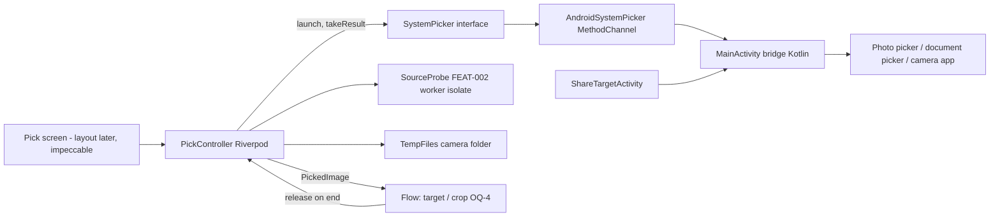

# FEAT-001 — Technical Plan

## 1. Summary
A small Kotlin bridge in `MainActivity` (ADR-006) launches the system photo picker through the AndroidX `PickVisualMedia` contract (document picker as fallback), the document picker, or the system camera intent writing into `<cache>/camera/<random>.jpg` through a non-exported FileProvider scoped to that folder. Results land in one native pending slot. Dart pulls it once (`takeResult` clears it) at start-up and whenever the bridge signals `resultReady`, so warm returns, activity recreation and process death share one delivery path (FR-15, FR-17). A pure-Dart `PickController` (Riverpod) validates the scheme, checks the camera file, calls FEAT-002's existing `SourceProbe` in its worker isolate, shows progress after 500 ms with Cancel, and hands `PickedImage` (the provider's `content://` URI, never a copy) to the flow. Camera files reuse FEAT-004's `TempFiles` delete and start-up sweep pattern. No runtime permission, no network, no new Dart dependency.

## 2. Architecture impact
- New module `lib/features/pick/{domain,data,presentation}` (ADR-001 layout). Domain has no Flutter, Riverpod or channel imports.
- `MainActivity.kt` changes from a plain `FlutterActivity` to a `FlutterActivity` subclass with the bridge (ADR-006). New `ShareTargetActivity.kt` (no UI, Should, FR-20).
- `AndroidManifest.xml`: FileProvider, `queries` for `IMAGE_CAPTURE`, `uses-feature camera required=false`, Play services photo-picker module entry, share intent filter (Should). New `res/xml/camera_paths.xml`.
- `android/app/build.gradle.kts`: two AndroidX pins (ADR-006) and a merged-manifest check task (FR-18).
- Reused unchanged: `SourceHandle`, `SourceProbe` (`ProbeOk`/`ProbeErr`, worker isolate), `Reason`, `platform_decode.openReadOnly` (via the probe), the crop screen as consumer, the enum-only log pattern. `TempFiles` gains a folder parameter and a `keep` argument for the sweep (small, backwards-compatible change).
- `packages/es_codec/tool/jnigen.dart`: **unchanged**. No new JNIgen classes are needed; camera availability and free space are answered by the Kotlin bridge.
- One new screen (pick). Its layout is designed later with impeccable (Product Owner rule) and waits on OQ-4; this plan defines only its controller and states.



## 3. Components
| Component | Layer | Responsibility | New / changed |
|---|---|---|---|
| `PickTypes` (`PickSource`, `PickOrigin`, `LaunchOutcome`, `PickMessage`, `PickedImage`) | domain | Plain types. `PickedImage {SourceHandle handle; SourceInfo info; PickOrigin origin}` with redacted `toString` | New |
| `PickRules` | domain | Pure functions: accept scheme (`content` only), refuse `fromOwnApp` for share, map `Reason` → `PickMessage` (pick-time variant of `SOURCE_UNAVAILABLE`), decide camera-file deletion per outcome (FR-6, FR-10, FR-11) | New |
| `SystemPicker` | data (interface) | The one seam for picker and camera (NFR-9): `cameraAvailable`, `launch`, `takeResult`, `pendingCaptureName`, `resultReady` | New |
| `AndroidSystemPicker` | data | `MethodChannel('exactsize/system_picker')` wrapper. Converts maps to typed `SystemPickResult`; unknown or malformed payloads become `NotOpenable`. Never logs payloads; `PlatformException` codes only, messages dropped | New |
| `TempFiles` (camera instance) | data | Same class as FEAT-004, second instance on `<cache>/camera/` (`@Named('camera')`). Used for `delete` and `sweep(keep:)`; `write` is not used (the camera app writes) | Changed (folder parameter, `keep`) |
| `PickOutcomeLog` | data | Enum-only, same shape as `CropOutcomeLog`: `exactsize.pick outcome=<CODE>`. No origin, URI, name, size | New |
| `PickController` | state | Riverpod `Notifier<PickState>`, keep-alive for the app session. Launch, result handling, probe with 500 ms progress and Cancel, generation token for late results, one image at a time, `release()` for the flow (FR-11) | New |
| Pick screen | UI | Buttons, disabled-camera reason, messages, progress, privacy line, focus restore. **Not designed here** (impeccable, OQ-4) | New, later |
| `MainActivity` bridge | native (Kotlin) | Intent building (contracts), `startActivityForResult`, `onActivityResult` → pending slot, saved-state marker, busy guard, capture-lost detection, best-effort delete on finish (FR-12), share hand-in, channel handler. All entry points catch `Throwable` and return enum codes only; no `android.util.Log` | Changed |
| `ShareTargetActivity` | native (Kotlin) | Exported, no UI. Receives `ACTION_SEND image/*`, forwards the stream URI with the read grant to `MainActivity` (`NEW_TASK \| SINGLE_TOP`), finishes. Avoids a second `MainActivity` + Flutter engine in the sender's task (R6). Should | New |
| `checkMergedManifest` Gradle task | build | Fails the release build on forbidden permissions, an exported or wrongly scoped FileProvider, or a missing camera `queries` entry (FR-18) | New |

**Native bridge behaviour (`MainActivity`)**
- `launch(gallery)`: busy → `busy`. If `PickVisualMedia.isPhotoPickerAvailable(this)`: contract intent with `ImageOnly` (single item). Else, or on `ActivityNotFoundException`: `ACTION_OPEN_DOCUMENT`, `CATEGORY_OPENABLE`, `image/*`, no `EXTRA_ALLOW_MULTIPLE`. Both fail → `unavailable` (FR-3).
- `launch(files)`: `ACTION_OPEN_DOCUMENT` as above; failure → `unavailable` (FR-21).
- `launch(camera)`: `StatFs(cacheDir).availableBytes` < `MIN_FREE_BYTES` (32 MiB, [Assumption], see OQ-T3) → `lowSpace`. Create `<cache>/camera/<32 hex from SecureRandom>.jpg`; `IOException` → `lowSpace`. `FileProvider.getUriForFile`, `ACTION_IMAGE_CAPTURE` + `EXTRA_OUTPUT` + read/write grant flags [Fact-level platform behaviour, still checked in spike: since API 21 the framework copies `EXTRA_OUTPUT` into `ClipData` so the grant reaches the camera app]. `ActivityNotFoundException` → delete file, `unavailable`. Marker `es.pendingCapture = <name>` saved.
- `onActivityResult`: gallery/files → `Picked(uri, origin)` or `Cancelled`; selection count > 1 cannot happen with these intents, and `parseResult` returns the first item anyway (section 8 rule). Camera: `RESULT_OK` → `Captured(uri, name)`; anything else → `Cancelled(name)`. The result `Intent` extras (preview bitmap) are never read (FR-4, AC-2.2). Slot set, marker cleared, `resultReady` sent if a Dart engine is attached.
- `onResume` with the marker still set and no result delivered in this resume → `CaptureLost(name)` (FR-17 recovery failed) [Hypothesis: `onActivityResult` always precedes `onResume` on return; spike].
- `onDestroy` with `isFinishing` → delete everything in `<cache>/camera/` (FR-12, best effort).
- `onCreate` / `onNewIntent` with a forwarded share: ignored when `FLAG_ACTIVITY_LAUNCHED_FROM_HISTORY` is set or the saved state says it was consumed (no re-delivery on recreation). `Picked(uri, share, fromOwnApp)` where `fromOwnApp = packageManager.resolveContentProvider(authority, 0)?.packageName == packageName`. Missing stream → `NotOpenable(share)`.

## 4. API contracts
In-process only. No network endpoints.
```
// Channel 'exactsize/system_picker' (Dart -> Kotlin). Arguments and results are
// strings, bools and enum names only. Errors: PlatformException(code: enum name,
// message: null) — Kotlin never sends exception text.
cameraAvailable()          -> bool          // resolveActivity(IMAGE_CAPTURE) != null
launch({source})           -> 'launched' | 'busy' | 'unavailable' | 'lowSpace'
takeResult()               -> null | {origin, outcome, uri?, fileName?, fromOwnApp?}  // clears the slot
pendingCaptureName()       -> null | '<32 hex>.jpg'                                   // FR-17 marker
// Kotlin -> Dart
resultReady()              // no arguments; Dart then calls takeResult()

// Dart
enum PickSource { camera, gallery, files }
enum PickOrigin { camera, gallery, files, share }          // never logged or persisted
enum LaunchOutcome { launched, busy, unavailable, lowSpace }

abstract interface class SystemPicker {
  Future<bool> cameraAvailable();
  Future<LaunchOutcome> launch(PickSource source);
  Future<SystemPickResult?> takeResult();
  Future<String?> pendingCaptureName();
  Stream<void> get resultReady;
}

sealed class SystemPickResult                               // toString redacted
  Picked      { String uri; PickOrigin origin; bool fromOwnApp }
  Captured    { String uri; String fileName }
  Cancelled   { PickOrigin origin; String? fileName }
  CaptureLost { String? fileName }
  NotOpenable { PickOrigin origin }

enum PickMessage { pickerUnavailable, cameraNoPhoto, lowSpace, captureLost, itemNotOpenable,
                   sourceUnavailable /* pick-time variant */, unsupported, corrupt, tooLarge }

final class PickState {
  PickPhase phase;            // idle | awaitingSystemUi | opening
  bool showProgress;          // opening for > 500 ms (FR-13)
  bool cameraAvailable;       // FR-5; re-checked on app resume
  PickMessage? message;       // last refusal; cleared on the next launch
  PickSource? lastSource;     // focus restore (AC-7.1)
  PickedImage? current;       // the session image (FR-10); the flow listens to changes
}

class PickController extends Notifier<PickState> {
  Future<void> launch(PickSource source);   // ignored unless phase == idle (AC-5.4)
  void cancelOpening();                     // FR-13: generation++, delete new camera file, idle, no message
  Future<void> release();                   // FR-11: start-over and flow end (FEAT-007 calls it)
}

// FEAT-002, reused unchanged:
Future<ProbeResult> SourceProbe.probe(SourceHandle src)  // ProbeOk{SourceInfo} | ProbeErr{Reason}
```

**Result handling in `PickController`** (one in-flight result at a time)
1. `takeResult()`. Null → nothing to do.
2. `Cancelled` → delete its camera file, phase idle, no message (FR-9). `CaptureLost` → delete file, `captureLost`. `NotOpenable` → `itemNotOpenable`.
3. `Picked`: scheme ≠ `content`, or `origin == share && fromOwnApp` → `itemNotOpenable` (FR-8, FR-20). `Captured`: file missing or length 0 → delete, `cameraNoPhoto` (FR-6).
4. Phase `opening`, start 500 ms timer → `showProgress`. `SourceProbe.probe(SourceHandle(uri))`.
5. If the generation changed (Cancel, or a newer result) → discard; delete this attempt's camera file.
6. `ProbeErr` → delete this attempt's camera file, map to `PickMessage`, keep `current` (FR-10, AC-3.2, AC-3.3).
7. `ProbeOk` → new `PickedImage` becomes `current`; only now delete the previous session camera file (FR-10, FR-11). Log `ACCEPTED`.

**Start-up** (in `main`, next to the existing FEAT-004 sweep): `pendingCaptureName()` then `cameraFiles.sweep(keep: name)` (FR-11, FR-17). `PickController.build()` calls `takeResult()` once, so a result that arrived before Dart ran (process death, engine recreation, cold-start share) is handled exactly once.

**Flow hand-off and share mid-flow (AC-8.4):** when `current` changes, the flow (owner decided in OQ-4) pops back from the crop screen and calls `CropController.end()`. `CropScreen.dispose` already cancels a running render (`_cancel?.cancel()`, crop_screen.dart). The previous camera file is deleted in step 7.

## 5. Data model
- **In memory, Dart:** `PickState` and the current `PickedImage` (URI string, `SourceInfo`, origin), plus the controller's private camera-file name for the current image. Lost with the Flutter engine; nothing restored (FR-16).
- **In memory, Kotlin:** one pending-result slot; `launchOutstanding` flag.
- **Saved-instance-state `Bundle` (system-held across process death):** `es.pendingCapture` = the random file name only, `es.launchOutstanding`, `es.shareConsumed`. This is the FR-17 marker. It holds no URI, path, user name or content [Assumption: a Bundle satisfies "a marker holding a random file name"; see OQ-T4]. It is dropped by the system when the task is removed.
- **Files:** `<cacheDir>/camera/<32 hex>.jpg`. At most one at rest; two briefly while a new capture is probed. Swept at every Dart start except the marker's file. No database, no preferences, no migrations. Gallery, files and share images are never copied.

## 6. Integrations
| Integration | Purpose | Data leaving device |
|---|---|---|
| System photo picker via `ActivityResultContracts.PickVisualMedia` (`androidx.activity:activity:1.10.1`, ADR-006) | Gallery, images only, single | None (online-only items are fetched by the provider, PRD section 10) |
| Play services photo-picker backport, manifest `ModuleDependencies` service entry with `photopicker_activity:0:required` | Photo picker on API 28–29 [Hypothesis: per Android "Photo picker" docs; the module may download on demand and may not appear on an offline emulator] | None by ExactSize |
| `ACTION_OPEN_DOCUMENT` | Fallback and "Choose from files" | None |
| `ACTION_IMAGE_CAPTURE` + `androidx.core.content.FileProvider` (`androidx.core:core:1.16.0`) | Camera into `<cache>/camera/` | None |
| `ACTION_SEND` (`image/*`) via `ShareTargetActivity` | Share target (Should) | None |
| `StatFs` | Free space before creating the camera file | None |
| FEAT-002 `SourceProbe` (JNIgen `ContentResolver`, `BitmapFactory`, `ExifInterface`) | Validate at pick time | None |

No Dart package is added. No network client, analytics or ad SDK sees any pick data.

**Manifest additions (sketch, values are not secrets):**
- `<provider android:name="androidx.core.content.FileProvider" android:authorities="${applicationId}.camera" android:exported="false" android:grantUriPermissions="true">` with `res/xml/camera_paths.xml` = `<cache-path name="camera" path="camera/"/>` only.
- `<queries><intent><action android:name="android.media.action.IMAGE_CAPTURE"/></intent></queries>` next to the existing `PROCESS_TEXT` entry.
- `<uses-feature android:name="android.hardware.camera" android:required="false"/>`.
- `ShareTargetActivity`: `exported="true"`, `Theme.NoDisplay`, intent filter `SEND` + `DEFAULT` + `image/*`. No `SEND_MULTIPLE` (AC-8.3).
- No `<uses-permission>` added. `launchMode` stays `singleTop` (R13).

## 7. Security & privacy
- **PCI-DSS / Bangladesh Bank:** not in scope. No money, cards, tokens or credentials [Fact](FEAT-001 prd.md section 10). No secrets exist; any future key would be `[PLACEHOLDER]`, kept server-side or in secure storage, never in the bundle.
- **Personal data:** photos (faces, minors), signatures. Only a URI is held in memory; the image is read by the probe read-only (`"r"`), never copied, re-encoded or written. The original is untouched (AC-6.6).
- **Least privilege:** no runtime or install-time photo, camera or storage permission; the merged-manifest check enforces it for every dependency (FR-18). It fails loudly rather than stripping with `tools:node="remove"`, so a human decides.
- **FileProvider:** not exported, `grantUriPermissions` only, path `camera/` only. FEAT-004's `exactsize_out/` is not reachable through it (integration test: `getUriForFile` on that folder throws).
- **Untrusted input (share, any provider):** only `content://`; `file://` and any authority owned by our own package are refused (blocks reading our private files through our own provider). The intent's MIME type is ignored; the probe decides. Kotlin never opens the stream itself.
- **Logging (FR-19):** Dart uses `PickOutcomeLog` (enum names only). `SystemPickResult`, `PickedImage` and `SourceHandle` have redacted `toString`. Kotlin has no `android.util.Log` calls and catches `Throwable` at every bridge entry, returning an enum code with a null message, so a `SecurityException` text containing a URI never reaches logcat or a crash report. A unit test greps `MainActivity.kt` and `ShareTargetActivity.kt` for `Log.`, `println` and `printStackTrace`.
- **No network:** the import-ban test (`test/features/compression/no_network_imports_test.dart`) is extended to `lib/features/pick/`; airplane-mode run on the emulator (AC-6.5).
- **Camera file:** app-private cache, random 128-bit name, never in the gallery. GPS EXIF written by the camera app stays inside that file and is never read by FEAT-001; output stripping is FEAT-018. Residual: one file can remain until the next start if the app is never reopened (PRD section 10).
- **Test data:** synthetic images and `[PLACEHOLDER]` names only.

## 8. Requirement coverage
| Req | How it is met | Status |
|---|---|---|
| FR-1 | `PickController.launch(source)` opens the system UI directly; no dialog or rationale exists in the flow | Met (UI layout later) |
| FR-2 | `PickVisualMedia` `ImageOnly`, single-item contract; no permission declared | Met [Hypothesis: picker shows no videos for `ImageOnly` on every path; spike] |
| FR-3 | `isPhotoPickerAvailable` → photo picker, else or on `ActivityNotFoundException` → `ACTION_OPEN_DOCUMENT image/*`; both fail → `pickerUnavailable`; camera state untouched | Met |
| FR-4 | `<cache>/camera/<random>.jpg`, FileProvider `camera/` only, not exported; result extras never read; nothing written to shared storage | Met |
| FR-5 | `cameraAvailable()` at controller build and on resume (`queries` entry); `StatFs` threshold + file creation before launch → `lowSpace` | Met; threshold is OQ-T3 |
| FR-6 | `Captured` accepted only if the file exists and length > 0; every other outcome deletes it | Met |
| FR-7 | `SourceProbe.probe` right after a valid result; Ok → `PickedImage`, Err → `PickMessage` | Met |
| FR-8 | URI passed through unchanged; scheme check; no `OpenableColumns`/display-name query anywhere in the module (review + grep test) | Met |
| FR-9 | `Cancelled` → idle, no message; camera file deleted | Met |
| FR-10 | `current` replaced only in step 7; refusals and cancels leave it | Met |
| FR-11 | Delete on refusal, cancel, replacement, `release()`; at most one at rest; cold-start `sweep(keep: marker)` | Met. `release()` callers: start-over and FEAT-007 flow end (FEAT-007 must call it) |
| FR-12 | `onDestroy` with `isFinishing` deletes `<cache>/camera/*` | Met (Should), best effort. Android 12+ back on the root activity does not finish it [Hypothesis], so the sweep is the real guarantee |
| FR-13 | 500 ms timer → `showProgress`; Cancel bumps the generation and deletes the attempt's file; late probe result discarded. The probe isolate itself is not killed (it closes its descriptor in `finally`) | Met |
| FR-14 | All read failures already map to `SOURCE_UNAVAILABLE` in `openReadOnly`/`probeSync`; `PickRules` maps it to the pick-time message. No network code | Met. See OQ-T2: non-seekable provider streams |
| FR-15 | One native slot cleared by `takeResult`; native `launchOutstanding` (kept in the Bundle) returns `busy`; Dart phase guard | Met [Hypothesis on ordering; spike] |
| FR-16 | Dart state lives only in memory; new engine starts on the pick screen; start-up sweep | Met. Flow start screen depends on OQ-4 |
| FR-17 | Bundle marker + `onActivityResult` after recreation → `Captured`; missing file or no result by `onResume` → `CaptureLost` + delete; sweep keeps only the marker's file | Met (Should) [Hypothesis; spike] |
| FR-18 | No permissions added; `queries` + `uses-feature required=false`; `checkMergedManifest` fails the release build | Met |
| FR-19 | `PickOutcomeLog`; redacted `toString`; Kotlin catches all and sends no text; grep test | Met |
| FR-20 | `ShareTargetActivity` (single `SEND image/*`), forward to `MainActivity`; scheme and own-package checks; cold (`onCreate`) and warm (`onNewIntent`) | Met (Should) [Hypothesis on task and grant forwarding; spike, R6] |
| FR-21 | `launch(files)` → `ACTION_OPEN_DOCUMENT` | Met (Should) |
| FR-22 | ARB string; layout later | Met (Should), copy owned by FEAT-016 |
| NFR-1 | Headers-only probe in a worker isolate; no copy | To measure (R12); measured up to hand-off, see OQ-T6 |
| NFR-2 | Every outcome is an enum; Kotlin catches all; test set below | Met by test plan |
| NFR-3 | No network code; import-ban + airplane test | Met |
| NFR-4 | Typed messages, `cameraAvailable` reason, `lastSource` for focus; semantics and layout tests in the UI task | Partly: needs the impeccable-designed screen |
| NFR-5 | ARB keys with ICU placeholders; translations via FEAT-019 | Met (translations external) |
| NFR-6 | Sections 6–7 | Met |
| NFR-7 | One code path; emulator matrix API 28 AOSP (no Play services), API 28 Google Play image, API 36 | Met [Hypothesis: backport availability on the API 28 Play image] |
| NFR-8 | The pick module imports no `BitmapFactory`, `dart:ui` image or pixel type; the probe reads headers only | Met (grep test) |
| NFR-9 | `SystemPicker` is the single seam; `SourceProbe` and `TempFiles` faked via get_it; synthetic data only | Met |
| NFR-10 | No sensitive permission; Data Safety "no data collected or shared" for this feature | Met [Hypothesis: Play policy reading, PRD OQ-10] |

**Gaps / flags:** (1) NFR-4 completes only with the UI task (impeccable, OQ-4). (2) FR-12 rarely fires on Android 12+. (3) FR-14 and AC-4.3 depend on providers returning a seekable descriptor (OQ-T2). (4) Zero-byte gallery files return `SOURCE_UNAVAILABLE`, not the PRD's `CORRUPT_INPUT` (OQ-T1). (5) FR-15/17/20 rest on platform ordering to confirm in the spike.

### Testing strategy
- **Unit (Dart, `flutter test`, fakes behind `SystemPicker`, fake `SourceProbe`, `TempFiles` on a temp dir):** every result type; exactly-once (`resultReady` twice → one probe); double launch (AC-5.4); Cancel during probe + late Ok/Err (FR-13); refusal keeps the previous image and its file (AC-3.3); acceptance deletes the previous file; `release()`; share `file://`, `http://`, own-app → `itemNotOpenable`; camera missing/zero-byte; capture lost; `sweep(keep:)`; `Reason` → message mapping; start-up `takeResult`. Log audit: every captured line matches `^exactsize\.pick outcome=[A-Z_]+$`.
- **Static tests:** import-ban extended to `lib/features/pick/`; grep tests for display-name queries, pixel types, and Kotlin `Log.`/`println`/`printStackTrace`; `checkMergedManifest` runs in every release build (CI).
- **Widget:** written with the UI task: TalkBack order and labels, disabled camera with reason, polite live-region messages, focus back on the used button, 200 % font, RTL mirror with unmirrored icons.
- **Emulator integration (`integration_test`, API 28 and API 36, 2 GB profile):** paths that need no system-UI tapping: `cameraAvailable`; FileProvider URI opened by the probe; `getUriForFile` refuses `exactsize_out/`; share via `adb shell am start -a android.intent.action.SEND -t image/* --eu android.intent.extra.STREAM <MediaStore content URI of a pushed synthetic image>` (cold and warm), and a `file://` share; storage listing after a pick (AC-6.1); airplane mode.
- **Scripted manual checks (system UIs cannot be driven by `integration_test`):** a checklist with adb commands, run on API 28 AOSP (no Play services; document picker expected), API 28 Google Play image (photo picker backport may be missing, then document picker), API 36: pick, cancel, camera OK/cancel, "Don't keep activities" (`adb shell settings put global always_finish_activities 1`), process kill while the camera is open (`adb shell am kill <package>` after pressing home), double tap, the AC-3.5 test set, airplane mode with a "cloud" provider where the emulator has one. Results recorded in tasks.md.

## 9. Risks
| # | Risk | Likelihood | Impact | Mitigation |
|---|---|---|---|---|
| R1 | Photo picker backport missing on API 28 devices and emulator images [Hypothesis] | High on emulator | Low | Document-picker fallback is functional; test both paths; AC-1.4 covers it |
| R2 | Result ordering assumption wrong: Dart calls `takeResult` before `onActivityResult`, or `onResume` capture-lost check fires too early [Hypothesis] | Low–Medium | High (lost or duplicate result) | Pull + `resultReady` push covers late results; capture-lost only when the marker is set and a resume passes without a result; spike T01 with DKA and `am kill` |
| R3 | URI grant not usable after process death or from the worker isolate [Hypothesis] | Low | Medium | Maps to `SOURCE_UNAVAILABLE`, user picks again; spike |
| R4 | OEM camera apps ignore `EXTRA_OUTPUT`, write 0 bytes, or return only the preview | Medium (real phones) | Medium | Size check → `cameraNoPhoto`; extras never used; residual: only the emulator camera is tested (PO test-environment decision) |
| R5 | A dependency (ads SDK, FEAT-025) adds CAMERA or media permissions | Medium | High (camera intent `SecurityException`, store disclosure) | `checkMergedManifest` fails the release build |
| R6 | Share starts a second `MainActivity` and Flutter engine in the sender's task; its start-up sweep deletes the first session's camera file [Hypothesis] | Medium | Medium | `ShareTargetActivity` trampoline with `NEW_TASK \| SINGLE_TOP`; spike checks task and grant forwarding; if it fails, FR-20 moves to Next (PRD OQ-3) |
| R7 | Providers that stream (pipe descriptor, `statSize` −1) are refused by `SourceProbe` as `SOURCE_UNAVAILABLE`, so some online items fail even when online (AC-4.3) [Hypothesis] | Medium | Medium | Spike on available providers; options in OQ-T2 (accept, or a PRD change; copying would break FR-8) |
| R8 | Path or URI leak through Kotlin exception text | Low | High | Catch-all at entry points, null messages, no `Log`, grep test |
| R9 | FileProvider scoped too wide | Low | High | `camera/` only; manifest check; integration test on `exactsize_out/` |
| R10 | Low-space threshold too high or too low | Medium | Low | One constant; OQ-T3 |
| R11 | ADR-001 deviation (Kotlin in `MainActivity`) not accepted | Low–Medium | Medium | ADR-006 for the PO; Option D (local plugin) is the same code in another place |
| R12 | NFR-1 ≤ 1 s missed on the 2 GB emulator (isolate spawn + open + header) | Low | Low | Headers only; measure in the integration run; best effort per PRD |
| R13 | Home then launcher icon during camera kills the camera if `launchMode` changes | Low | Medium | Keep `singleTop`; spike confirms the camera stays on top |
| R14 | Effort overrun | Medium | Medium | Musts first; share and files buttons are separate tasks |

## 10. Decisions
- ADR-001 App stack (Approved): relied on; ADR-006 is a scoped exception (Kotlin for activity results only).
- ADR-003, ADR-004 (Approved): untouched; FEAT-001 passes only a URI and `SourceInfo`.
- **ADR-006 System picker and camera bridge** (Proposed): Kotlin bridge in `MainActivity` over a `MethodChannel`, AndroidX contracts, pull-based result slot. Main alternative: `image_picker` (rejected: copies files, broad FileProvider [Hypothesis]).
- No ADR for: FileProvider path, marker in the Bundle, share trampoline, controller states, low-space threshold. All cheap to change.

## 11. Deliberately left out
- `image_picker`, `file_picker` and any Dart picker plugin (ADR-006).
- Pigeon or other channel codegen: five methods with string payloads do not justify a generator.
- A local plugin package (ADR-006 Option D) and changing `MainActivity` to `FlutterFragmentActivity` / `registerForActivityResult`: contracts work with `startActivityForResult` on a plain `FlutterActivity`.
- UI automation of system pickers (patrol, UiAutomator, Espresso-Intents) and Robolectric tests for Kotlin: replaced by a scripted manual checklist plus Dart unit tests.
- Persisted URI permissions, display-name queries, `ACTION_GET_CONTENT`, `SEND_MULTIPLE`, `ACTION_VIEW`.
- Automatic permission stripping (`tools:node="remove"`).
- Any new JNIgen bindings.

## 12. Open questions (proposals for the Product Owner)
| OQ | Proposal |
|---|---|
| OQ-T1 Zero-byte gallery/share file | `SourceProbe` returns `SOURCE_UNAVAILABLE` for `statSize <= 0` (source_probe.dart line 63); the PRD edge-case table expects `CORRUPT_INPUT`. Proposal: one-line FEAT-002 change, `== 0` → `CORRUPT_INPUT`, `< 0` stays `SOURCE_UNAVAILABLE`, with a FEAT-002 test. Alternative: change the PRD row. Camera zero-byte is caught earlier by FR-6 either way |
| OQ-T2 Non-seekable provider streams | If the spike shows pipe descriptors for some providers, accept `SOURCE_UNAVAILABLE` with the pick-time message (proposed) and note the limit in PRD AC-4.3. Copying to cache would break FR-8 |
| OQ-T3 Low-space threshold | 32 MiB free in the cache volume before launching the camera [Assumption: a 50 MP JPEG is about 15–25 MB]. PRD says only "sufficient" |
| OQ-T4 FR-17 marker location | Saved-instance-state Bundle (system-held, dropped with the task) instead of a marker file. Same content (random name only). Proposed as a reading of FR-17, no PRD change |
| OQ-T5 Gallery result after process death | Delivered by the same mechanism (not only camera). Proposed reading: this is a new result, not a "restored image", so FR-16 still holds |
| OQ-T6 NFR-1 end point | Measure to the `PickedImage` hand-off. "Next screen" includes FEAT-002's preview decode if the next screen is crop (OQ-4), which FEAT-001 does not control |
| OQ-T7 ADR-001 wording | If ADR-006 is approved, add a clarification line to ADR-001 pointing to it (PO decides; ADR-001 would be Under Discussion until re-approved) |
| PRD OQ-4 | Still blocks the UI task and decides where a pending start-up result is routed when the start screen is not the pick screen |

**Effort estimate** (PRD guess 0.8–1.2 pw Musts + 0.3 Shoulds) [Assumption for all lines]
| Work | pw |
|---|---|
| Spike T01: picker availability (API 28 AOSP / Play / 36), result ordering, DKA engine lifetime, grants, descriptor type, resolved AndroidX versions, launcher-during-camera | 0.2 |
| Kotlin bridge (gallery, files, camera, slot, Bundle marker, busy, capture lost), manifest, FileProvider, Play services entry | 0.25 |
| `checkMergedManifest` Gradle task | 0.05 |
| `AndroidSystemPicker`, `TempFiles` change, start-up sweep, `PickOutcomeLog`, static tests | 0.1 |
| `PickController` + `PickRules` + unit tests | 0.3 |
| Emulator integration + scripted manual checklist on 3 images | 0.2 |
| ARB keys (English; translations FEAT-019) | 0.05 |
| Pick screen build after impeccable design + widget tests | 0.2 |
| **Must subtotal** | **1.35** |
| Share target (`ShareTargetActivity`, checks, cold/warm tests) | 0.15 |
| FR-17 extra (capture-lost path, kill tests), FR-12, FR-21, FR-22 | 0.1 |
| **Total** | **≈ 1.6 (range 1.3–2.0)** |

Not counted: impeccable design work for the pick screen, translations (FEAT-019), the flow controller that owns screen order (OQ-4).

## Change log
| Version | Date | Change |
|---|---|---|
| 0.1 | 2026-11-21 | First draft |
