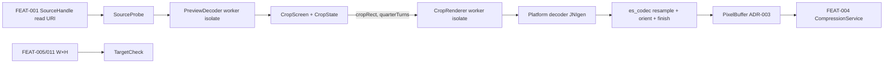

# FEAT-002 — Technical Plan

## 1. Summary
The crop screen is pure Flutter. A pure-Dart `CropState` (centre, width and quarter-turns in oriented-source pixels) is edited by drag, pinch, corner handles, buttons and TalkBack actions, and is rounded once into an integer `cropRect` (FR-8). Decoding uses the Android platform decoders through JNIgen: `BitmapRegionDecoder`, with a `BitmapFactory` fallback, asked for ARGB_8888 sRGB output. Orientation is read with `ExifInterface` and applied by our own lossless D4 step, the same rule for preview, gestures and render (ADR-004). The render runs in a worker isolate. It re-opens the read URI, region-decodes at the largest power-of-two sample that stays ≥ W×H (FR-7), resamples once with a vendored, pinned `stb_image_resize2` (Catmull-Rom) in `es_codec` straight into the ADR-003 native buffer (ADR-005), orients, compacts to 3 channels when opaque, asserts W×H and hands the `PixelBuffer` to FEAT-004. FEAT-002 writes no files: pixels stay in memory (ADR-003).

## 2. Architecture impact
- New module `lib/features/crop/{domain,data,presentation}` (ADR-001 layout). Domain has no Flutter, Riverpod or JNI imports.
- `packages/es_codec/` (created by FEAT-004) gains `stb_image_resize2.h` (pinned), about 150 lines of C (resample wrapper, D4 orient, finish/compact, bitmap lock) and a jnigraphics link.
- JNIgen bindings for `BitmapRegionDecoder`, `BitmapFactory(.Options)`, `Bitmap`, `ExifInterface`, `ContentResolver`/`ParcelFileDescriptor` and `Activity.setRecentsScreenshotEnabled`.
- One new screen (crop). It reuses FEAT-004's `/proc/meminfo` reader, enum-only log wrapper and isolate-runner pattern.



## 3. Components
| Component | Layer | Responsibility | New / changed |
|---|---|---|---|
| `TargetCheck` | domain | W,H integers 1–10,000, W×H ≤ 24 MP → `INVALID_TARGET_DIMENSIONS` (FR-1) | New |
| `Orientation` (D4) | domain | Maps EXIF 1–8 and user quarter-turns to one of 8 rotate/flip transforms. Provides point/rect mapping raw↔oriented and the display matrix. Invalid → 1 | New |
| `CropState` / `CropMath` | domain | Pure state `{cx, cy, cw, quarterTurns}` (doubles, oriented space; `ch = cw·H/W`). Cover, minimum and clamp rules (FR-4), `toCropRect` rounding (FR-8), `upscaleFactor` (FR-11), drag/pinch/handle/nudge/zoom/rotate/centre/reset reducers | New |
| `SourceHandle` | data | Wraps the FEAT-001 read URI in memory. `toString()` is redacted; never logged or persisted | New |
| `SourceProbe` | data | Opens the URI read-only, runs the `ContainerCheck`, reads `BitmapFactory` bounds (w, h, mime), sniffs the animation flag (WebP `VP8X`/`ANIM`, PNG `acTL`, GIF) from header bytes, reads the orientation only (`ExifInterface` for JPEG/PNG/WebP, `HeifOrientation` for HEIC), and chooses the decode path: `full` for GIF, `region` otherwise (ADR-004 v1.1). Ceiling 200 MP → `IMAGE_TOO_LARGE` | New |
| `ContainerCheck` | data | Pure Dart over the first bytes and the file length: JPEG SOI + SOF, PNG signature + IHDR (+ IEND present), WebP RIFF/VP8 header and RIFF length, HEIF `ftyp` + `meta`, GIF header. Missing or inconsistent structure or truncated data → `CORRUPT_INPUT`; declared size > 200 MP → `IMAGE_TOO_LARGE` before any decode (ADR-004 v1.1) | New (v1.1) |
| `HeifOrientation` | data | Pure Dart ISOBMFF reader: primary item (`pitm`), its `irot`/`imir` via `iprp`/`ipma`; if neither, `TAG_ORIENTATION` from the file's `Exif` item; else 1. Bounded reads, never trusts box sizes beyond the file length (ADR-004 v1.1) | New (v1.1) |
| `PreviewDecoder` | data | Same decode path at a sample size where the long side is ≤ 2048. Pixels go to `ui.ImageDescriptor.raw` → `ui.Image`. Display only (FR-25, FR-7) | New |
| `CropRenderer` | data | Worker isolate pipeline (below). Cancel flag between steps; try/finally frees the bitmap and buffers on every path | New |
| `MemoryPreflight` | data | Estimates (decoded region + output + transform buffer + per-format decoder working memory) × 2 against `MemAvailable` → `IMAGE_TOO_LARGE`. Working memory per source pixel (T04, ADR-004 v1.1): progressive JPEG 3.5 B, baseline JPEG 0.7 B, PNG/WebP/HEIC 0 [Assumption: measured on one arm64 device; emulator RSS was unreliable] | Reuses FEAT-004 reader |
| `es_codec` crop functions | native | `es_resample` (stb, Catmull-Rom, `STBIR_RGBA` or `STBIR_4CHANNEL`), `es_orient` (lossless D4), `es_finish` (alpha scan, compact 4→3 if opaque), `es_bitmap_lock` (jnigraphics) | Changed |
| `cropControllerProvider` | state | Riverpod notifier holding `CropState` for the flow session (keep-alive until the flow ends); restores state on return (AC-8.4) | New |
| `CropScreen` | UI | Preview `ui.Image` painted under a matrix (orientation × zoom/pan), dimmed outside the frame, two-tone frame outline, checkerboard under alpha, corner handles, Centre/Reset (Must), nudge/zoom (Should), rotate (Should), upscale notice, Continue, progress after 500 ms | New |
| `RecentsGuard` | UI/data | On route push, calls `Activity.setRecentsScreenshotEnabled(false)` (API 33+) via JNIgen; `true` on pop. No `FLAG_SECURE` (FR-26) | New |

**Render pipeline (`CropRenderer.render`)**
1. `TargetCheck`. Re-open the URI with `"r"`. Failure, or bounds differing from the probe → `SOURCE_UNAVAILABLE`.
2. `d4 = quarterTurns ∘ exif`. Map `cropRect` (oriented) → raw rect.
3. `s` = largest power of two with `cropW/s ≥ W` and `cropH/s ≥ H`, else 1 (FR-7).
4. `MemoryPreflight`.
5. Decode the raw rect at `s` (`ARGB_8888`, `SRGB`, unpremultiplied). If the config or colour space comes back different → `UNSUPPORTED_INPUT`. Java `OutOfMemoryError` → `OUT_OF_MEMORY_HANDLED`.
6. `malloc` the output (W×H in raw orientation, 4 ch) and `es_resample` from the locked bitmap. Recycle the bitmap.
7. If `d4 ≠ identity`: allocate a second buffer, `es_orient`, free the first. Peak memory is therefore max(region + out, 2 × out).
8. `es_finish`: `hasTransparency` = any alpha < 255; if false, compact in place to 3 channels.
9. Assert width = W, height = H, channels ∈ {3, 4}, stride = W × channels (FR-16) → `PixelBuffer`; ownership passes to FEAT-004.

**Crop screen geometry.** The frame fits the crop area with ≥ 24 dp side margins. Cover width `coverCw = min(srcW', srcH'·W/H)` in oriented space. Minimum crop width = max(`coverCw/8`, the width where the shorter side is 32 px), capped at `coverCw` for tiny sources. Drag moves the centre, pinch scales `cw` about the focal point, and a handle changes `cw` with the opposite corner fixed. All three clamp to [min, cover] and to the image bounds. On handle release only the view re-fits; `CropState` is unchanged (AC-13.4). One gesture mode at a time: the first recogniser to win holds until all pointers lift. Handle hit areas are 48 dp, centred on the corners and pushed outward when the frame is < 96 dp in either dimension so they never overlap (AC-13.6). The crop area is drawn in physical coordinates, so handles and nudge directions do not mirror in RTL; the control rows do (FR-23).

## 4. API contracts
In-process Dart API. No network endpoints.
```
Future<ProbeResult> SourceProbe.probe(SourceHandle src)
  Ok   { SourceInfo info }   // rawW, rawH, mime, exifOrientation 1..8, isAnimated, hasAlpha, decodePath
  Err  { UNSUPPORTED_INPUT | CORRUPT_INPUT | SOURCE_UNAVAILABLE | IMAGE_TOO_LARGE }

Future<PreviewResult> PreviewDecoder.decode(SourceHandle src, SourceInfo info)
  Ok   { ui.Image image; int sampleSize }      // display only, never a render input
  Err  { same as probe | OUT_OF_MEMORY_HANDLED }

CropRect CropMath.toCropRect(CropState s, SourceInfo info, Target t)   // pure, deterministic
double   CropMath.upscaleFactor(CropRect r, Target t)                  // max(W/r.w, H/r.h)

Future<RenderResult> CropRenderer.render(RenderRequest req,
    { CancelSignal? cancel, void Function(RenderStep)? onProgress })
RenderRequest { SourceHandle src; SourceInfo info; CropRect cropRect; int quarterTurns; Target target }
RenderResult = Ok  { PixelBuffer pixels }     // ADR-003 type, ownership to caller → FEAT-004
             | Err { Reason reason }          // no buffer, nothing on disk
Reason: INVALID_TARGET_DIMENSIONS, UNSUPPORTED_INPUT, CORRUPT_INPUT, SOURCE_UNAVAILABLE,
        IMAGE_TOO_LARGE, OUT_OF_MEMORY_HANDLED, CANCELLED, INTERNAL_ERROR (FR-16)

// ADR-003, unchanged; FEAT-002 fills it:
PixelBuffer { width=W, height=H, channels 3|4 (= hasTransparency ? 4 : 3), stride=W×channels,
              data (native, straight alpha), hasTransparency, upscaleFactor,
              cropRect {x,y,w,h ints, oriented space after EXIF + manual rotation},
              rotationApplied (0|90|180|270, manual clockwise only, see OQ-13) }
```
**Match with FEAT-004-TECH section 4 and ADR-003:** `CompressionRequest.pixels` takes this `PixelBuffer` unchanged. FEAT-004 relays `UNSUPPORTED_INPUT`, `IMAGE_TOO_LARGE` and `OUT_OF_MEMORY_HANDLED`. The other FEAT-002 reasons end the flow before FEAT-004 is called. The names differ (`INVALID_TARGET_DIMENSIONS` here, `INVALID_TARGET` in FEAT-004) but they are distinct checks, so this is not a conflict. **Result: no conflict with ADR-003 and no superseding ADR needed.** FEAT-002 OQ-10 is answered by ADR-003.

## 5. Data model
Transient, in memory, for the flow session only: `SourceHandle` (URI string), `SourceInfo`, `CropState`, `Target`, the preview `ui.Image`, and during render one bitmap plus at most two native buffers. Nothing is persisted: no database, no files, no migrations. FEAT-002 writes no temp files at all, because pixels are handed over in memory (ADR-003). The PRD's temp-file cleanup and low-storage cases therefore reduce to freeing memory on every exit path. The FEAT-004 orphan sweep covers FEAT-004's own output file.

## 6. Integrations
| Integration | Purpose | Data leaving device |
|---|---|---|
| Android `BitmapRegionDecoder`, `BitmapFactory`, `Bitmap` (JNIgen) | Decode, sRGB, region and sample | None |
| `android.media.ExifInterface` (JNIgen) | Orientation tag only | None |
| `ContentResolver.openFileDescriptor(uri, "r")` (JNIgen) | Read-only access to the kept read URI, re-opened per decode (OQ-3 decided) | None |
| `Activity.setRecentsScreenshotEnabled` (API 33+) [Fact](https://developer.android.com/reference/android/app/Activity#setRecentsScreenshotEnabled(boolean)) | FR-26 | None |
| NDK jnigraphics (`AndroidBitmap_lockPixels`) | Zero-copy pixel read in C | None |
| `stb_image_resize2.h` (pinned commit, public domain / MIT) [Fact](https://github.com/nothings/stb) | Resample (ADR-005) | None |

No SDK, network client or downloadable codec is used (NFR-5).

## 7. Security & privacy
- **PCI-DSS / Bangladesh Bank:** not in scope. No money, cards, tokens or credentials [Fact](FEAT-002 prd.md section 10). No secrets exist; any future key would be `[PLACEHOLDER]`, kept server-side or in secure storage, never in the bundle.
- **Personal data:** identity photos and signatures, possibly of minors. They are processed in memory only and never written to disk by FEAT-002. The original is opened read-only (`"r"`) and never written (FR-17; AC-11.1 test compares bytes and mtime).
- **No network:** the import-ban test from FEAT-004 is extended to `lib/features/crop/`, plus an airplane-mode test (AC-11.2).
- **Logging:** enum-only log wrapper (shared with FEAT-004). Exception messages from JNI and the platform are **never** logged or put in crash reports, because they can contain the content URI or a file path [Hypothesis]. They are mapped to `Reason` codes. `SourceHandle.toString()` is redacted. No crop coordinates, sizes tied to content, or EXIF values are logged.
- **EXIF:** only `TAG_ORIENTATION` is read. Flag: `ExifInterface` parses all tags (including GPS) into its own transient object inside the process. FEAT-002 reads none of them, keeps none, and drops the object at once. Nothing reaches the output buffer.
- **Recents:** hidden on Android 13+ via `RecentsGuard`, with screenshots still allowed. Android 9–12 get no protection (accepted, OQ-8). FEAT-006 should use the same guard.
- **Test data:** generated patterns only (orientation arrows, zone plates, synthetic HEIC/WebP/PNG made by scripts). No real faces or signatures; any sensitive value in fixtures or docs is `[PLACEHOLDER]`.
- **Supply chain:** stb pinned by commit and checksum, licence added to the in-app licence page, CVE watch together with libjpeg-turbo.

## 8. Requirement coverage
| Req | How it is met | Status |
|---|---|---|
| FR-1 | `TargetCheck` before probe and again at render | Met |
| FR-2 | `SourceProbe`: bounds-only decode + header sniff; failures mapped before the screen opens | Met |
| FR-3 | `Orientation` D4 used by preview matrix, `CropMath` and `es_orient`; `ExifInterface` orientation only; no tag in `PixelBuffer` | Met; HEIF `irot` behaviour to verify in spike (R4) |
| FR-4 | `CropMath` cover/min/clamp; frame layout ≥ 24 dp margins | **Partly**: ratio-exact + fully visible + ≥ 48 dp short side cannot all hold beyond about 6.5:1 on a 360 dp portrait screen (see OQ-14) |
| FR-5 | `Semantics.customSemanticsActions` (move ×4, zoom ±, centre, reset) calling the same reducers; Centre/Reset buttons 48 dp | Met |
| FR-6 | Probe ceiling 200 MP (PRD v1.1); `MemoryPreflight`; OOM mapped; target ≤ 24 MP | **Partly**: a low-memory-killer process kill cannot be caught (same as FEAT-004 FR-18) |
| FR-7 | Preview at sample ≤ 2048 long side; render region decode at the largest valid power-of-two `s`; preview never passed to the renderer (type-separated) | Met (ADR-004) |
| FR-8 | `toCropRect`: `w = round(cw)`, `h = round(w·H/W)`, both clamped ≥ 1 and in bounds; x/y rounded and clamped; stb maps the rect to W×H with separate scales | Met |
| FR-9 | stb Catmull-Rom, alpha premultiplied internally (ADR-005) | Met; visual chart gate |
| FR-10 | `ARGB_8888` + `SRGB` request; config or colour-space mismatch → `UNSUPPORTED_INPUT` | Met |
| FR-11 | Live `upscaleFactor` from the rounded rect; notice > 1.0 (icon + text, live region); confirm dialog > 2.0 at Continue | Met |
| FR-12 | Pure `CropMath`; pinned resampler; fixed pipeline order | Met on the same device **and OS build**; an OS update may change decoder output (R9, OQ-12) |
| FR-13 | Every render re-opens the URI and re-decodes; `CropState` held in a keep-alive provider | Met |
| FR-14 | `STBIR_RGBA` keeps alpha; `es_finish` sets `hasTransparency`; checkerboard painted under the preview | Met |
| FR-15 | Animation flag from header sniff; decoders return the first frame; notice shown | Met [Hypothesis: first-frame behaviour per decoder, spike] |
| FR-16 | Assert step 9; `INTERNAL_ERROR` + message; buffer freed | Met |
| FR-17 | Read-only descriptor; no write APIs referenced in the module (review + test) | Met |
| FR-18 | Worker isolate; progress shown after 500 ms; cancel between steps; no temp files (ADR-003); orphan sweep is FEAT-004's | Met; cancel latency equals one native step (up to seconds at 200 MP) |
| FR-19 | Only `PixelBuffer` fields + `Reason` exposed | Met |
| FR-20 | State in a provider, geometry recomputed on layout; screen scrolls at 200% font | Met |
| FR-21 | `quarterTurns` in `CropState`, folded into one `d4`; lossless orient + one resample | Met |
| FR-22 | `gen-l10n` ARB keys with ICU placeholders; numbers and "W×H" in bidi isolates | Met (translations via FEAT-019) |
| FR-23 | Control rows use `Directionality`; crop canvas, handles and nudge arrows are physical | Met |
| FR-24 | Enum-only logger; no JNI exception text; redacted `SourceHandle` | Met |
| FR-25 | Preview ≤ 2048 uploaded once; gestures change only the paint matrix (`RepaintBoundary`) | To prove on device (R6) |
| FR-26 | `RecentsGuard` (API 33+), no `FLAG_SECURE` | Met |
| FR-27 | Nudge (5 % of visible crop, long-press repeat) and zoom buttons calling the same reducers | Met (Should) |
| FR-28 | Handle reducer anchored at the opposite corner, same clamps; re-fit on release; 48 dp outward hit areas; labelled `Semantics` per handle; zoom actions are the equivalent | Met (Should) |
| NFR-1 | Region decode + NEON resample; spike measures 12/50 MP on the slowest device | To prove (R2) |
| NFR-2 | 12 MP → 2 MP: preview ~12 MB + region ≤ ~9 MB + output 8 MB [Fact: arithmetic]. 24 MP target: max(region 96 + out 96, 2 × 96) ≈ 192 MB < 350 MB [Fact: arithmetic]. Only one full-size working buffer plus transform | Met [Hypothesis: platform decoder overhead small], rest is R1 |
| NFR-3 | Assert + golden tests + chart gate | Met |
| NFR-4 | Custom actions, live region (`Semantics(liveRegion: true)` on the notice/status text), 48 dp, icon + text, two-tone outline | Met |
| NFR-5 | No network code; import-ban + airplane test | Met |
| NFR-6 | ARB, RTL, bidi isolates | Met (translations external) |
| NFR-7 | Section 7 | Met |
| NFR-8 | Fixture matrix: 8 orientations × JPEG/HEIC, HEIC/WebP variants, 1×1, 100 MP, 200 MP, corrupt, extreme ratios | Met by test plan |
| NFR-9 | Pure `CropMath` and D4 unit tests; `es_resample/orient/finish` tested on synthetic buffers with goldens; decode tested in instrumented tests | Met. The full pipeline is not a pure function, because it includes the platform decoder; the pure part starts at decoded pixels |
| NFR-10 | minSdk 28; one path for all four formats | Met |

**Gaps / flags:** (1) FR-4 extreme ratios (OQ-14). (2) FR-6, like FEAT-004 FR-18: OS process kills can't be caught. (3) FR-12 holds per OS build. (4) NFR-9 purity starts after decode. (5) NFR-1 and FR-25 are unproven until the spike. Nothing is dropped.

## 9. Risks
| # | Risk | Likelihood | Impact | Mitigation |
|---|---|---|---|---|
| R1 | Memory: 24 MP target on a 2 GB device (~192 MB peak in our code, plus Flutter and ads) leads to a low-memory kill that looks like a crash | Medium | High | Pre-flight with 2× headroom → `IMAGE_TOO_LARGE`; free the region before orienting; preview freed during render [Assumption: the preview can be re-decoded on return]; test on the 2 GB device with ads loaded |
| R2 | 100–200 MP sources: progressive JPEG, PNG or HEIC region decode may allocate near full size (~800 MB at 200 MP) or exceed 8 s [Hypothesis] | Medium | High | Spike with synthetic 100 and 200 MP baseline/progressive JPEG, PNG and HEIC; per-format pre-flight factor; early `IMAGE_TOO_LARGE` if needed; catch OOM |
| R3 | Region decoder gaps: format/OEM differences, `inPreferredColorSpace` or `inPremultiplied` not honoured by `decodeRegion` [Hypothesis] | Medium | Medium | Per-source `full` fallback; post-decode config/colour-space check; device matrix of ≥ 3 OEMs |
| R4 | EXIF orientation wrong: mirrored values 2/4/5/7, preview/render mismatch, HEIF `irot` applied twice or not at all | Medium | High (sideways or mirrored ID photo) | One D4 table for everything; own `HeifOrientation` reader because decoders ignore `irot`/`imir` and `ExifInterface` differs per API level (T04); asymmetric synthetic fixtures for all 8 values in JPEG and HEIC (EXIF and `irot`/`imir`); instrumented check against the fixture's known orientation (`ImageDecoder` is not a reliable oracle on API 28: it ignores `imir`) |
| R5 | HEIC variants: 10-bit/HDR, gain maps, grid/tiled, multi-image (burst/live) | Medium | Medium | Primary image only; F16 or non-sRGB output → `UNSUPPORTED_INPUT` (no crash); script-generated fixtures for each variant |
| R6 | Gesture jank on low-end GPUs (< 30 fps) | Low–Medium | Medium | Matrix-only repaint of a pre-uploaded texture; simple stroke overlays; profile-mode trace on the R1 device; drop the preview to 1536 px if needed |
| R7 | `package:jni` on a worker isolate, or jnigraphics access to the JNI env, does not work as assumed [Assumption] | Medium | High | Day-1 spike; fallback `copyPixelsToBuffer` into a direct buffer over native memory; last resort, decode on the main isolate with progress (jank risk) |
| R8 | Read URI permission lapses before render (OQ-3) | Low–Medium | Low | `SOURCE_UNAVAILABLE` + "choose again"; test with revoked permission |
| R9 | An OS update changes decoder output, breaking FR-12 for the "same device" | Low | Medium | Goldens only on decoded synthetic buffers; device determinism test runs twice in one session; OQ-12 |
| R10 | Path/URI leak via exception text in logs or crash reports | Low | High | Never log exception messages; lint/review rule; release-log audit test (AC-11.4) |
| R12 (v1.1) | The own parsers (`ContainerCheck`, `HeifOrientation`) read untrusted bytes: a crafted file could cause a hang, huge allocation or exception | Low | Medium | Bounded loops and reads, box sizes checked against the file length, no allocation from declared sizes; seeded mutation test over the T02 fixtures (truncate, flip bytes) expecting a `Reason` or a valid result, never a crash |
| R11 | Effort overrun (section 12) | High | Medium | Ship Musts first; Shoulds (handles, rotate, nudge buttons) are separate tasks that can slip to R1.x |

## 10. Decisions
- ADR-001 App stack, ADR-002 Encoder, ADR-003 Pixel handover: Approved v1.0, relied on unchanged.
- **ADR-004 Image decode path** (Proposed): platform `BitmapRegionDecoder`/`BitmapFactory` via JNIgen, own D4 orientation, one path for preview and render. Main alternative: `ImageDecoder` only.
- **ADR-005 Resampler** (Proposed): vendored `stb_image_resize2` in `es_codec`, Catmull-Rom. Main alternative: own fixed-point C filter.
- Gesture model and rounding: no ADR. Pure Dart, cheap to change.

## 11. Deliberately left out
- Bundled decoders and an own ICC engine (ADR-004 Option D). Cross-device identity stays Should.
- Linear-light resampling (PO trim), Lanczos (not in stb), sharpening.
- Tiled or progressive "deep zoom" preview: one preview ≤ 2048 px is enough for a 48 dp-plus frame.
- Copying the source into the cache (OQ-3: keep the URI).
- Persisted crop state, undo history, free-ratio crop, fit/pad (FEAT-008).
- A Kotlin plugin or a custom MainActivity (ADR-001). App-wide recents hiding was rejected because the PO scoped it to the crop screen (and FEAT-006).

## 12. Open questions (proposals for the Product Owner)
Decided 2026-11-20 and recorded in FEAT-002 PRD v1.2: OQ-12 option A (Product Owner), OQ-4, 6, 10, 11, 13, 14 as proposed. OQ-9 (keep Shoulds in R1 or not) goes to the roadmap update.
| OQ | Proposal |
|---|---|
| OQ-4 ICC in output | Close it: already decided in FEAT-004-TECH OQ-6 (no profile, untagged sRGB, accepted 2026-11-20). FEAT-002 hands over sRGB pixels, so nothing changes here. |
| OQ-6 Target lower bound | No extra bound in FEAT-002: keep 1–10,000 per side and ≤ 24 MP (140×60 signatures exist, and tiny targets are valid). FEAT-005 owns entry UI and may show a soft hint below 16 px [Assumption]. |
| OQ-9 Effort | See below: ≈ 4.7 pw (range 4.0–5.5) vs roadmap 1.3. Options: ship all; or move the Shoulds (handles, rotate, nudge buttons, about 0.7 pw) to R1.x. The roadmap update is the PO's step, together with FEAT-004's 3.9 pw. |
| OQ-10 Handover | Close it: answered by ADR-003 (Approved). The FEAT-002 side matches (section 4). |
| OQ-11 Who probes | `SourceProbe` (FEAT-002 code) is the single implementation. FEAT-001 calls it right after picking, so the unsupported message shows "when selected" (FEAT-004 AC-5.2), and passes `SourceInfo` on. FEAT-002 re-checks bounds at render. |
| OQ-12 Cross-device determinism | Keep Should. Platform decoders differ by device and OS. Same-device Must is read as "same device and OS build" [Assumption]. Making it Must would need ADR-004 Option D (bundled decoders + ICC engine), at large cost. |
| OQ-13 (new) `rotationApplied` meaning | Manual rotation only, 0/90/180/270 clockwise. EXIF orientation is source-derived and must not go downstream (FR-3, FR-19), and mirrors can't be expressed in degrees. `cropRect` is in the space after EXIF and manual rotation (what the user sees). Needs a PRD clarification line. |
| OQ-14 (new) Extreme ratios vs FR-4 | Beyond about 6.5:1 in portrait the frame can't be ratio-exact, fully visible and ≥ 48 dp. Proposal: draw the true-ratio frame at full width; give it a ≥ 48 dp touch band and the PRD's "limited on-screen precision" hint pointing to the buttons; the output stays exact. Needs a PRD clarification of FR-4. |

**Effort re-estimate** (roadmap 1.3 pw; decision log guess ~3 pw) [Assumption for all lines]
| Work | pw |
|---|---|
| Spike: region decode/sRGB/HEIC `irot`/100–200 MP, JNI on worker isolate, jnigraphics, stb timing (ADR-004/005) | 0.5 |
| `SourceProbe`, URI open/re-open, reason mapping, memory pre-flight (reuses FEAT-004 reader) | 0.3 |
| Render pipeline: FR-7 maths, D4, `es_codec` C (resample/orient/finish/lock), assert, `PixelBuffer` + unit tests | 0.7 |
| Preview decode and display | 0.2 |
| `CropState`/`CropMath` pure Dart (clamps, rounding, upscale, reducers) + tests | 0.5 |
| Crop screen Must UI: drag/pinch, frame/overlay, checkerboard, notices/dialog, Centre/Reset, extreme ratios, 200 % font, rotation/split-screen | 0.6 |
| TalkBack actions, live region, labels | 0.2 |
| ARB keys, RTL (translations in FEAT-019) | 0.2 |
| `RecentsGuard` | 0.1 |
| Fixtures (8 orientations × JPEG/HEIC, variants, 100 and 200 MP), goldens, device-matrix perf/memory | 0.7 |
| **Must subtotal** | **4.0** |
| Corner handles (FR-28), matching the decision log's +0.4 | 0.4 |
| Rotate 90° (FR-21) | 0.2 |
| Nudge/zoom buttons (FR-27) | 0.1 |
| **Total** | **≈ 4.7 (range 4.0–5.5)** |

Not counted here, to avoid double counting: the `es_codec` CMake/3-ABI/16 KB build and libjpeg-turbo vendoring (FEAT-004, 0.5 pw), the `/proc/meminfo` reader, enum logger and isolate-runner pattern (FEAT-004), the project scaffold (ADR-001, ~0.3 pw), translations (FEAT-019) and the picker (FEAT-001). The increase over 1.3 pw comes from scope added after the roadmap estimate: EXIF, region decode, accessibility, rotate and handles. Against the 20.2 pw plan, FEAT-002 (+3.2) and FEAT-004 (+1.9) together add about +5.1 pw [Fact: arithmetic on the estimates].

## Change log
| Version | Date | Change |
|---|---|---|
| 0.1 | 2026-11-20 | First draft |
| 0.2 | 2026-11-20 | Source ceiling 200 MP (PRD v1.1): probe, R2, fixtures, spike; effort 4.5 → 4.7 pw |
| 1.0 | 2026-11-20 | Approved by Product Owner |
| 1.1 | 2026-11-21 | Gate G1 spike results (FEAT-002-T04, ADR-004 v1.1): `ContainerCheck` and `HeifOrientation` components, GIF on the `full` path, per-format memory factors, R4 updated, R12 added. Under Discussion until re-approved |
