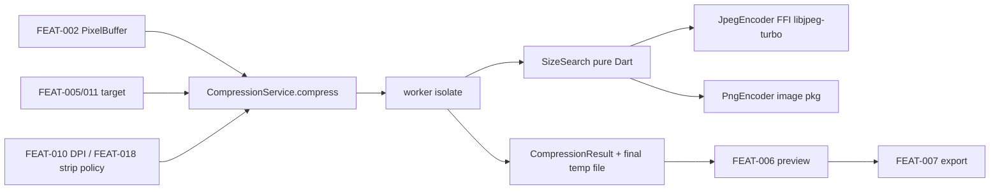

# FEAT-004 — Technical Plan

## 1. Summary
A pure-Dart search engine runs in a background isolate and calls a bundled, pinned libjpeg-turbo through Dart FFI to encode JPEG candidates fully in memory (ADR-001, ADR-002). It computes the byte window from the FR-3/FR-4 rule, binary-searches JPEG quality in `[qFloor, 100]`, checks neighbours, then applies the FR-8 levers (4:4:4, no optimised Huffman, COM padding) only when needed. PNG is encoded once at maximum lossless compression with the pure-Dart `image` package. All metadata (JFIF density/pHYs DPI, no EXIF, no ICC) is written by the same serialiser on every pass, so the size gate always measures the real final bytes. Pixels arrive as an in-memory native buffer owned by FEAT-004 (ADR-003). Only the final file touches disk, in app-private cache.

## 2. Architecture impact
No code exists yet; this feature is the first consumer of the stack in ADR-001.
- New Dart module `lib/features/compression/` (domain: window rule, search, padding, outcome; data: encoder adapters, temp files, isolate runner; presentation: outcome-to-message mapping).
- New local FFI plugin `packages/es_codec/` (vendored libjpeg-turbo at a pinned tag, CMake build for arm64-v8a, armeabi-v7a, x86_64, 16 KB page aligned).
- No new screen: FEAT-006 hosts progress and outcome display; FEAT-004 supplies the progress stream, result object and localised strings.



## 3. Components
| Component | Layer | Responsibility | New / changed |
|---|---|---|---|
| `TargetValidator` | domain | FR-16 / section 8 rules; returns `INVALID_TARGET` + specific message key | New |
| `ByteWindow` | domain | FR-3/FR-4: `lo = min×1024`, `hi = max×1000`; if `lo > hi` then `lo = min×1000` and `narrow = true`; min unset → `lo = 0` | New |
| `SizeSearch` | domain | Pure function `(encoder, pixels, window, settings) → plan/outcome`; algorithm below; caches size per (config, q) | New |
| `JpegPadder` | domain | Splices COM segments after the JFIF APP0 segment; exact byte arithmetic | New |
| `Encoder` interface | domain | `encodeJpeg(q, subsampling, optimise)` and `encodePng()` → bytes. Exists for NFR-9 (fake encoder with scripted size curves in tests) | New |
| `TurboJpegEncoder` | data | FFI to TurboJPEG v3 (`tj3Init/Set/Compress8/Free/Destroy`); 4:2:0 or 4:4:4, optimise on/off, baseline only, JFIF density from DPI | New |
| `DartPngEncoder` | data | `image` package, level 9, 3 or 4 channels, `pHYs` only when DPI is set | New |
| `Flattener` | domain | JPEG + alpha: in-place integer composite onto white, 4→3 channels (FR-12) | New |
| `CompressionRunner` | data | Spawns worker isolate, passes buffer address, relays progress, cancel flag checked between passes, frees buffer, maps native/alloc errors | New |
| `TempFiles` | data | Writes only the final file to `<cache>/exactsize_out/`; deletes on failure/cancel; sweeps the folder at app start (FR-20, shared with FEAT-002 FR-18) | New |
| `OutcomeMessages` | presentation | Maps result to ARB keys with ICU placeholders; numbers and "KB" wrapped in bidi isolates (U+2068…U+2069) | New |
| `es_codec` plugin | native | Builds pinned libjpeg-turbo `.so`; no custom C beyond the build | New |

**Search algorithm (JPEG).** Configs: A = 4:2:0 + optimised Huffman (base); B = 4:4:4 + optimised; C = 4:4:4 + standard Huffman. Progressive is never used, so FR-8 lever 3 reduces to "optimised Huffman off" [Assumption: baseline is the safest choice for portal validators].
1. Encode A@100. In window → success.
2. If A@100 > hi: binary search the largest q in `[qFloor, 99]` with size ≤ hi (≤ 6 passes); then check q+1, q+2 (cached or encoded) for non-monotonic fits; take the highest q that fits. If none ≥ qFloor fits: encode A@1; `> hi` → `ABOVE_MAX`, else `TOO_DEGRADED`.
3. If the chosen size < lo (size jumped over a narrow window): try B and C at the same q; else go to padding (OQ-12, decided); `NO_FIT` only if fewer than 4 bytes of room.
4. Floor path (A@100 < lo): B@100 → in window success; if > hi, binary search q in B for largest ≤ hi, success if ≥ lo, else pad that file. If B@100 < lo: C@100 → in window success, < lo → pad C@100 (largest under-floor file), > hi → pad B@100.
5. Padding target = `min(lo + min(1024, (hi − lo) div 2), hi)`; pad amount ≥ 4 bytes (one empty COM segment); segments of ≤ 65,537 bytes (4-byte header + ≤ 65,533 payload), last split so no segment is < 4 bytes; payload is a fixed constant byte [Assumption: 0x20]. If `hi − size < 4`: `BELOW_MIN` (or `NO_FIT` in the jump case).
6. Final gate (FR-6): `lo ≤ finalBytes.length ≤ hi` on the exact bytes to be written; else the result is a failure, never success.
Worst-case passes: success path 1 + 6 + 2 + 2 = 11 in rare jump cases, typical 8–9; floor path ≤ 9. A hard cap of 10 passes (NFR-1) returns the best in-window candidate found, else the closest-size failure [Assumption: the cap rarely binds; measured in the corpus test].

**PNG path.** Encode once. In window → success. `> hi` → `PNG_ABOVE_MAX`, plus one probe A@qFloor: `jpegWouldFit = size ≤ hi` (with padding available, this guarantees the JPEG path can succeed). `< lo` → `PNG_BELOW_MIN`. Alpha is kept.

## 4. API contracts
In-process Dart API (no network endpoints).
```
Future<CompressionResult> CompressionService.compress(
  CompressionRequest req, { CancelSignal? cancel, void Function(int pass, int maxPasses)? onProgress })

CompressionRequest { PixelBuffer pixels   // ADR-003, ownership moves to FEAT-004
                     int? minKb; int maxKb; OutputFormat format (jpeg|png)
                     int? dpi }           // from FEAT-010; FEAT-018 policy = "write no EXIF/ICC" (fixed)

CompressionResult = Success { String tempFilePath; int sizeBytes; OutputFormat format;
                              int? quality; Subsampling? subsampling; bool optimisedHuffman;
                              int paddingBytes; Set<Notice> notices }   // narrowRange, paddingAdded, transparencyFlattened
                  | Failure { Reason reason; int? closestBytes; Direction? direction (tooBig|tooSmall);
                              bool jpegWouldFit; Set<Notice> notices }
Reason: ABOVE_MAX, TOO_DEGRADED, NO_FIT, BELOW_MIN, PNG_ABOVE_MAX, PNG_BELOW_MIN, INVALID_TARGET,
        UNSUPPORTED_INPUT (relayed from FEAT-002), IMAGE_TOO_LARGE, OUT_OF_MEMORY_HANDLED, CANCELLED, WRITE_FAILED
```
`WRITE_FAILED` is new (low storage, PRD section 9 "write failure"); accepted 2026-11-20 (PRD v1.1). Failure never carries a file path (FR-6, FR-11).

## 5. Data model
No persistent data, no database, no migrations. Transient only: the native pixel buffer (freed at end of run), in-memory candidate bytes (current + best only), and one final file in app-private cache (`<cache>/exactsize_out/<random>.jpg|png`, random name, no user data). Ownership of the success file passes to FEAT-006/FEAT-007, which delete it after export or discard; the start-up sweep removes anything left.

## 6. Integrations
| Integration | Purpose | Data leaving device |
|---|---|---|
| libjpeg-turbo (pinned tag, vendored source, IJG/BSD/zlib licences) | JPEG encode | None |
| `image` pub package (MIT) [Assumption: licence verified at pin time] | PNG encode | None |
| Android `/proc/meminfo` `MemAvailable` (read via `dart:io`) [Assumption: readable on API 28–36; else rely on allocation failure] | Memory pre-flight | None |
No SDK, network client or downloadable codec is used by the pipeline (NFR-6).

## 7. Security & privacy
- **PCI-DSS / Bangladesh Bank:** not in scope; no money, cards, tokens or credentials [Fact](FEAT-004 prd.md section 10). No secrets exist in this feature; if any build-time key is ever added it is `[PLACEHOLDER]`, injected server-side or via secure storage, never bundled.
- **No network:** `lib/features/compression/` and `packages/es_codec/` may not import `dart:io` HTTP classes, `package:http` or any SDK; enforced by an import-ban test, plus an airplane-mode integration test (AC-6.2). The app as a whole may hold INTERNET permission for ads (FEAT-025), so the guarantee is at code level.
- **Data at rest:** pixels never written to disk (ADR-003); only the final file, in app-private cache, deleted per FR-20.
- **Logging:** a log wrapper accepts only the `Reason`/outcome enum; no pixel data, sizes tied to files, names or paths in release logs or crash reports (NFR-7).
- **Padding:** constant bytes, no user, device or time data (AC-2.3).
- **Supply chain:** libjpeg-turbo built from vendored source at a pinned tag with checksum; CVE watch; tests use synthetic images only (`[PLACEHOLDER]` assets, no real faces or signatures).

## 8. Requirement coverage
| Req | How it is met | Status |
|---|---|---|
| FR-1 | `CompressionRequest` takes `PixelBuffer` (ADR-003) + target; no resize code exists in the module; dimension assert at entry | Met |
| FR-2 | Always encodes from pixels; source bytes never reach FEAT-004 | Met |
| FR-3 | `ByteWindow` | Met |
| FR-4 | `ByteWindow` narrow branch + `narrowRange` notice | Met |
| FR-5 | Binary search + neighbour check (section 3 step 2) | Met |
| FR-6 | Final gate on exact bytes before write; failure has no path | Met |
| FR-7 | Search range starts at `qFloor` (constant, default 40); `TOO_DEGRADED` | Met; value is OQ-8 |
| FR-8 | Configs A→B→C, then `JpegPadder`; disclosure via `paddingAdded` notice | Met; lever 3 = Huffman only (no progressive in base); jump case padded (OQ-12) |
| FR-9 | `DartPngEncoder` level 9, lossless | Met |
| FR-10 | PNG failure codes + one JPEG probe → `jpegWouldFit`; no automatic switch | Met |
| FR-11 | `Failure` fields + `OutcomeMessages` | Met |
| FR-12 | `Flattener` + `transparencyFlattened` notice; FEAT-006 shows it before export | Met (display in FEAT-006) |
| FR-13 | Decoding is FEAT-002's; FEAT-004 relays `UNSUPPORTED_INPUT`. HEIC supported on all devices (minSdk 28, ADR-001) | Met by FEAT-002; PRD wording follow-up already noted in FEAT-002 |
| FR-14 | One serialiser writes all metadata each pass (OQ-9 proposal); final gate measures it; no post-processing, so padding can't be stripped | Met if FEAT-010/018 accept "settings, not post-processing" (OQ-13) |
| FR-15 | Bundled pinned encoder, deterministic search, constant padding; golden-file test | Met |
| FR-16 | `TargetValidator` before any encode | Met |
| FR-17 | Worker isolate, pass-count progress, cancel flag between passes, cleanup | Met |
| FR-18 | Memory pre-flight → `IMAGE_TOO_LARGE`; allocation/native failure → `OUT_OF_MEMORY_HANDLED` | Partly: a low-memory-killer process kill cannot be caught (risk R2) |
| FR-19 | `Success` carries size, quality, format, notices; FEAT-006 displays them as is | Met |
| FR-20 | Only final file on disk; deletion on fail/cancel; start-up sweep | Met |
| FR-21 | Pinned encoder + per-ABI golden test; fallback "both in window" | Likely met, proven by test (R3) |
| NFR-1 | Native encoder, ≤ 10 passes, in-memory candidates; spike day 1 on the slowest device | To prove (R1) |
| NFR-2 | ~8 MB pixels + ~10–20 MB encoder/candidates at 2 MP [Hypothesis]; in-place flatten | Met with margin [Hypothesis] |
| NFR-3 | ADR-002 | Met |
| NFR-4 | ARB + ICU placeholders, bidi isolates; translations via FEAT-019 | Met (translations external) |
| NFR-5 | FEAT-004 exposes progress/outcome; the host screen (FEAT-006) uses a live region / `SemanticsService.announce` | Shared with FEAT-006 |
| NFR-6 | No network code; import-ban + airplane test | Met |
| NFR-7 | Enum-only log wrapper | Met |
| NFR-8 | Corpus harness (≥ 500 synthetic exports) on the R1 device matrix | Met by test plan |
| NFR-9 | `SizeSearch` pure; fake encoder unit tests; golden tests | Met |

**Gaps / flags:** (1) FR-8 vs `NO_FIT`: resolved, the jump case is padded and `NO_FIT` needs fewer than 4 bytes of room (OQ-12, PRD v1.1). (2) FR-18 cannot fully exclude OS process kills. (3) NFR-1's 10-pass cap can rarely bind in jump cases. (4) NFR-5 and FR-12 display depend on FEAT-006. No FR/NFR is infeasible.

## 9. Risks
| # | Risk | Likelihood | Impact | Mitigation |
|---|---|---|---|---|
| R1 | Low-end device misses 3 s / 8 s (slow CPU, thermal throttling) | Medium (pure Dart: High) | High | libjpeg-turbo NEON; search starts at `qFloor`; ≤ 10 passes; size cache; spike on slowest device before building anything else |
| R2 | Memory: large targets (12–24 MP) on 2 GB devices trigger a low-memory kill that looks like a crash | Medium | High | `MemAvailable` pre-flight (2× headroom) → `IMAGE_TOO_LARGE`; single native buffer, in-place flatten; keep only current + best candidate |
| R3 | Cross-device bytes differ (SIMD paths per ABI, compiler flags) | Medium | Medium (Should) | Pinned source + identical flags; per-ABI golden test; disable SIMD for the differing step or accept "both in window" (AC-6.4) |
| R4 | Same-device determinism broken by an encoder update | Low (bundled) | High | Encoder version is part of the app version; goldens regenerate on any bump |
| R5 | KB rule edge cases: narrow windows (FR-4) where size jumps over the window; padding gaps < 4 bytes; min unset; max 2 KB at large W×H; narrow notice wording | High (they will occur) | Medium | Unit tests with scripted size curves for each case; exact segment arithmetic; jump case padded (OQ-12) |
| R6 | A portal validator rejects JPEGs with large COM segments | Low [Hypothesis] | High | Baseline JFIF only; COM is a standard JPEG marker; test files in common validators/libraries; disclosure note; padding only as last resort |
| R7 | Native build burden (NDK, 3 ABIs, 16 KB pages) slows a solo dev | Medium | Medium | Spike proves the build first; if it fails, fall back to ADR-002 Option B |
| R8 | Quality floor 40 too low or too high for signatures (thin strokes) | Medium | Medium | Visual test set tuning task; single constant, easy to change (OQ-8) |
| R9 | Ownership bugs (use-after-free, leak) of the native buffer | Low | High | Single owner rule (ADR-003); worker never killed mid-call; debug leak counter test |

## 10. Decisions
- ADR-001 App stack (Flutter 3.50.x + FFIgen/JNIgen, minSdk 28, Riverpod) — Approved v1.0.
- ADR-002 Image encoder (pinned libjpeg-turbo + Dart PNG) — Approved v1.0.
- ADR-003 Pixel handover (native in-memory buffer) — Approved v1.0; answers FEAT-002 OQ-10.
- Search algorithm: no ADR. FR-5 already fixes it and it is a pure function that is cheap to change (only goldens move).

## 11. Deliberately left out
- Progressive JPEG, arithmetic coding, WebP/HEIC output.
- Model-based size prediction (secant/interpolation search): binary search fits the budget.
- PNG lossless colour-type reduction (RGB→grey/palette) and zopfli/oxipng-style recompression: would shrink PNGs and cut `PNG_ABOVE_MAX`, but adds tuning; candidate for R1.x.
- Lossy PNG colour reduction (OQ-3).
- Platform-channel memory API (the `/proc/meminfo` read suffices).

## 12. Open questions (proposals for the Product Owner)
All proposals below accepted by the Product Owner on 2026-11-20; OQ-12 decided as padding. Recorded in FEAT-004 PRD v1.1.
| OQ | Proposal |
|---|---|
| OQ-3 PNG lossy colours | No in R1 (agree with PRD default). Lossless colour-type reduction is the cheaper first step, R1.x. |
| OQ-4 Max W×H / formats | Keep 24 MP hard cap and JPEG/PNG only; add the memory pre-flight, so low-end devices may say `IMAGE_TOO_LARGE` earlier [Assumption: portal targets are rarely above 2 MP]. |
| OQ-5 Decimal KB | Whole KB in R1. The window is integer bytes internally, so decimals later are a validation/UI change only. |
| OQ-6 ICC policy | Write no ICC profile (untagged sRGB, the web default), owned by FEAT-004's serialiser; matches FEAT-002 OQ-4 proposal; saves ~0.5–3 KB per file. |
| OQ-7 Export anyway | No in R1; if ever, in FEAT-015. |
| OQ-8 Quality floor | One floor, default 40 for photos and signatures in R1, tuned on a synthetic visual set during implementation; per-type floor only if tuning shows signatures need it. |
| OQ-9 Metadata order | Inside the loop: the encoder writes JFIF density / pHYs (FEAT-010) and writes no EXIF/ICC (FEAT-018 policy) on every pass. JFIF APP0 always carries density fields, so DPI adds zero bytes to JPEG [Fact](JFIF 1.02 spec); PNG `pHYs` adds 21 bytes. |
| OQ-10 minSdk / HEIC | Decided by the Product Owner 2026-11-20: minSdk 28 (Android 9); HEIC decodes on every supported device (ADR-001 v0.2). |
| OQ-11 Accuracy metric | Count success against the FR-3 safe window (the app cannot see the portal). Measure the 99% in the pre-release device-matrix corpus, not by production telemetry; any on-device counter stays local or opt-in (FEAT-027). |
| OQ-12 (new) Jump case | When no quality lands inside a narrow window, apply FR-8 (levers 2–3, then padding from the best file under the ceiling). This follows FR-8's literal text and helps users, but makes `NO_FIT` reachable only when the gap is < 4 bytes. Alternative: reserve padding for "below floor even at quality 100" (AC-2.2 wording) and return `NO_FIT`. Also confirm the new `WRITE_FAILED` code. Needs a PRD clarification (v1.1). |
| OQ-13 (new) FEAT-010/018 coupling | FEAT-010 and FEAT-018 supply settings to FEAT-004's serialiser instead of post-processing the file. Their PRDs must state this. |

**Effort re-estimate** (roadmap: 2.0 pw) [Assumption for all lines]
| Work | pw |
|---|---|
| Spike: libjpeg-turbo FFI build + per-pass timing B vs C on slowest device | 0.5 |
| `es_codec` plugin productionised (pinned source, 3 ABIs, 16 KB pages, licences) | 0.5 |
| Window, validator, search, levers, padder + fake-encoder unit tests | 1.0 |
| PNG path, JPEG probe, flattener | 0.3 |
| Isolate runner, progress, cancel, temp files, sweep, memory pre-flight | 0.5 |
| Result model, ARB messages (English keys; translations FEAT-019), a11y hooks | 0.3 |
| Golden determinism tests, 500-export corpus harness, quality-floor tuning | 0.8 |
| **Total** | **≈ 3.9 (range 3.5–4.5)** |
Not included: shared project scaffold from ADR-001 (~0.3 pw). Option B (no native code) would save ~0.7 pw but risks NFR-1. Dropping the FR-21 cross-device proof would save ~0.2 pw.

## Change log
| Version | Date | Change |
|---|---|---|
| 0.1 | 2026-11-20 | First draft |
| 0.2 | 2026-11-20 | Aligned with ADR-001 v0.2: minSdk 28, Riverpod, Flutter 3.50.x |
| 0.3 | 2026-11-20 | ADR-001 to ADR-003 approved; OQ-3 to OQ-13 decided (OQ-12: pad); PRD v1.1 referenced |
| 1.0 | 2026-11-20 | Approved by Product Owner |
