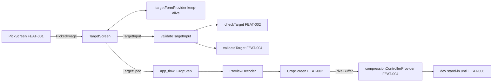

# FEAT-005 — Technical Plan

## 1. Summary
A new module `lib/features/target/` holds the shared `TargetSpec` and a pure-Dart input pipeline: clean the text (FR-4), read it strictly as a whole number, then let FEAT-002's `checkTarget` and FEAT-004's `validateTarget` decide ranges, attributing every error to its field. FEAT-004's code is not changed. A keep-alive Riverpod notifier keeps the raw field texts, the format and which errors are visible for the life of the process. Nothing is persisted or restored. The target screen replaces `_NextStepPlaceholder`. A small app-level flow file wires pick → target → crop (preview decode) → compression, with a dev-only stand-in after crop until FEAT-006 ships. **No ADR:** nothing here is costly to reverse (section 10).

## 2. Architecture impact
- New module `lib/features/target/{domain,presentation}` (ADR-001 layout). It has no data layer, because it does no I/O. The domain imports only crop and compression domain types (the same pattern as `pick/domain` → `crop/domain` [Fact](lib/features/pick/domain/pick_types.dart)), with no Flutter or Riverpod.
- New `lib/app_flow.dart`: screen order after pick. `lib/app.dart` points `PickScreen.onPicked` at it, and `_NextStepPlaceholder` is deleted.
- No change to FEAT-001, FEAT-002 or FEAT-004 code. FEAT-002's `CropScreen`, `PreviewDecoder` and `CropMessages`, and FEAT-004's `validateTarget`, `OutcomeMessages`, `compressionControllerProvider` and `CompressionRequest` are used unchanged.
- One new screen (target), designed with impeccable first (FR-16).



## 3. Components
| Component | Layer | Responsibility | New / changed |
|---|---|---|---|
| `TargetSpec` | domain | Immutable `width, height, minKb?, maxKb, format`. `dimensions` → FEAT-002 `Target`; `request(PixelBuffer)` → FEAT-004 `CompressionRequest`. `==`/`hashCode`; `toString()` redacted | New |
| `TargetInput`, `TargetField` | domain | Raw field texts and `OutputFormat`; the only thing FEAT-011 fills (FR-9). Fields: `width, height, minKb, maxKb, format` | New |
| `cleanNumberText` | domain | FR-4 (a)–(c): drop whitespace and bidi controls, map 4 digit systems to 0–9, map `,` `٫` `٬` to `.` | New |
| `readNumber` | domain | Strict reader for cleaned text: `Empty`, `Whole(int)` (`^[0-9]+$`, leading zeros stripped, more than 9 significant digits → 999,999,999), `NotWhole` (digits and at least one `.`, including `1.000.000`), `NotNumber` (anything else, including `-5`, `0x10`, `1e3`, `300x300`) | New |
| `validateTargetInput` | domain | Per-field validation through FEAT-002/004 (algorithm below). Returns `TargetInputValid(TargetSpec)` or `TargetInputInvalid(Map<TargetField, TargetError>)`, where `firstField` is the first invalid field in the fixed order W, H, Min, Max | New |
| `targetHints` | domain | From `SourceInfo` + valid W/H: oriented photo size, `canUsePhotoSize`, `enlarges`, `verySmall` (FR-11 to FR-13) | New |
| `targetFormProvider` / `TargetFormController` | state | `NotifierProvider` (Riverpod 3, not auto-disposed): `TargetInput` plus the revealed-error set. Methods `setText`, `setFormat`, `reveal(field)`, `revealAll()`, `fill(TargetInput)` (FEAT-011), `usePhotoSize`, `startForPhoto()` (keeps values, clears revealed errors) | New |
| `TargetMessages` | UI | Maps `TargetError` to text through the existing `CropMessages.target` and `OutcomeMessages.target`, plus the one new pixel key; hints and labels; numbers and units in isolates | New |
| `TargetScreen` | UI | Photo line, W/H row, Min, Max, `SegmentedButton<OutputFormat>`, hints, Continue. Owns its `TextEditingController`s and `FocusNode`s; cleans a field when it loses focus | New |
| `app_flow.dart` | UI (flow) | `openTargetStep`, `_CropStep` (decodes the preview, shows `CropScreen`, disposes the `ui.Image`), `_AfterCropStandIn` (dev-only, FEAT-006 replaces it) | New |
| `lib/app.dart` | UI | `onPicked: openTargetStep`; placeholder removed | Changed |
| `app_en.arb` | l10n | New keys only (section 4); existing keys reused (FR-15) | Changed |

**Validation algorithm (`validateTargetInput`, answers PRD OQ-8).** Every text goes through `readNumber(cleanNumberText(raw))` first.
1. **W, H:** `Empty` or `NotNumber` → `sideOutOfRange`. `NotWhole` → new `pixelsNotWhole`. `Whole(n)` → `checkTarget(Target(n, 1))` decides the side (0 fails there). If both sides pass, `checkTarget(Target(w, h))` → `tooManyPixels` on Width. No pixel limit is written in FEAT-005.
2. **Max:** `NotWhole` → `TargetMessage.wholeNumbersOnly`; `NotNumber` → `invalidNumber`. `Empty` or `Whole(n)` → `validateTarget(maxText: ''|'$n', format: f.name)`; an `InvalidTarget(m)` becomes Max's error.
3. **Min:** `Empty` → none. `NotWhole`/`NotNumber` as for Max. `Whole(n)` → `validateTarget(maxText: maxOk ? '$max' : '$maxKbLimit', minText: '$n', format)`. Because Max and format were already checked, any error now belongs to Min. When Max is invalid, `minNotBelowMax` is dropped: a Min-only entry is not an error by itself (PRD section 9).
4. **Format:** passed as `OutputFormat.name`, so `chooseJpegOrPng` is unreachable (defensive branch kept).

All errors are returned together (AC-3.5). The only number rules in FEAT-005 are the text classes (digits, dot) and the 9-digit cap. The cap keeps W×H under 10^18, inside int64 [Fact: arithmetic]. It also avoids FEAT-004's 20-digit case: `validateTarget` only ever sees canonical digit strings, so it never reaches `double.tryParse`.

**Chosen vs alternative for OQ-8.**
- **A (recommended): compose per field in FEAT-005** (above). Good: no change to an Implemented feature, limits and messages stay in FEAT-002/004 (NFR-5), about 60 lines. Bad: Min attribution relies on `validateTarget` checking Max before the pair rule. A table test pins every message to its field, so a FEAT-004 change that breaks this fails CI.
- **B: FEAT-004 change request.** Make `_parseKb` public and add a field to `InvalidTarget` (or return all problems). Good: one owner of KB parsing. Bad: re-opens FEAT-004 (version bump, retest, PO approval). It still does not cover multi-dot input (`1.000.000` gives `invalidNumber` in FEAT-004, but the PRD wants the whole-number message), or pixels and Unicode digits, so FEAT-005 needs its own reader anyway.

**Cleaning: on blur and on Continue, not a `TextInputFormatter`.** A formatter rewrites text during IME composition. For Arabic and Devanagari IMEs this can break the composing region and move the caret [Hypothesis]. The PRD only asks for the cleaned value after the field is left (AC-5.1). Live error updates (FR-7) run `clean → read → validate` on the raw text without rewriting it, so what the user sees and what is validated always agree. The field then shows the result of FR-4 (a)–(c). Leading zeros stay as typed, and a long digit string is not rewritten to 999999999 (OQ-T2). The only formatter is `LengthLimitingTextInputFormatter(32)` [Assumption], which keeps a huge paste out of memory and semantics (NFR-8) and is composition-aware. Bengali digits are included as one extra range (Could, PRD OQ-11 proposed yes). The whitespace class is Dart's `\s`, which follows ECMAScript (includes U+00A0, U+202F, U+FEFF) [Fact](https://262.ecma-international.org/#sec-white-space). A space is never a decimal mark, so removing it guesses nothing.

## 4. API contracts
In-process Dart API. No network endpoints.
```dart
// lib/features/target/domain/target_spec.dart
final class TargetSpec {
  const TargetSpec({required int width, required int height, int? minKb, required int maxKb, required OutputFormat format});
  Target get dimensions;                              // FEAT-002 Target(width, height)
  CompressionRequest request(PixelBuffer pixels);     // FEAT-004, ADR-003 buffer moves in
  String toString() => 'TargetSpec(<redacted>)';      // FR-14
}

// lib/features/target/domain/target_input.dart
enum TargetField { width, height, minKb, maxKb, format }
final class TargetInput { String width, height, minKb, maxKb; OutputFormat format /* default jpeg */; copyWith; toString redacted }
sealed class TargetError
  PixelRangeError(TargetDimensionsMessage m)          // FEAT-002 enum, reused
  PixelsNotWhole()                                    // the one new message
  KbError(TargetMessage m)                            // FEAT-004 enum, reused
sealed class TargetInputResult
  TargetInputValid(TargetSpec spec)
  TargetInputInvalid(Map<TargetField, TargetError> errors) { TargetField get firstField; }

String cleanNumberText(String raw);
NumberRead readNumber(String cleaned);                // Empty | Whole(int) | NotWhole | NotNumber
TargetInputResult validateTargetInput(TargetInput input);   // pure, no Flutter; FEAT-011 data test calls it (AC-9.3)

// lib/features/target/domain/target_hints.dart
const smallTargetHintPx = 16;                         // FR-13 hint threshold, not a limit [Assumption, PRD OQ-12]
TargetHints targetHints(SourceInfo info, {int? width, int? height});
  // photo = Orientation.fromExif(info.exifOrientation).orientedSize(rawW, rawH)
  // canUsePhotoSize = checkTarget(Target(photo)) == null
  // enlarges = W / CropMath.coverWidth(sw, sh, Target(W, H)) > 1.0  (= max(W/sw, H/sh))
  // verySmall = W < 16 || H < 16

// lib/app_flow.dart
void openTargetStep(BuildContext context, PickedImage image);
```
**New ARB keys** (English; translations through FEAT-019): `targetPixelsNotWhole` ("Use whole numbers of pixels."), `targetLabelWidth`, `targetLabelHeight`, `targetLabelMin`, `targetLabelMax`, `targetOptional`, `targetUnitPx`, `targetUnitKb`, `targetFormatLabel`, `targetPhotoSize` ({size}), `targetUsePhotoSize`, `targetHintEnlarged`, `targetHintVerySmall`, `targetContinue` (or reuse `cropButtonContinue`, decided in the design pass). **Reused:** `targetMaxOutOfRange`, `targetMinNotBelowMax`, `targetWholeNumbersOnly`, `targetInvalidNumber`, `targetChooseJpegOrPng`, `cropTargetSideOutOfRange`, `cropTargetTooLarge`, `pixelSize` [Fact](lib/l10n/app_en.arb).

## 5. Data model
In memory only, for the life of the process: `TargetFormState { TargetInput input; Set<TargetField> revealed; }` in `targetFormProvider`. `TargetSpec` exists only while it is handed on. No database, file, preference, `restorationId` or `RestorationScope`. Flutter state restoration would write to the Android saved-instance Bundle, which survives process death and would break AC-8.3. `MaterialApp` sets no `restorationScopeId` [Fact](lib/app.dart). No migrations. FEAT-012 will define its own serialised form of `TargetSpec` later.

**Session memory (FR-10, answers Q5).**
| Event | What happens |
|---|---|
| Typing | `onChanged` → `setText` (raw text). Errors render from `validateTargetInput(state.input)` filtered by `revealed` |
| Focus leaves a field | Clean the text into the controller, then `reveal(field)` |
| Back from crop | The target route stayed underneath, so its widget state is intact. The provider holds the same values anyway |
| Rotation, font scale, locale | No activity restart: `configChanges` covers orientation, screenSize, locale, layoutDirection and fontScale [Fact](android/app/src/main/AndroidManifest.xml). Messages are built in `build()`, so they re-render in the new language |
| Next photo (pick or share) | Routes are rebuilt. The new `TargetScreen` copies the values from the provider; `startForPhoto()` clears `revealed` |
| Process death | Provider gone, nothing restored: next start is empty (AC-8.3) |

## 6. Integrations
None new. No SDK, plugin, network client or platform call. Android IMEs get the `EditorInfo` flags that Flutter derives from the `TextField` options (section 7).

## 7. Security & privacy
- **PCI-DSS / Bangladesh Bank:** not engaged. Only pixel and KB numbers and a format are handled: no card, token, wallet, amount or credential [Fact](prd.md section 10). There are no secrets. Any future one is `[PLACEHOLDER]`, kept server-side or in secure storage, never in the bundle.
- **Keyboard privacy (FR-3, answers Q4).** Verified in the pinned SDK and package: `TextField` in `material_ui` 1.11.1 has `autocorrect` (nullable), `enableSuggestions` (default true), `enableIMEPersonalizedLearning` (default true), `keyboardType`, `textInputAction`, `inputFormatters`, `autofillHints` (default `const []`), `spellCheckConfiguration`, `enableInlinePrediction` and `restorationId` [Fact](material_ui-1.11.1/lib/src/text_field.dart lines 277–350). `enableIMEPersonalizedLearning` maps to Android `EditorInfo.IME_FLAG_NO_PERSONALIZED_LEARNING` [Fact](flutter 3.50.1 packages/flutter/lib/src/services/text_input.dart line 708). FEAT-005 sets `keyboardType: TextInputType.number`, `autocorrect: false`, `enableSuggestions: false`, `enableIMEPersonalizedLearning: false`, `autofillHints: null`, and no spell check or `restorationId`. Open points: whether each IME honours the flags [Hypothesis]; whether `autofillHints: null` fully disables autofill on Android [Hypothesis]; whether number mode on Arabic and Hindi keyboards sends native digits [Hypothesis] (cleaning accepts them either way).
- **No storage, logs or analytics (FR-14):** no outcome-log events for this step; `TargetSpec` and `TargetInput` have redacted `toString`. Static tests extend the FEAT-004 no-network import ban and the FEAT-002 write-API ban to `lib/features/target/` and `lib/app_flow.dart`, and ban `shared_preferences`, `dart:io`, `print`/`debugPrint` and log wrappers there.
- **Clipboard:** the app never writes to it. A user-initiated Copy from the field's system menu is the user's own action (OQ-T4).
- **Photo:** the step reads only `SourceInfo` (size, EXIF orientation) from `PickedImage`: no pixels, no handle access, no copy.

## 8. Requirement coverage
| Req | How it is met | Status |
|---|---|---|
| FR-1 | `TargetScreen` pushed by `openTargetStep` after every accepted image; `_NextStepPlaceholder` deleted | Met |
| FR-2 | `SegmentedButton<OutputFormat>` with `emptySelectionAllowed: false` (the default) and single select [Fact](material_ui segmented_button.dart line 156); state defaults to `jpeg` | Met |
| FR-3 | Section 7 options; `textInputAction` next ×3 then done; `onSubmitted` focuses the next node in the fixed list W, H, Min, Max, which is reading order in both LTR and RTL; done → `unfocus` | Met (IME compliance [Hypothesis]) |
| FR-4 | `cleanNumberText` + `readNumber` (pure); cleaned on blur and on Continue | Met (Bengali: Could, included) |
| FR-5 | `checkTarget` + `TargetDimensionsMessage` reused; `PixelsNotWhole` new | Met |
| FR-6 | `validateTarget` + `TargetMessage` reused, per-field composition (section 3) | Met |
| FR-7 | `revealed` set: reveal on blur or Continue, then live; messages beside fields (size row for W/H) with error icon + text, not colour alone | Met |
| FR-8 | Continue always enabled: `revealAll()`, focus `firstField`, `SemanticsService.sendAnnouncement` of its message (crop's pattern [Fact](crop_screen.dart line 178)); on valid input `onContinue(spec)` | Met |
| FR-9 | `TargetSpec` is the only hand-over; `fill(TargetInput)` for FEAT-011; `validateTargetInput` is pure | Met |
| FR-10 | Keep-alive provider (section 5) | Met |
| FR-11 | `targetHints.enlarges` from the oriented size via `Orientation.fromExif` and `CropMath.coverWidth`; non-blocking, live region | Met |
| FR-12 | Photo line via `pixelSize` in isolates; "Use photo size" only when `checkTarget(photo)` passes | Met |
| FR-13 | `verySmall` hint, threshold 16 | Met ([Assumption], PRD OQ-12) |
| FR-14 | Section 7: memory only, redacted `toString`, static bans, no `restorationId` | Met (user copy: OQ-T4) |
| FR-15 | Section 4 keys; reuse list kept | Met (translations: FEAT-019) |
| FR-16 | Build task blocked behind a lean impeccable pass (Material 3, one emulator screenshot per key state), joint with FEAT-011's entry if PRD OQ-10 is answered first | Met as a gate |
| NFR-1 | Pure integer work on ≤ 32-character strings; benchmark unit test (10,000 validations) | Met |
| NFR-2 | Labels with unit and optional/required in the `InputDecoration`; 48 dp targets; `SingleChildScrollView` + `resizeToAvoidBottomInset`; W/H row turns into a column at large text scale or narrow width; Material 3 roles only | Met (verified by goldens + emulator) |
| NFR-3 | No network code (import ban) | Met (FEAT-016 verifies) |
| NFR-4 | gen-l10n; `Directionality` mirrors the layout; field text `TextDirection.ltr`; units and numbers in U+2068/U+2069 isolates as in `CropMessages._iso`; `NumberFormat(localeName)` | Met (AI-reviewed translations only) |
| NFR-5 | No limit constants in FEAT-005 apart from the hint threshold and text classes; a test changes nothing in FEAT-005 but asserts that messages carry the values from `maxTargetSide` and `maxKbLimit` | Met |
| NFR-6 | Section 7 | Met |
| NFR-7 | Section 9 table as a unit test; one emulator drive en/ar/hi at 200% | Met |
| NFR-8 | Strict reader, length cap, 1,000-string seeded fuzz | Met |
| NFR-9 | Nothing platform-specific; drive runs on API 36.1 locally and API 28 in CI | Met |

**Gaps / flags:** (1) IME behaviour is outside app control (R1). (2) The flow after crop is a dev-only stand-in until FEAT-006 (OQ-T1). (3) FR-14 clipboard reading (OQ-T4).

### Flow wiring (answers Q6)
- **pick → target:** `PickScreen` calls `openTargetStep` once per accepted image, with only itself below [Fact](pick_screen.dart). It pushes `TargetScreen(image, onContinue)`.
- **Back from target = start-over:** `PopScope.onPopInvokedWithResult(didPop)` calls `pickController.release()` and `cropController.end()`, **but only if `identical(ref.read(pickControllerProvider).current, image)`**. A new pick or share mid-flow makes `PickScreen` call `popUntil(isFirst)`, and that programmatic pop also fires `PopScope`. By then `current` is already the new image, so the guard skips the release. The current placeholder lacks this guard and would reset the just-accepted image [Fact](lib/app.dart line 63, pick_screen.dart line 24) (see R2). Values stay in the provider.
- **target → crop:** `_CropStep(image, spec)` decodes the preview with `PreviewDecoder` (progress after 500 ms). A `PreviewErr` shows `CropMessages.reason` with "Choose another photo". On success it shows `CropScreen(src: image.handle, info: image.info, preview, target: spec.dimensions, …)`. The `ui.Image` is disposed when the route goes. Re-entering with the same target keeps the crop; a changed target re-initialises it (FEAT-002 AC-2.2/AC-8.4) [Fact](crop_controller.dart `start`). The preview is decoded again on each entry (R5).
- **crop → compression:** `onContinue(pixels)` → `compressionController.start(spec.request(pixels))` (ownership moves, ADR-003), then pushes `_AfterCropStandIn`, a dev-only stand-in that shows the run state via `announcementFor`. Popping it calls `compressionController.cancel()`, which cancels the run or deletes an unexported temp file (FEAT-004 FR-20). FEAT-006 replaces it.
- **crop "Choose another photo":** `release()` and `cropController.end()` first, then `popUntil(isFirst)`, so the guard sees `current == null` and does not release twice.
- **Ownership:** `PickController.release()` belongs to the flow (target route Back, Choose another). The target step never touches files.

### Testing strategy (answers Q9)
| Level | Content |
|---|---|
| Unit (pure Dart) | Table test of every PRD section 9 row that has no UI: empty, 0, negative, `300.5`, `7.5`, `7,5`, `1,000`, `1.000`, `1.000.000`, `٧٫٥`, `١٬٠٠٠`, 10,001, 6000×4000 accepted, 6001×4000 and 10,000×2,401 refused, Max 1/2/10,240/10,241, Min only, Min 0, Min = Max, 49/50, `٣٠٠` `۳۰۰` `३००` `৩০০`, `0300`, bidi-wrapped and space-padded input, `300x300`, `३०० px`, `0x10`, `+5`, `1e3`, 10/20/40 digits → range message, and each message tied to its field. Seeded 1,000-string fuzz (random code points from all the ranges above plus letters): never throws, and every `TargetInputValid` passes `checkTarget` and `validateTarget`. Hints: EXIF 6 3000×4000 photo line, 200×200 → 300×300 upscale, 12,000-wide photo hides "Use photo size", 15/16 px boundary. Controller: `startForPhoto` keeps values and clears `revealed`; `fill` |
| Static | Import bans and log/IO bans (section 7); `lib/features/target/domain` has no Flutter or Riverpod imports |
| Widget | AC-1.1 (empty on fresh start, JPEG), AC-1.2 hand-over, AC-1.3 Next/Done order in en and ar, AC-2.x, AC-3.1 focus + announcement captured, AC-3.4 live clear, AC-3.5 all errors, AC-4.x segmented semantics (`selected`, `inMutuallyExclusiveGroup` [Fact](segmented_button.dart line 653)), AC-5.1 blur cleaning, AC-5.4 RTL mirror with LTR digits, AC-6.1 200% at 360×640 with a 300 dp keyboard inset (no overflow, Continue scrollable), AC-6.3 ≥ 48 dp, AC-7.x hints, AC-8.1 Back from crop (fake crop route), AC-8.2 locale switch re-renders. The keyboard config sent to the engine (`tester.testTextInput`) has learning, suggestions and autocorrect off [Hypothesis: exact JSON keys]. Guard test: a new `current` before a programmatic pop → no `release()` |
| Goldens | Host goldens with `TolerantGoldenComparator` (as the pick screen [Fact](test/features/pick/presentation/pick_screen_test.dart)): en and ar × empty / filled / error at 360×640, plus 200% |
| Emulator (`integration_test/target_flow.dart`, `flutter drive`, **`testWidgets` only**: plain `test()` failures are not reported under flutter drive) | Fixture photo → target → crop → Back keeps values → changed size re-inits the crop → Continue reaches compression READY; new photo keeps values; en/ar/hi at text scale 2.0, one screenshot per state empty/valid/error (impeccable lean rule); app-storage listing before/after shows no new file. API 36.1 locally, API 28 in CI. Re-run FEAT-001-T25's share drive (mid-flow share with the target step open) |
| Manual (scripted) | TalkBack pass (labels, error announcement, focus); Gboard on the emulator shows incognito/no suggestions on the fields [Hypothesis that Gboard shows it]; `adb shell am kill` after Home on the target step → next start empty (AC-8.3) |

## 9. Risks
| # | Risk | Likelihood | Impact | Mitigation |
|---|---|---|---|---|
| R1 | IMEs ignore the no-learning or no-suggestion flags, or number mode sends unexpected characters (native digits, `٫`, NBSP) | Medium | Medium (privacy expectation; odd input) | Flags set and asserted in widget tests; cleaning accepts all listed systems and rejects the rest with a message; Gboard manual check; residual risk stated in FEAT-016 privacy copy |
| R2 | Programmatic `popUntil` on a new pick or share fires the target route's `PopScope` and releases the image just accepted | High without guard (the placeholder pattern does it today) | High (flow opens with a released image; camera folder swept) | Identity guard (section 8 flow); widget test; re-run the FEAT-001-T25 share drive |
| R3 | Field attribution by composition drifts if FEAT-004 changes the order or rules of `validateTarget` | Low | Medium (error under the wrong field) | Table test pins each message to its field; one-line comment at the call site; OQ-8 option B stays available |
| R4 | 200% font + keyboard on 360×640: the W/H row clips or Continue is unreachable | Medium | Medium | Row → column switch, scroll view, goldens at 200% en/ar, emulator screenshots |
| R5 | The preview is re-decoded on every crop entry: noticeable wait on Back → Continue (first frame 1.5 s on API 28 [Fact](docs/CHANGELOG.md FEAT-002-T29)) | Medium | Low | Progress after 500 ms; fallback: keep the preview in the flow for the session and dispose it on release (about 16 MB at 2048², [Fact: arithmetic]) |
| R6 | Stale target reused for the next photo or a signature (PRD OQ-13) | Medium | Medium (wrong file exported) | Values visible on open; photo line; FEAT-006 shows the target in the meets-spec check; "clear all" left to the PO |
| R7 | Moving input focus does not move TalkBack focus, or the error is read twice | Medium | Low | Explicit announcement of the first message only; TalkBack manual check; adjust in the build task |
| R8 | Effort overrun (FEAT-002 and FEAT-004 were 2–3× over [Fact](prd.md OQ-9)) | Medium | Medium | Shoulds (FR-11 to FR-13) are separate tasks; the flow stand-in is kept minimal |

## 10. Decisions
- Relied on, unchanged: **ADR-001** (Riverpod for flow state, gen-l10n, module layout, material_ui), **ADR-003** (the `PixelBuffer` moves from crop to compression through `TargetSpec.request`).
- **No new ADR.** Nothing in this plan is costly to reverse. Moving or renaming `TargetSpec` is a refactor inside one app with no persisted form, and FEAT-012 will define persistence itself. Per-field composition can switch to option B with one FEAT-004 change request. Cleaning and state are a few pure functions and one provider. ADR-007 is therefore not written.

## 11. Deliberately left out
- Any change to FEAT-002/004 code (OQ-8 option B), and fixing FEAT-004's latent hex/sign acceptance (OQ-T6).
- A `TextInputFormatter` that cleans while typing; full-width digits (U+FF10–FF19) and other digit systems not in the PRD.
- Preview pre-decode while the user types, and a session preview cache (R5 fallback only).
- A flow/router package or a flow state machine: three pushes and two pop rules do not justify one.
- "Clear all", a paste-splitting "300x300" helper, MB input, decimal KB, persistence (PRD non-goals).
- A Copy/Cut-free context menu (OQ-T4).

## 12. Open questions
| OQ | Question / proposal |
|---|---|
| OQ-T1 | **Flow wiring ownership.** No feature owns the preview decode before crop or the hand-off from crop to compression; FEAT-001's plan left "the flow controller" uncounted [Fact](FEAT-001 tech.md section 12). Proposal: FEAT-005 does it (`app_flow.dart`, about +0.5 d) with a dev-only stand-in after crop until FEAT-006. Alternative: a separate small flow task |
| OQ-T2 | **What the field shows after cleaning.** Proposal: the result of FR-4 (a)–(c), so leading zeros stay and a 12-digit paste is not rewritten to 999999999 (only read as it). Leading zeros are stripped before the 9-digit count (`0000000000300` = 300). Confirm this reading of FR-4 |
| OQ-T3 | **Upscale notice wording.** FEAT-002 already has `cropNoticeEnlarged` ("This photo is smaller than {size} px, so it will be enlarged…"). Reusing it saves one string in 6 languages and keeps the wording the same across screens. The PRD section 8 text is the default |
| OQ-T4 | **Clipboard.** The app never writes to it; the field's system menu still offers Copy/Cut to the user. Default: keep the menu (Paste is needed for the paste cases). Alternative: remove Copy/Cut via `contextMenuBuilder` (a few lines) |
| OQ-T5 | **Programmatic-pop release (finding).** The current `_NextStepPlaceholder` calls `release()` on any pop, including the `popUntil` that follows a new pick or share. FEAT-005 replaces it with the guarded version; no FEAT-001 change needed. FYI for the FEAT-001 record |
| OQ-T6 | **FEAT-004 validator accepts `0x10` (= 16) and `+5`.** `int.tryParse` without a radix accepts a `0x` prefix and a sign [Fact](https://api.dart.dev/stable/dart-core/int/parse.html). Not reachable from FEAT-005, because the strict reader rejects them first. Optional FEAT-004 change request |
| PRD OQ-1, OQ-3, OQ-7, OQ-10 | Still to answer before the design pass. This plan assumes the PRD defaults (session memory, JPEG, "Use photo size", FEAT-005 works alone) |

**Effort estimate** (PRD OQ-9 suggested about 1.0 pw) [Assumption for all lines; 1 pw = 5 days]
| Work | days |
|---|---|
| Domain: `TargetSpec`, cleaning, reader, per-field validation, hints + table, fuzz and static tests | 1.0 |
| State: `targetFormProvider` + tests | 0.25 |
| Impeccable lean design pass (FR-16) | 0.5 |
| `TargetScreen`: fields, focus order, errors/announcement, segmented format, hints, RTL, 200% font, widget tests and goldens | 1.75 |
| Flow wiring: `app_flow.dart` (guarded release, preview decode step, crop → compression stand-in) + tests (OQ-T1) | 1.0 |
| English ARB keys | 0.25 |
| Emulator drive (en/ar/hi, 200%), FEAT-001-T25 re-run, TalkBack and kill manual checks | 0.75 |
| Slack | 0.5 |
| **Total** | **6.0 d ≈ 1.2 pw (range 1.0–1.5)** |

Not counted: translations (FEAT-019), FEAT-011's preset entry, FEAT-006's result screen. Without OQ-T1 the total is about 1.0 pw, matching the PRD.

## Change log
| Version | Date | Change |
|---|---|---|
| 0.1 | 2026-11-23 | First draft |
| 1.0 | 2026-11-23 | Approved by Product Owner |
