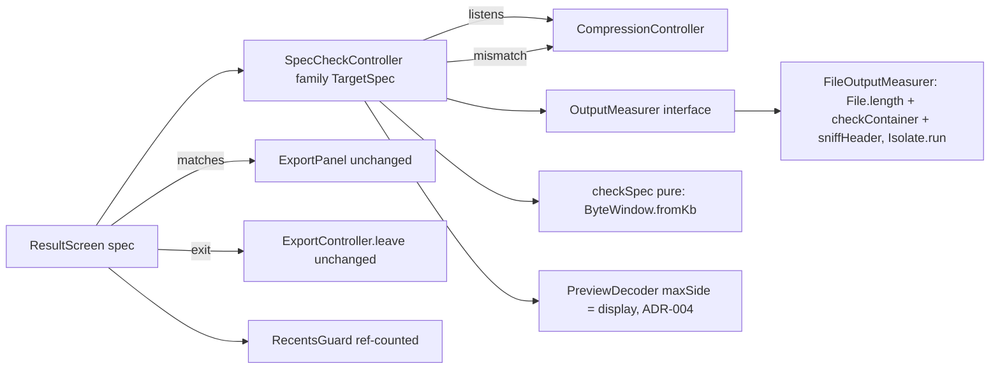

# FEAT-006 — Technical Plan

## 1. Summary
FEAT-006 adds no package, no native code and no ADR. It reuses three things that already exist:
- **Measuring:** the pure-Dart container check from FEAT-002 (`checkContainer` over a `FileByteSource`). It reads the signature, the stored width and height, and checks that the file is complete (JPEG must reach EOI, PNG chunk CRCs, IEND) [Fact](lib/features/crop/data/container_check.dart). `File.length` gives the byte count.
- **Preview:** FEAT-002's `PreviewDecoder`, which follows ADR-004 (`BitmapRegionDecoder` with `inSampleSize` in a worker isolate, returning a `ui.Image` that the caller disposes) [Fact](lib/features/crop/data/preview_decoder.dart). It gets one new optional `maxSide` argument so the decode is limited to the display size.
- **Verdict:** a pure function over the measured values, the full `TargetSpec` and FEAT-004's `ByteWindow.fromKb`.

A new `SpecCheckController` (Riverpod, autoDispose, keyed by `TargetSpec`) watches the compression run. When the run succeeds it measures, decides and decodes, then shows one of four states: checking, matches, doesn't match, unreadable. `ResultScreen` takes the full `TargetSpec` in place of `Target`. It replaces only its success branch and embeds `ExportPanel(success:, size: spec.dimensions)` unchanged.

## 2. Architecture impact
- **New module** `lib/features/preview/{domain,data,presentation}` (ADR-001 layout). The domain has no Flutter, Riverpod or `dart:io` imports.
- **Changed** `lib/features/export/presentation/result_screen.dart`: the constructor goes from `size` to `spec` (section 4.4); the success branch switches on the check state; the `PopScope` rules are in 4.4. The running and failure branches stay byte-for-byte the same (FR-20).
- **Changed** `lib/app_flow.dart` line 117: `ResultScreen(spec: widget.spec, onStartOver: …)`. `integration_test/result_screen_demo.dart` gets the same one-line change.
- **Changed (small, FEAT-002 code):** `PreviewDecoder.decode(src, info, {int maxSide = maxSide})` and `previewSampleSize(w, h, [maxSide])`. The default keeps FEAT-002's 2048, so its tests do not change.
- **Changed (small, FEAT-002 code):** `RecentsGuard` becomes reference-counted (a static depth counter: disable on 0→1, enable on 1→0). Reason: the crop screen's guard stays mounted under the result route [Fact](lib/app_flow.dart, `MaterialPageRoute` push). A second guard that does not count would turn protection **back on** for the crop screen when the result screen pops after FR-10 Back.
- **Changed:** `_checkerboard` in `crop_canvas.dart` becomes public (`paintCheckerboard`) so FR-15 reuses it.
- **Removed:** `ExportMessages.ready`, the `exportReady` key in all 6 ARBs and the two `ready` cases in `export_messages_test.dart`. They belong to FEAT-007's interim FR-29 line, which FR-20 replaces. The LTR-isolate trick for "W × H" moves into `CheckMessages`, together with its all-locales order test.
- **Untouched:** `ExportPanel`, `ExportController` (including `leave()`), `ExportInput`, `CompressionController`, `ByteWindow`, `achievedKb`, `OutcomeMessages.notice`, ADR-007's bridge.



## 3. Components
| Component | Layer | Responsibility | New / changed |
|---|---|---|---|
| `MeasuredOutput` | domain | `{int bytes, int width, int height, OutputFormat format, bool hasAlpha}`. `toString` is redacted because the values are image-derived | New |
| `MeasureResult` | domain | sealed: `Measured(MeasuredOutput)` or `Unreadable()` | New |
| `OutputMeasurer` | domain (interface) | `Future<MeasureResult> measure(String path, {required int expectedBytes})`. This is the NFR-6 seam | New |
| `checkSpec` | domain | Pure: `SpecCheck checkSpec(MeasuredOutput m, TargetSpec t)` gives `pixels`, `size`, `format` (bools), `window` (`ByteWindow.fromKb(minKb:, maxKb:)`), `sizeDirection` (null inside the window, `tooBig` above `hi`, `tooSmall` below `lo`) and `meets` | New |
| `FileOutputMeasurer` | data | `Isolate.run`: opens the file read-only. Gives `Unreadable` when the file is missing, empty, cannot be opened or has a length other than `expectedBytes`. Otherwise it runs `checkContainer(FileByteSource)`: `ContainerOk` JPEG or PNG gives `Measured` (alpha from `sniffHeader`), anything else gives `Unreadable` (OQ-T2). Catches everything; keeps no exception text. Registered `@LazySingleton(as: OutputMeasurer)` (ADR-001) | New |
| `SpecCheckLog` | data | Same shape as `ExportOutcomeLog`: `exactsize.preview outcome=SPEC_MEETS\|SPEC_MISMATCH fields=DIMENSIONS,SIZE,FORMAT\|SPEC_UNREADABLE\|PREVIEW_UNAVAILABLE`. Takes enums only (OQ-T6) | New |
| `PreviewDecoder` | data | Optional `maxSide` | Changed (1 parameter) |
| `SpecCheckController` | state | `NotifierProvider.autoDispose.family<…, SpecCheckState, TargetSpec>`. Sequence and states in 4.3. Owns the `ui.Image` and disposes it on every transition and on dispose. One `AppLifecycleListener(onResume:)` for FR-12 | New |
| `CheckMessages` | presentation | Row labels, target and measured texts, row sentence for TalkBack, alt text. Reuses `achievedKb`, `kbAmount`, `kbRange` and the FSI/LRI isolates exactly as `ExportMessages` does | New |
| `SpecCheckView` | UI | Preview (`RawImage` in a sized box, never an `ImageProvider`, so nothing enters `imageCache`), caption, headline (live region), three rows, notices, 1,024 line, caveat. **Designed with impeccable** (section 13) | New |
| `ResultScreen` | UI | `spec` parameter; success branch from `SpecCheckState`; wraps everything in `RecentsGuard` | Changed |
| `RecentsGuard` | UI | Reference-counted | Changed (about 4 lines) |
| `app_flow.dart` | app | Passes the full spec | Changed (1 line) |
| ARB files | l10n | About 16 new keys (section 4.5), `exportReady` removed | Changed |

## 4. API contracts
In-process only. No network endpoint, channel or JNI binding is added.

### 4.1 Measurement
```
abstract interface class OutputMeasurer {
  Future<MeasureResult> measure(String path, {required int expectedBytes});
}
```
- Values come only from the file, never from `success.format`, the target or the name (FR-2). `expectedBytes` (`success.sizeBytes`) feeds only the FR-11 consistency check.
- Pixel size is the stored size from the SOF or IHDR header. FEAT-004's encoders write no EXIF and no orientation [Fact](lib/features/compression/data/turbo_jpeg_encoder.dart line 39; dart_png_encoder.dart line 10), so the stored size is the shown size. This closes the PRD section 9 [Assumption]; a test asserts that FEAT-004 output has no APP1 segment and no eXIf chunk.
- Padding: FEAT-004 inserts COM segments after APP0 and writes nothing after EOI [Fact](lib/features/compression/domain/jpeg_padder.dart). `checkContainer` walks COM like any other segment.
- Cost: files are at most 10,240,000 bytes [Fact](target_validator.dart `maxKbLimit`). The JPEG entropy scan and the PNG CRC over ≤ 10 MB in Dart should take ≤ 100 ms off the UI thread [Hypothesis; spike T01].

### 4.2 Verdict (FR-4)
```
final class SpecCheck { bool pixels, size, format; ByteWindow window; Direction? sizeDirection; bool get meets; }
SpecCheck checkSpec(MeasuredOutput m, TargetSpec t);
```
- `pixels` = `m.width == t.width && m.height == t.height`; `size` = `window.contains(m.bytes)`; `format` = `m.format == t.format`.
- The shown KB value is `achievedKb(m.bytes, sizeDirection)`, reused and not copied (FR-6).
- FR-8 line visible = `!window.narrow`.

### 4.3 Controller sequence and states
`SpecCheckState` (sealed): `CheckIdle` (no success yet; the screen shows FEAT-007's running or failure branch), `Checking`, `CheckMeets(success, measured, check, ui.Image? preview)` (preview null means "Preview isn't available"), `CheckMismatch(measured, check)`, `CheckUnreadable(success)`.

1. `build()` reads `compressionControllerProvider` and `ref.listen`s to it. It goes to `Checking` on the first `CompressionDone(CompressionSuccess)`. Once it has left `CheckIdle` it ignores later run states, so the `Idle` that follows `cancel()` or `leave()` does not reset it.
2. It calls `measure`. On `Unreadable` it logs `SPEC_UNREADABLE` and goes to `CheckUnreadable`.
3. It calls `checkSpec`. If the file does not match, it logs `SPEC_MISMATCH fields=…`, calls `CompressionController.cancel()` (the single deleter of the temp file) and goes to `CheckMismatch`. No preview is decoded because the file is gone.
4. If the file matches, it decodes the preview with `PreviewDecoder.decode(SourceHandle(Uri.file(path).toString()), SourceInfo(rawWidth, rawHeight, mime, exifOrientation: 1, isAnimated: false, hasAlpha, decodePath: region), maxSide: min(physicalShortestSide, 2048))`. Region decode works for JPEG and PNG [Fact](ADR-004, spike results). `openReadOnly` takes `file://` and `content://` the same way [Fact](platform_decode.dart doc comment), but an app-cache `file://` URI on API 28 and 36 is not yet verified [Hypothesis; spike T01].
   - `PreviewOk` gives `CheckMeets(image)` and logs `SPEC_MEETS`.
   - `PreviewErr(outOfMemoryHandled)` gives `CheckMeets(null)` and logs `SPEC_MEETS` and `PREVIEW_UNAVAILABLE`.
   - Any other `PreviewErr` gives `CheckUnreadable` (AC-4.4).
5. Verdict and preview appear in one transition, so the result is announced once (FR-1, AC-8.2).
6. `onResume` while in `CheckMeets` measures once more (FR-12). `Unreadable` or a mismatch moves to step 2 or 3 and disposes the image. With `bytes == sizeBytes` enforced, a re-measure that still matches is equal by construction, so nothing is redrawn.
7. If the user leaves while measuring, `ref.mounted` is checked after every await. A late `ui.Image` is disposed, the same as in `_CropStep` [Fact](app_flow.dart).

### 4.4 Screen contract
`ResultScreen({required TargetSpec spec, required VoidCallback onStartOver})`; `size` becomes `spec.dimensions`.

| Check state | Body | `PopScope.canPop` | Exit |
|---|---|---|---|
| `CheckIdle` | FEAT-007 running or failure branch, unchanged | true | Existing: `cancel()` if the run is not Idle |
| `Checking` | Progress, no verdict text | false | `_leave` (FR-23 confirm, then `leave()`), OQ-T7 |
| `CheckMeets` | `SpecCheckView` → notices → caveat → `ExportPanel(success:, size: spec.dimensions)` → Done | false | `_leave` unchanged (FR-21) |
| `CheckMismatch` | Headline (section 8 text), rows, Back | true | Pop to the crop step, which keeps the photo and spec (AC-3.3); the file is already deleted |
| `CheckUnreadable` | `ExportMessages.message(ExportOutcome.fileMissing)` reused, and one button with an existing label | false | `ExportController.leave()` with **no** confirm, then `onStartOver` (OQ-T4) |

- Reading order and focus order (FR-7): preview, headline, rows, notices, caveat, panel, Done.
- Each row is `Semantics(label: rowSentence, excludeSemantics: true)`. Status is shown as icon plus word; colour is never the only signal.
- The headline sits in the one live region. The panel keeps its own live region [Fact](export_panel.dart).
- Numbers, `px`, `KB` and format names use the same LRI/FSI isolates as FEAT-007, and digits are Western 0-9 (FR-23, NFR-4).
- Preview box: width ≤ content width; height ≤ `0.4 × screen height` in portrait; enlargement ≤ 4 device pixels per image pixel, computed from the **measured** W×H. Aspect ratio is kept with `BoxFit.contain`, with a checkerboard under alpha (FR-15).
- Rotation, font and locale changes: `MainActivity` handles `orientation|locale|fontScale|…` itself [Fact](android/app/src/main/AndroidManifest.xml line 19), so the widget tree and the providers survive. State holds only numbers and enums, and text is built in `build()`. Compression does not re-run because `start()` ignores a repeated request [Fact](compression_providers.dart) (FR-22).

### 4.5 New strings (English drafts in PRD section 8)
`checkMatches`, `checkMismatch`, `checkLabelPixels`, `checkLabelFileSize`, `checkLabelFormat`, `checkTarget`, `checkThisFile`, `checkMeets`, `checkDoesntMeet`, `checkUpToKb(max)`, `checkPixels(width, height)`, `checkAlsoFits1024`, `checkCaveat`, `previewCaption`, `previewAlt(width, height, format)`, `previewUnavailable`, `checkRowSentence(label, target, measured, status)`.
Reused: `kbAmount`, `kbRange`, `exportFileMissing`, `notice*`, `exportDone`, the Material back label.

## 5. Data model
Memory only: `SpecCheckState` and one `ui.Image` that lives as long as the screen. Nothing is persisted and there is no migration. The temp file stays owned by FEAT-004/FEAT-007 (the PRD contract); FEAT-006 only reads it and, on FR-10, asks `CompressionController.cancel()` to delete it.

## 6. Integrations
None new. The plan uses Android `BitmapRegionDecoder` through the existing JNIgen bindings (ADR-004) and `setRecentsScreenshotEnabled` through the existing `AndroidRecentsBinding`. No data leaves the device. No ad, analytics or crash SDK receives anything from this feature (FEAT-025 is not integrated).

## 7. Security & privacy
- **PCI-DSS / Bangladesh Bank:** N/A, as PRD section 10 says. No card data, token or money is involved. A picked photo of a card is treated as an opaque image and never read or logged.
- **At rest:** no new file. The preview is never written to disk, cache, gallery or clipboard. `RawImage` with no `ImageProvider` keeps it out of `PaintingBinding.imageCache`. The image is disposed on leave, on discard, on FR-10 and FR-11, and on dispose (FR-19, AC-6.2).
- **FR-10:** the mismatching file is deleted at once, not on Back. The start-up sweep covers process death [Fact](temp_files.dart `sweep`).
- **Recents:** the reference-counted `RecentsGuard` covers the whole result route on API 33 and later. Screenshots are not blocked (FEAT-002 OQ-8). Android 9–12 get no protection (PRD flag 2).
- **Logs:** enum codes only. `MeasuredOutput` and `SpecCheck` have redacted `toString`. A grep test in the style of `export_privacy_test.dart` bans `print`, `debugPrint` outside the log class, `dart:io` `HttpClient`/`Socket`, `Image.file`, `FileImage` and `MemoryImage` in `lib/features/preview/`.
- **Untrusted bytes:** `checkContainer` is already bounded and fuzz-tested against the T02 damaged fixtures [Fact](ADR-004 Consequences). FEAT-006 adds no parser.
- **Secrets:** none. Examples use `[PLACEHOLDER]` names such as `exactsize-300x300-[TOKEN].jpg`.

## 8. Requirement coverage
| Req | Component | How it is met | Test |
|---|---|---|---|
| FR-1 | `SpecCheckController`, `ResultScreen` | `Checking` shows progress only | `result_screen_check_test`: no "Matches" before the fake measurer completes (AC-1.4) |
| FR-2 | `FileOutputMeasurer` | Length plus header and signature, off thread | `file_output_measurer_test`: JPEG and PNG fixtures checked against the `package:image` oracle (already a dependency, tests only); a swapped file (AC-1.2); a `.jpg` name holding PNG bytes gives PNG |
| FR-3 | `checkSpec(…, TargetSpec)`; `app_flow` passes the spec | Uses only width, height, minKb, maxKb, format | `app_flow_test`: the pushed `ResultScreen.spec` equals the spec entered |
| FR-4 | `checkSpec` + `ByteWindow.fromKb` | Exact pixels, the shared window, format equality | `spec_check_test`: floor and ceiling ±1, width and height ±1, format swap, narrow 49–50 KB at 49,500 B, max-only (AC-2.2, AC-2.3); compared to `ByteWindow.contains` on a generated set (NFR-5) |
| FR-5 | `SpecCheckView`, `CheckMessages` | Three fixed rows; "Up to N KB" | Widget test for row order and texts (AC-1.1, AC-1.3) |
| FR-6 | `achievedKb` reused | Rounds away from the target | `check_messages_test`: ceiling +20 B reads above max (AC-3.2) |
| FR-7 | `SpecCheckView` | Headline text; focus order | Semantics traversal order test; a string test that no key contains "accept" or "guarantee" |
| FR-8 | `SpecCheckView` | `!window.narrow` | Shown for non-narrow, hidden for narrow (AC-2.4) |
| FR-9 | `SpecCheckView` | Caveat line | Present in the matches state (AC-2.5) |
| FR-10 | Controller step 3, `ResultScreen` | No panel, file deleted, Back to crop, logged | Fake measurer returns an off-by-one file: `ExportPanel` absent, file gone, pop lands on the crop step, log line has `fields=` (AC-3.1, AC-3.3, AC-3.5) |
| FR-11 | Measurer, controller step 4 | FILE_MISSING message, `leave()` with no confirm | Missing, empty, truncated and length-mismatch fixtures, plus a non-OOM `PreviewErr` (AC-3.4) |
| FR-12 | `AppLifecycleListener` | One re-measure per resume | Controller test: simulated resume after deleting the file gives Unreadable |
| FR-13 | Controller step 4 | Decoded from the output file, `BoxFit.contain`, no filter | Integration (API 36): a replaced colour fixture shows that colour (AC-4.2); widget test: box aspect equals the measured aspect (AC-4.1) |
| FR-14 | `maxSide`, box sizing | Display-bound decode; OOM placeholder | Unit: `previewSampleSize` with `maxSide`; integration: 24 MP output with no crash (AC-4.3); `debugForceOutOfMemory` gives the placeholder while rows and panel stay (AC-4.4) |
| FR-15 | `paintCheckerboard` | Under alpha PNG | Golden of a transparent PNG |
| FR-16 | `previewAlt` | W, H and format only | Semantics label equals the alt string (AC-4.6) |
| FR-17 | `SpecCheckView` | No gesture detector on the preview | A drag on the preview scrolls the page (AC-4.7) |
| FR-18 | `OutcomeMessages.notice` reused | One `BoothNotice` per notice, before the panel | All three notices, and none (AC-5.1, AC-5.2) |
| FR-19 | `RecentsGuard`, `RawImage`, `SpecCheckLog` | Recents, no cache, enum logs, no network | `recents_guard_test` (nested case); `imageCache.currentSize == 0` and the image disposed after leave (AC-6.2); `preview_privacy_test` grep; log sink captures only codes (AC-6.3) |
| FR-20 | `ResultScreen` | Only the success branch changes | FEAT-007 running and failure tests, unchanged (AC-7.3) |
| FR-21 | `ResultScreen._leave`, `ExportPanel` | Unchanged panel and leave | FEAT-007 leave, confirm and slow-save tests with the edit set in OQ-T1 (AC-7.1, AC-7.2) |
| FR-22 | Provider lifetime, manifest `configChanges` | State in the controller | Widget test changes size, locale and text scale: same state, `start` not called again (AC-7.4) |
| FR-23 | ARB, `CheckMessages` | ICU placeholders, isolates | All-locales test: `{width}` comes before `{height}`, no English fallback, Western digits; `/l10n-translate` log |
| NFR-1 | Isolates, `maxSide` | Off the UI thread, bounded decode | Spike T01 timing and RSS on the API 36 emulator (2 GB) and the API 28 CI emulator |
| NFR-2 | `SpecCheckView` | Live region, row sentences, 48 dp, 200% reflow | `result_screen_check_a11y_test`: `androidTapTargetGuideline`, `textContrastGuideline`, 200% at 360×640 in en, ar, hi with no overflow (AC-8.1, AC-8.2) |
| NFR-3 | — | No network API | Privacy grep; airplane-mode step in the device checklist (AC-6.4) |
| NFR-4 | ARB | 6 languages, RTL | Arabic golden plus a `Directionality` assertion (AC-8.3) |
| NFR-5 | `checkSpec` | Generated boundary set | `spec_check_test`, 100% agreement |
| NFR-6 | `OutputMeasurer` | Interface plus a fake in tests | Every FR-10 and FR-11 widget test uses the fake |
| NFR-7 | — | API 28 and latest | `integration_test/preview_check_test.dart` on API 28 (CI) and API 36 (local) |
| NFR-8 | Section 7 | Identity data rules | Same as FR-19 |

## 9. Risks
| Risk | Likelihood | Impact | Mitigation |
|---|---|---|---|
| "FEAT-007 suite passes unchanged" (AC-7.1) cannot be met word for word. Its fixture is 48,200 bytes of `0x01`, which is not an image, so a real check says unreadable. `ResultScreen(size:)` changes. The "Ready:" test and its 7 goldens assert the interim state that FR-20 removes | Certain | Medium (gate wording) | OQ-T1: a fixed edit set and no change to any behaviour assertion |
| `checkContainer` rejects a file FEAT-004 legitimately writes (for example many COM segments, PNG chunk order), so valid output is blocked | Low | High | Run the measurer over every FEAT-004 golden and runner case and over padded JPEGs at 4 B and 65,537 B segments; 0 rejections is the T03 exit |
| An app-cache `file://` URI fails in `ContentResolver.openFileDescriptor` on some API level | Low | Medium | Spike T01 on API 28 and 36. Fallback: `ParcelFileDescriptor.open` through a JNIgen binding (a small regeneration, still ADR-004) |
| Peak memory above 24 MB during a 24 MP decode (decoder working set of about 0.7 B per source pixel for baseline JPEG [Fact](ADR-004 v1.1), plus about 3 pixel copies) | Medium | Low (OOM gives the placeholder; the check stays) | `maxSide` = screen short side (about 4.7 MB steady at 1080 px); spike measures RSS; NFR-1 redefined in section 10 |
| Nested `RecentsGuard` re-enables thumbnails for the crop screen after FR-10 Back | Certain without the change | Medium (privacy) | Reference count plus a nested test |
| Two isolate spawns (measure, then decode) push the median above 500 ms on the API 28 emulator | Low | Low | Spike T01. If needed, run the measurer inside the decode isolate (no API change) |
| `achievedKb` counts 1024 B per KB when the file is too small, while FR-6 says "1 KB = 1000 bytes" | Certain (text) | Low | OQ-T3: clarify the PRD; the code stays reused |
| AI-only translation of the 17 strings | Medium | Low | `/l10n-translate` with back-translation; short, plain messages |

## 10. Decisions
- **ADRs relied on:** ADR-001 (Flutter, Riverpod, get_it + injectable, gen-l10n), ADR-004 (decode path and structure check, reused for the output file), ADR-007 (export bridge behind the unchanged panel).
- **No new ADR.** Every choice here can be undone within the feature: a parser that already exists, one optional parameter, a counter in a widget. Nothing touches framework, storage, auth, payments or a dependency. ADR-008 stays unused.
- **[Assumption] numbers resolved:**
  - Preview area 40% of height and enlargement cap 4×: kept as named constants; the impeccable pass may tune them within FR-14.
  - Time (≤ 500 ms median, ≤ 1.5 s p95, up to 2 MP): kept, and measured in spike T01 [Hypothesis: about 50 ms measure + 100–300 ms decode].
  - Memory 24 MB: proposed reading is "steady extra memory for the preview ≤ 24 MB". Steady is about 4.7 MB at 1080 px. The transient peak at 24 MP is measured in T01 and reported, not gated.
- **Effort re-estimate:** about 6 days ≈ **1.2 pw** (range 1.1–1.3), against 0.8 pw on the roadmap (+0.4 pw).

  | Work | Days |
  |---|---|
  | Spike T01 | 0.5 |
  | Domain and boundary tests | 0.5 |
  | Measurer and fixtures | 0.5 |
  | Controller (states, resume, delete, dispose) | 1.0 |
  | `RecentsGuard`, `maxSide`, checkerboard | 0.25 |
  | Screen with the impeccable pass, a11y and goldens | 1.5 |
  | FEAT-007 test migration | 0.5 |
  | Strings and 5 translations | 0.75 |
  | Emulator integration | 0.5 |

  Cutting all four OQ-10 Shoulds (FR-8, FR-9, FR-12, FR-15) saves only about 0.1 pw, so cutting them is not recommended.

## 11. Deliberately left out
- A preview-only decoder: the Flutter engine codec (`Image.file` with `cacheWidth`). It would be simpler, but it uses `imageCache` and decodes PNG at full size first [Hypothesis]. This is the main alternative to the chosen decode path.
- A second byte-window or KB-rounding implementation.
- Detecting a swapped file whose numbers match after resume.
- Preview in the mismatch state, zoom, the hide toggle, the JPEG switch, the enlargement reminder (PRD defaults).
- A production counter or telemetry.
- Moving `previewDecoderProvider` out of `app_flow.dart`. A separate seam `resultPreviewDecoderProvider` is used instead, so FEAT-002's tests keep their imports.

## 12. Open questions
- [ ] **OQ-T1 FEAT-007 regression gate.** Proposed: AC-7.1 means every FEAT-007 behaviour assertion passes unchanged. Allowed edits:
  - the constructor argument (`spec:`);
  - a fake measurer and preview override (or a valid synthetic 300×300 JPEG fixture);
  - retiring the "Ready:" test and the two `ExportMessages.ready` tests;
  - re-recording the 7 result goldens.

  Panel, controller, data, domain and privacy tests stay untouched.
- [ ] **OQ-T2 Non-JPEG/PNG signature** (WebP, GIF, HEIF, unknown). Proposed: FR-11 unreadable, because FEAT-004 cannot produce them. Alternative: FR-10 with a fixed format name, which needs one more string.
- [ ] **OQ-T3 FR-6 wording.** `achievedKb` divides by 1024 when the file is too small; that is needed so the value never reads as in range. Proposed: a minor PRD clarification.
- [ ] **OQ-T4 Unreadable exit** skips FEAT-007's "Leave without saving?" because there is nothing left to save. Confirm.
- [ ] **OQ-T5** Remove `exportReady` from all 6 ARBs (proposed), or keep it unused.
- [ ] **OQ-T6** PRD FR-19 names `outcome_log.dart` as the log wrapper. The plan adds a same-shape `SpecCheckLog`, as pick, crop and export each have their own. Confirm.
- [ ] **OQ-T7** Exiting during `Checking` uses the FR-23 confirm (proposed), the same as the matches state.

## 13. UI design note
The matches, mismatch, unreadable and preview-unavailable states are a real screen. Before any design or build, the Product Owner is told. The screen is designed with impeccable in lean mode: one short pass on Material 3 and the existing Booth theme, no image comps, no reviewer subagents, and one emulator screenshot per key state (CLAUDE.md, Implementation and Budget). Non-visual tasks (domain, measurer, controller, `RecentsGuard`, `maxSide`, strings) may go first.

## Change log
| Version | Date | Change |
|---|---|---|
| 0.1 | 2026-11-25 | First draft |
| 1.0 | 2026-11-25 | Approved by Product Owner; OQ-T1 to OQ-T7 at their proposed defaults; no new ADR |
