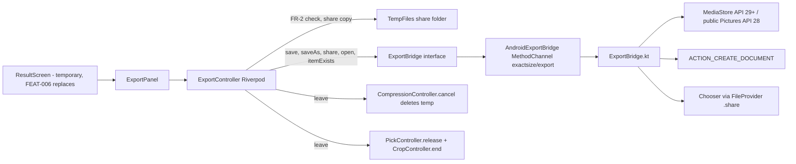

# FEAT-007 — Technical Plan

## 1. Summary
A second small Kotlin class, `ExportBridge.kt`, on its own `MethodChannel('exactsize/export')`, is set up by `MainActivity` in the same way as the ADR-006 picker bridge (ADR-007). It does the four jobs Dart cannot do alone: write to shared storage (MediaStore with `IS_PENDING` on API 29+; a hidden `.part` file, a no-overwrite rename and a media scan on API 28), the API 28 runtime permission, the system save-as dialog, and the share chooser and Open intents. Dart owns the logic: the FR-4 name, the FR-2 check, retries on a taken name, idempotent Save, the share copy and flow end. That logic lives in a pure-Dart domain and a Riverpod `ExportController`, behind one `ExportBridge` interface so it can be tested with fakes (NFR-9). For Share, Dart copies the temp file to `<cache>/exactsize_share/<FR-4 name>`, which is exposed by a new non-exported FileProvider scoped to that folder only. FEAT-004's temp file is never renamed, so its delete-by-path and start-up sweep stay as they are. A temporary result screen replaces `_AfterCropStandIn` and embeds a self-contained `ExportPanel`; FEAT-006 later replaces the screen and keeps the panel. No Dart dependency is added and no network is used. The only new permission is `WRITE_EXTERNAL_STORAGE` with `maxSdkVersion="28"`.

## 2. Architecture impact
- **New module** `lib/features/export/{domain,data,presentation}` (ADR-001 layout). The domain has no Flutter, Riverpod or channel imports.
- **New Kotlin** `android/app/src/main/kotlin/com/exactsize/exact_size/ExportBridge.kt`. **Changed** `MainActivity.kt`: about 15 lines to create the bridge in `configureFlutterEngine`, pass it `onActivityResult(REQUEST_SAVE_AS)` and `onRequestPermissionsResult`, and remove it in `cleanUpFlutterEngine`. The picker code is unchanged.
- **Manifest:** `<uses-permission android:name="android.permission.WRITE_EXTERNAL_STORAGE" android:maxSdkVersion="28"/>`; a second `FileProvider` with authority `${applicationId}.share` (`exported="false"`, `grantUriPermissions="true"`, `@xml/share_paths`). New `res/xml/share_paths.xml` holds only `<cache-path name="share" path="exactsize_share/"/>`. No `<queries>` entry is needed: `startActivity` of a chooser, `ACTION_VIEW` or `ACTION_CREATE_DOCUMENT` does not depend on package visibility [Hypothesis: Android package-visibility docs; spike T01].
- **`checkMergedManifest`** is extended (section 7). The camera provider checks stay unchanged.
- **`main.dart`:** one more unawaited sweep for the share folder, and one unawaited `sweepIncomplete()` call on the export bridge (FR-16).
- **`app_flow.dart`:** `_AfterCropStandIn` is deleted and `onContinue` pushes `ResultScreen(spec: widget.spec)` (section 4.5).
- **DI:** a third `TempFiles` instance, `@Named('share')` on folder `exactsize_share`, next to `@Named('camera')` [Fact](lib/features/pick/data/pick_module.dart). `ExportBridge` is a `@lazySingleton`.
- **Reused unchanged:** `CompressionSuccess`, `CompressionController.cancel()` (the single deleter of the temp file), `TempFiles`, `PickController.release()`, `CropController.end()`, the FSI isolate pattern `_iso` from `outcome_messages.dart`, the import-ban test and the Kotlin grep tests.
- **New screens:** the export panel and the temporary result screen. Both are real UI, so the Product Owner is told before design and they go through one lean impeccable pass on Material 3 (CLAUDE.md, Implementation and Budget). This plan defines only their states and wiring.



## 3. Components
| Component | Layer | Responsibility | New / changed |
|---|---|---|---|
| `ExportName` | domain | `generate(w, h, format, Random)` gives the FR-4 name; `pattern` is the section 8 regex; `ext` and `mime` per format. Pure | New |
| `ExportOutcome` | domain | Enum of the PRD section 5 codes (`SAVED`, `ALREADY_SAVED`, `SHARE_OPENED`, `SAVE_CANCELLED`, `NO_SPACE`, `SAVE_FAILED`, `PERMISSION_DENIED`, `FILE_MISSING`, `SHARE_FAILED`) plus `OPEN_NO_VIEWER` for the FR-15 message (not in the PRD list, see OQ-T4) | New |
| `SavedItem` | domain | `{String ref, String displayName, bool viaSaveAs}`. In memory only. `toString` is redacted | New |
| `ExportBridge` | data (interface) | The one seam (NFR-9): `save`, `saveAs`, `itemExists`, `open`, `share`, `sweepIncomplete` | New |
| `AndroidExportBridge` | data | Wraps the channel. Maps to typed results; unknown or malformed payloads become `failed`. A `PlatformException` code maps to `failed`; the message is dropped. Never logs payloads | New |
| `ShareCopies` | data | Uses the `@Named('share')` `TempFiles`: `copy(src, name)` writes `<cache>/exactsize_share/<name>` (`File.copy`, then a length check) and returns the path; `delete`; `sweep` at start | New |
| `ExportOutcomeLog` | data | Enum-only, same shape as `PickOutcomeLog`: `exactsize.export outcome=<CODE>` | New |
| `ExportController` | state | `Notifier<ExportState>`, autoDispose, one per result. Runs Save, Save as, Share, Open and Leave; busy guard; 500 ms progress timer; idempotent Save; `leave()` waits for an in-flight write (FR-24) | New |
| `ExportPanel` | UI | Save, Share, "Choose where to save" (Should), Open (Should), live-region message, privacy line (FR-26), chat hint (FR-21). Takes one `CompressionSuccess` and the output `Target`. **Designed with impeccable** | New |
| `ResultScreen` | UI (temporary) | Running: progress and Cancel. Failure: the existing FEAT-004 message and a way back. Success: "Ready: W × H px, SIZE KB, FORMAT" and `ExportPanel`. Back and leave handling. **Designed with impeccable**; FEAT-006 replaces it | New |
| `ExportBridge.kt` | native (Kotlin) | Save paths per API level, permission, save-as, share, open, item check, sweep. One single-thread executor for all I/O. Every entry point catches `Throwable` and returns enum codes only. No `android.util.Log` | New |
| `MainActivity.kt` | native | Creates, forwards to and removes the export bridge | Changed (small) |
| `checkMergedManifest` | build | New rules in section 7 | Changed |
| `main.dart` | app | Share-folder sweep and `sweepIncomplete()` at start | Changed |

## 4. API contracts
In-process only. There are no network endpoints.

### 4.1 Channel `exactsize/export` (Dart to Kotlin)
Arguments and results are strings, ints, bools and enum names only. Errors are `PlatformException(code: 'internalError', message: null)`; Kotlin never sends exception text. Examples use `[PLACEHOLDER]` values.
```
save({src: '<cache>/exactsize_out/[RANDOM].jpg', name: 'exactsize-300x300-[TOKEN].jpg',
      mime: 'image/jpeg', bytes: <int>})
  -> {outcome: 'saved',            name: '<name read back>', ref: 'content://media/[PLACEHOLDER]'}
   | {outcome: 'nameTaken'}         // API 28 only; Dart draws a new TOKEN (FR-13, max 5 tries)
   | {outcome: 'permissionDenied'}  // API 28: denied now or "don't ask again" (FR-9)
   | {outcome: 'noSpace' | 'failed' | 'fileMissing'}
  // API 28 permission: checked and, if missing, requested inside this call, once per call.

saveAs({src, name, mime, bytes})
  -> {outcome: 'saved', name: '<DISPLAY_NAME of the picked document>', ref: '<document uri>'}
   | {outcome: 'cancelled' | 'noSpace' | 'failed' | 'fileMissing'}

itemExists({ref})            -> bool          // FR-12; false on any error
open({ref, mime})            -> 'opened' | 'noViewer'
share({path, mime})          -> 'opened' | 'failed'   // path must be under <cache>/exactsize_share/
sweepIncomplete()            -> null          // FR-16; never asks for permission
```

### 4.2 Dart
```dart
enum ExportOutcome { saved, alreadySaved, shareOpened, saveCancelled, noSpace, saveFailed,
                     permissionDenied, fileMissing, shareFailed, openNoViewer }
// code getter gives the PRD spelling (SAVED, ...), as Reason.code does in FEAT-004.

sealed class BridgeSave { }                       // toString redacted
  final class BridgeSaved     extends BridgeSave { String name; String ref; }
  final class BridgeNameTaken extends BridgeSave { }
  final class BridgeSaveError extends BridgeSave { ExportOutcome outcome; } // noSpace|saveFailed|permissionDenied|fileMissing|saveCancelled

abstract interface class ExportBridge {
  Future<BridgeSave> save({required String src, required String name, required String mime, required int bytes});
  Future<BridgeSave> saveAs({required String src, required String name, required String mime, required int bytes});
  Future<bool> itemExists(String ref);
  Future<bool> open(String ref, String mime);   // false = no viewer
  Future<bool> share(String path, String mime); // false = chooser not launched
  Future<void> sweepIncomplete();
}

abstract final class ExportName {
  static final pattern = RegExp(r'^exactsize-[0-9]{1,6}x[0-9]{1,6}-[a-z0-9]{6}\.(jpg|png)$');
  static String generate(int w, int h, OutputFormat f, Random secure); // asserts the pattern and length <= 40
}

final class ExportState {
  bool busy;               // a save or save-as is writing; more taps are ignored (FR-12, AC-5.1)
  bool showProgress;       // busy for > 500 ms (FR-24, NFR-1)
  SavedItem? saved;        // last verified save of this result
  bool sharedOnce;         // only for the FR-23 leave check; never displayed (FR-19)
  ExportOutcome? message;  // last message; cleared on the next action
}

// Riverpod 3.5 (pubspec): family argument passed to the constructor.
final exportControllerProvider =
    NotifierProvider.autoDispose.family<ExportController, ExportState, ExportInput>(ExportController.new);

class ExportController extends Notifier<ExportState> {
  ExportController(this.input);   // ExportInput = (CompressionSuccess success, Target size)
  final ExportInput input;
  Future<void> save();
  Future<void> saveAs();          // Should (FR-10)
  Future<void> share();
  Future<void> open();            // Should (FR-15)
  bool get needsLeaveConfirm;     // FR-23: saved == null && !sharedOnce
  Future<void> leave();           // FR-22/FR-24; the caller then navigates
}
```

### 4.3 Data flow
**Save (any API level)**
1. `busy` → return (AC-5.1). If `saved != null` → `itemExists(saved.ref)`: true → `ALREADY_SAVED`, done (AC-5.2); false → go on (AC-5.3).
2. FR-2: `File(success.tempFilePath)` exists and `length() == sizeBytes`, else `FILE_MISSING`.
3. `busy = true`, start the 500 ms timer. Up to 5 times: `name = ExportName.generate(...)`; `bridge.save(...)`; `BridgeNameTaken` → next try. Five taken names → `SAVE_FAILED` (FR-13).
4. `BridgeSaved` → `saved = SavedItem(ref, name read back)`, message `SAVED` (FR-11). Errors → their code (FR-9, FR-14). The temp file is always kept.
5. `busy = false`; log the code.

**Kotlin `save` on API 29+ (FR-6)** [Hypothesis H1; spike T01]
1. Check `File(src).length() == bytes`, else `fileMissing`.
2. `insert(MediaStore.Images.Media.getContentUri(VOLUME_EXTERNAL_PRIMARY), {DISPLAY_NAME=name, MIME_TYPE=mime, RELATIVE_PATH="Pictures/ExactSize", IS_PENDING=1})`. A null result → `failed`.
3. `openOutputStream(uri, "w")`; copy in 64 KiB chunks from `FileInputStream(src)` (NFR-1: no decode, no full buffer); flush; `fd.sync()`.
4. Verify with `openFileDescriptor(uri, "r").statSize == bytes`. On mismatch → `delete(uri)` → `failed` (FR-3).
5. `update(uri, {IS_PENDING=0})`; query `DISPLAY_NAME` → return `saved` with the name the system stored (a conflict rename is shown, FR-11).
6. Any `IOException` or `SecurityException` → `delete(uri)` (best effort), then `noSpace` if `StatFs(Environment.getExternalStorageDirectory()).availableBytes < bytes + 1 MiB`, else `failed` (FR-14). Exception text is never read into a message.
- No pre-query for name collisions on 29+: MediaStore renames on conflict instead of overwriting [Hypothesis; spike], so FR-13's "never overwrite" holds and `nameTaken` is not returned. Collision odds are 1 in 36^6 for each name.

**Kotlin `save` on API 28 (FR-7)** [Hypothesis H2; spike T01]
1. `checkSelfPermission(WRITE_EXTERNAL_STORAGE)`. If missing: `requestPermissions(..., REQUEST_WRITE)` and keep the pending `MethodChannel.Result` in the bridge instance; continue in `onRequestPermissionsResult`. Denied → `permissionDenied`. One request per call; no "asked before" flag is stored. After "don't ask again" the platform returns DENIED at once without a dialog, so the same message appears immediately and nothing loops (AC-2.4) [Hypothesis; spike]. `shouldShowRequestPermissionRationale` is not used: the PRD has no rationale screen.
2. `dir = Environment.getExternalStoragePublicDirectory(DIRECTORY_PICTURES)/ExactSize`; `mkdirs()`. `final = dir/name`; `part = dir/.<name>.part` (a leading dot and a non-media extension, so neither the scanner nor most file managers show it). If `final` or `part` exists → `nameTaken`.
3. Copy to `part` in chunks; `fd.sync()`; check `part.length() == bytes`, else delete `part` → `failed`.
4. `Files.move(part, final)` without `REPLACE_EXISTING`, so an existing file is never overwritten (FR-13). `FileAlreadyExistsException` → delete `part` → `nameTaken`.
5. `MediaScannerConnection.scanFile(final, mime)`; wait up to 2 s for the callback. `ref` = the scanned `content://` URI, or the absolute path if the scan timed out. The path stays in memory, is never logged, and is used only by `itemExists`.
6. Errors are handled as in API 29+ step 6, with `part` deleted.

**Kotlin `saveAs` (FR-10, Should)** [Hypothesis H3]
`ACTION_CREATE_DOCUMENT`, `CATEGORY_OPENABLE`, type = mime, `EXTRA_TITLE = name`; `startActivityForResult(REQUEST_SAVE_AS)`. On `RESULT_OK` the copy goes to `openOutputStream(docUri, "w")` on the executor, and is checked through `openFileDescriptor(docUri, "r").statSize`. On failure → `DocumentsContract.deleteDocument(docUri)` (best effort) → `noSpace`/`failed`. Cancel → `cancelled` (no message). If the result arrives with no pending call (the activity was recreated and Dart restarted, FR-25), the empty document the picker created is deleted and nothing is reported (risk R8). No ADR-006 slot is used: there is nothing to recover after process death.

**Share (FR-17, FR-18)**
1. FR-2 check. If there is no share copy yet: `ShareCopies.copy(temp, ExportName.generate(...))` gives `<cache>/exactsize_share/exactsize-WxH-TOKEN.ext` with a length check (FR-3); a failure → `SHARE_FAILED`. Later Shares reuse the same copy (AC-5.4).
2. Kotlin: `FileProvider.getUriForFile(activity, "$packageName.share", file)`; a path outside the folder throws, which is the guard. `Intent(ACTION_SEND).setType(mime).putExtra(EXTRA_STREAM, uri)`, `clipData = ClipData.newRawUri("", uri)`, `FLAG_GRANT_READ_URI_PERMISSION` only. `Intent.createChooser(send, null)` with `EXTRA_EXCLUDE_COMPONENTS = [ShareTargetActivity, MainActivity]`. `startActivity(chooser)` (not for result: H4) → `opened`; any throw → `failed` (FR-20).
3. Dart sets `sharedOnce = true`, logs `SHARE_OPENED` and shows nothing (FR-19).
- The display name the receiver reads is the FileProvider's `OpenableColumns.DISPLAY_NAME`, which is the file's own name, so it is the FR-4 name (FR-5) [Hypothesis H5; spike T01 queries it through the URI].

**Open (FR-15, Should):** `ACTION_VIEW`, data = `ref` with the mime type, `FLAG_GRANT_READ_URI_PERMISSION`. `ActivityNotFoundException` → `noViewer`. If `ref` is a path (scan timed out on API 28), the bridge re-scans once to get a URI and returns `noViewer` if it still has none.

**Leave (FR-22, FR-24)**
1. `leave()` awaits the in-flight save future if `busy` (the write finishes or fails, FR-14).
2. `ShareCopies.delete(copyPath)` if there is one.
3. `CompressionController.cancel()` deletes the temp file and sets the state to idle [Fact](compression_providers.dart, `_discardResult`).
4. The screen then calls the existing `_chooseAnother` body: `release()`, `end()`, `popUntil(isFirst)`.

### 4.4 Start-up sweep (FR-16)
- **Dart, `main.dart`:** `unawaited(getIt<TempFiles>(instanceName: 'share').sweep())`, the same as the existing two sweeps [Fact](lib/main.dart).
- **Kotlin `sweepIncomplete`**, on the same single-thread executor as `save`, so a Save tapped right after launch waits for the sweep:
  - API 30+: query `Images.Media` with `QUERY_ARG_MATCH_PENDING = MATCH_ONLY` and selection `RELATIVE_PATH = 'Pictures/ExactSize/' AND OWNER_PACKAGE_NAME = <ours> AND DISPLAY_NAME LIKE 'exactsize-%'`; delete each row. API 29: the same with `MediaStore.setIncludePending(uri)` and `IS_PENDING = 1` in the selection. Scoped storage only returns our own items, and the selection limits the sweep further [Hypothesis; spike]. The system also removes pending items after about 7 days [Hypothesis].
  - API 28: only if `checkSelfPermission(WRITE)` is already granted; never requests it. List only `Pictures/ExactSize` and delete only names matching `^\.exactsize-.+\.(jpg|png)\.part$`. Completed files are never touched.
- Nothing is logged except `sweep=done` / `sweep=skipped`, with no counts. Counts are not personal data, but the PRD's log list does not include them.

### 4.5 Temporary result screen and `app_flow.dart` (FR-29, OQ-3 = build FEAT-007 first)
- `_CropStep.onContinue` keeps `compressionControllerProvider.notifier.start(...)` and pushes `ResultScreen(spec: widget.spec)` instead of `_AfterCropStandIn`. The stand-in class and its `shortcut:` comment are deleted.
- `ResultScreen` watches `compressionControllerProvider`:
  - `CompressionRunning`: progress and Cancel. Back or Cancel → `cancel()` and pop to crop, as the stand-in does today.
  - `CompressionDone(CompressionFailure)`: the existing `OutcomeMessages.failure(...)` text and a "Back" button that pops to crop. A failure has no file.
  - `CompressionDone(CompressionSuccess s)`: "Ready: [W] × [H] px, [SIZE] KB, [FORMAT]" from `spec.dimensions` and `s.sizeBytes` / `s.format`, not recomputed (FEAT-004 FR-19). Below it `ExportPanel(success: s, size: spec.dimensions)` and a "Done" button. There is no image and no "meets spec" claim.
  - `PopScope(canPop: false)` on success: back → if `needsLeaveConfirm`, the FR-23 dialog (Stay / Leave), else leave → `ExportController.leave()` → `_chooseAnother`.
- **What FEAT-006 replaces later:** `ResultScreen` as a whole (preview, meets-spec line, its own layout). It must embed `ExportPanel(success:, size:)` and call `ExportController.leave()` from its own exit, without changing the panel. `ExportController`, `ExportBridge`, `ShareCopies` and the Kotlin side stay as they are. This is noted in tasks.md and in FEAT-006's PRD dependency line.

## 5. Data model
- **Dart memory:** `ExportState` and the share copy path for the current result. They are disposed with the screen (autoDispose). Nothing is persisted: no preferences, no database and no saved-state keys (FR-25).
- **Kotlin memory:** the pending `MethodChannel.Result` for an in-flight permission request or save-as, held by the bridge instance (lost with the activity and engine, which matches FR-25). Unlike ADR-006, there is no static slot and no Bundle key.
- **Files:**
  - `<cache>/exactsize_out/<random>.jpg|png`: FEAT-004's file, unchanged and never renamed.
  - `<cache>/exactsize_share/exactsize-WxH-TOKEN.ext`: at most one, created on the first Share, deleted at leave and swept at start.
  - API 29+: `Pictures/ExactSize/exactsize-WxH-TOKEN.ext` through MediaStore (pending while written).
  - API 28: `Pictures/ExactSize/.exactsize-WxH-TOKEN.ext.part` while written, then `exactsize-WxH-TOKEN.ext`.
- No migrations.

## 6. Integrations
| Integration | Purpose | Data leaving the device |
|---|---|---|
| MediaStore (`ContentResolver`, `IS_PENDING`, `RELATIVE_PATH`) | Save on API 29+ | None; the copy stays on the device |
| `Environment.getExternalStoragePublicDirectory`, `java.nio.file.Files.move`, `MediaScannerConnection` | Save on API 28 | None |
| `ACTION_CREATE_DOCUMENT` | Save as (Should) | Only if the user picks a cloud provider location: that provider uploads it, as the user chose |
| `Intent.createChooser` + `ACTION_SEND` + `androidx.core.content.FileProvider` (already pinned 1.16.0, ADR-006) | Share | Whatever the chosen app does (user's choice, FR-26) |
| `ACTION_VIEW` | Open (Should) | None by ExactSize |

No Dart package and no Gradle artefact is added. No ad, analytics or crash SDK receives a file, name, path or URI (FR-28).

## 7. Security & privacy
- **PCI-DSS / Bangladesh Bank:** not in scope. There are no payments, cards, tokens or merchant credentials; files are opaque bytes [Fact](FEAT-007 prd section 10). No secrets exist in this feature; any future key would be `[PLACEHOLDER]`, kept server-side or in secure storage and never in the app bundle (SSLWIRELESS policy). Docs and tests use synthetic images and `[PLACEHOLDER]` names only, such as `exactsize-300x300-[TOKEN].jpg` and `content://media/[PLACEHOLDER]`.
- **Least privilege (FR-8):** API 29+ uses no permission. API 28 uses `WRITE_EXTERNAL_STORAGE` with `maxSdkVersion="28"`, requested only inside a Save tap, and never at start or for Share or Save as.
- **API 28 implicit READ (privacy flag 1):** on API 28 the storage group grant also lets the app read all shared storage [Hypothesis H2; spike T01 checks `checkSelfPermission(READ_EXTERNAL_STORAGE)` after granting WRITE]. This cannot be prevented technically, so it is limited in code: the export Kotlin only touches `Pictures/ExactSize` and its own MediaStore rows. Static tests (section 8, testing) grep `ExportBridge.kt` and fail on `listFiles` outside that folder, a `MediaStore` query without the `RELATIVE_PATH`/`OWNER_PACKAGE_NAME` selection, or `READ_EXTERNAL_STORAGE`. FEAT-001's `SourceProbe` keeps using only URI grants. The store permission disclosure must say this (NFR-8, PRD OQ-10).
- **FileProvider (FR-18):** a new authority `${applicationId}.share`, `exported="false"`, `grantUriPermissions="true"`, scoped to `exactsize_share/` only. It is separate from `.camera`, so FEAT-001 AC-6.4 is untouched and needs no FEAT-001 change. `exactsize_out/` is not reachable through either provider (integration test: `getUriForFile` throws). Each Share grants read only, for one URI, per intent.
- **Own app excluded (FR-17):** `EXTRA_EXCLUDE_COMPONENTS` lists `ShareTargetActivity` and `MainActivity`. If an OEM share sheet ignores it (R4), FEAT-001's `isOwnProvider` already flags any authority owned by our package, including `.share`, so the share target refuses it [Fact](MainActivity.kt, `isOwnProvider`). An integration test sends a `.share` URI to `ShareTargetActivity` and expects `itemNotOpenable`.
- **`checkMergedManifest` additions:** (1) `WRITE_EXTERNAL_STORAGE` must have `maxSdkVersion` ≤ 28. (2) Add `MANAGE_EXTERNAL_STORAGE` to the banned set (`READ_EXTERNAL_STORAGE`, `READ_MEDIA_*`, `CAMERA`, `ACCESS_MEDIA_LOCATION` stay banned). (3) A provider with authority `.share` must exist, be `exported="false"` and use only `@xml/share_paths`, and `share_paths.xml` must hold exactly one `<cache-path path="exactsize_share/"/>`. (4) Every `androidx.core.content.FileProvider` (or subclass named `*FileProvider`) in the merged manifest must be one of our two authorities, so a plugin cannot silently add a provider. (5) No provider may be `exported="true"`. It fails rather than strips (no `tools:node="remove"`).
- **Logging (FR-27):** `ExportOutcomeLog` only writes `exactsize.export outcome=<CODE>`. `SavedItem`, `BridgeSave` and `ExportInput` have redacted `toString`. Kotlin has no `Log` calls and catches `Throwable` at every entry point (the URI or path in a `SecurityException` never leaves). It returns `internalError` with a null message.
- **No network (FR-28, NFR-3):** the import-ban test is extended to `lib/features/export/`; the offline integration run covers Save and Share.
- **Screen:** the result screen shows identity data, so the FEAT-002 recents rule applies only once FEAT-006 shows pixels. The temporary screen shows no image.

## 8. Requirement coverage
| Req | How it is met | Status |
|---|---|---|
| FR-1 | `ExportPanel` is built only in the `CompressionDone(CompressionSuccess)` branch of `ResultScreen`; running and failure branches have no panel | Met |
| FR-2 | `ExportController` checks exists + `length == sizeBytes` before every save, save-as and share; Kotlin re-checks the length → `FILE_MISSING` | Met |
| FR-3 | Byte copy only (stream chunks, `File.copy`); written length is verified for every path; on mismatch the copy is deleted → `SAVE_FAILED`. No codec is imported in `lib/features/export/` (static test) | Met |
| FR-4 | `ExportName.generate` with `Random.secure()`; regex and length asserted; unit test over 10,000 names. The name is not localised | Met |
| FR-5 | The save uses the name as `DISPLAY_NAME` or the file name; the share copy carries it as its file name, which FileProvider reports | Met [Hypothesis H5; spike] |
| FR-6 | MediaStore insert with `IS_PENDING=1`, copy, verify, `IS_PENDING=0`, under `Pictures/ExactSize` | Met [Hypothesis H1; spike] |
| FR-7 | Permission inside the Save call; `.part`, verify, no-overwrite `Files.move`, `scanFile` | Met [Hypothesis H2] |
| FR-8 | Manifest cap; `checkMergedManifest` rules 1, 2, 4, 5; Kotlin limited to its own folder and rows; static grep tests | Met (implicit READ is a residual, R2) |
| FR-9 | `permissionDenied` → message; result and Share/Save as stay; one request per call | Met |
| FR-10 | `saveAs` via `ACTION_CREATE_DOCUMENT` with name and mime; cancel → `SAVE_CANCELLED`, no message | Met (Should) |
| FR-11 | Name read back from MediaStore (`DISPLAY_NAME`) or the final file; folder `Pictures/ExactSize`; message in a live region that stays until the screen is left; save-as shows the name only | Met |
| FR-12 | `busy` guard; `itemExists(ref)` before a repeat Save | Met |
| FR-13 | API 28: `nameTaken` + `Files.move` without replace, up to 5 tokens. API 29+: MediaStore renames on conflict and the read-back name is shown | Met [Hypothesis: MediaStore conflict rename; spike] |
| FR-14 | Pending row or `.part` or created document deleted on any error; temp file kept; `noSpace` by a `StatFs` check after the error | Met |
| FR-15 | `open(ref, mime)` with a read grant; `noViewer` → short message | Met (Should) [Hypothesis: grant of an own MediaStore URI to a viewer; spike] |
| FR-16 | `sweepIncomplete` (section 4.4) + share-folder sweep; API 28 only with the permission already granted | Met [Hypothesis: pending-row query by owner; spike] |
| FR-17 | Chooser, one `ACTION_SEND` stream, read grant, `EXTRA_EXCLUDE_COMPONENTS`, no permission, no shared-storage write | Met (OEM exclusion is R4) |
| FR-18 | Separate `.share` provider, scoped, not exported; build check; `isOwnProvider` covers it | Met |
| FR-19 | `share()` sets only `sharedOnce` (not displayed); no message | Met |
| FR-20 | Any throw on `startActivity` → `SHARE_FAILED`; result kept | Met |
| FR-21 | Static hint text near Share | Met (Should) |
| FR-22 | `leave()`: share copy deleted, `CompressionController.cancel()`, `release()`, `end()`, pop to first | Met |
| FR-23 | `needsLeaveConfirm` → dialog; a save-as save sets `saved` | Met (Should) |
| FR-24 | `leave()` awaits the in-flight write; progress after 500 ms | Met |
| FR-25 | autoDispose state, no persistence, no Bundle keys; pending Kotlin result dies with the engine | Met |
| FR-26 | Fixed line in the panel (ARB key; final copy FEAT-016) | Met |
| FR-27 | `ExportOutcomeLog`, redacted `toString`, Kotlin catch-all with no `Log`; log-audit test | Met |
| FR-28 | No network imports (static test); no SDK calls; offline run | Met |
| FR-29 | `ResultScreen` + `ExportPanel`; `_AfterCropStandIn` deleted | Met (UI after the impeccable pass) |
| FR-30 | New ARB keys with ICU placeholders `{folder}`, `{fileName}`; FSI isolates in code (`_iso` pattern); `/l10n-translate` for 5 languages, "AI-reviewed only" | Met (translations are a FEAT-019 task) |
| NFR-1 | 64 KiB chunks on a Kotlin executor; Dart `File.copy` (isolate I/O); measured in the drive target on the 2 GB profile | Met [Assumption: ≤ 1 s median; API 28 scan wait adds time, R7] |
| NFR-2 | Live region for results, 48 dp targets, text scaling, no colour-only status; widget tests | Met (UI task) |
| NFR-3 | No network code; offline drive run | Met |
| NFR-4 | Six languages; RTL mirror; LTR isolates for names and paths; Western digits | Met (FEAT-019) |
| NFR-5 | Sections 7 and 4.3 | Met |
| NFR-6 | Pending row or `.part` + verify + publish; kill test 20× per API level | Met [Hypothesis until the kill test passes] |
| NFR-7 | One Kotlin file with an `SDK_INT >= 29` branch; API 28 CI emulator and local API 36 emulator; one real device | Met (OEM behaviour is a residual) |
| NFR-8 | Permission disclosure and Data safety noted for release (PRD OQ-10) | Open (outside code) |
| NFR-9 | `ExportBridge` interface; fakes via get_it; `TempFiles` on a temp dir | Met |

**Gaps / flags:** (1) FR-5, FR-6, FR-13, FR-15 and FR-16 rest on platform behaviour to confirm in spike T01. (2) FR-29 and NFR-2 complete only with the UI task after the impeccable pass. (3) FR-17 OEM share sheets may ignore the exclusion (R4); the fallback is FEAT-001's refusal. (4) `OPEN_NO_VIEWER` is a new code that is not in the PRD list (OQ-T4).

### Testing strategy
- **Unit (Dart, `flutter test`, `FakeExportBridge`, `TempFiles` on a temp dir, synthetic bytes):** `ExportName` pattern, length, randomness source and no repeat in 10,000 draws; FR-2 missing and wrong length; save success; `nameTaken` ×1 then success; ×5 → `SAVE_FAILED`; each error code keeps the temp file; double tap (one bridge call); `ALREADY_SAVED` vs save again; share copy created once and reused, with a length check; share failure; leave waits for a slow fake save, then deletes the share copy and calls `cancel()` (temp gone); `needsLeaveConfirm`; log audit: every line matches `^exactsize\.export outcome=[A-Z_]+$`; redacted `toString`.
- **Static tests:** import-ban extended to `lib/features/export/` (network, codec); a Kotlin grep test for `Log.`, `println` and `printStackTrace` in `ExportBridge.kt`; the FR-8 grep rules (section 7); `checkMergedManifest` in every CI release build, plus one negative check (a test manifest with WRITE uncapped must fail).
- **Widget (with the UI task):** panel only on success; message live region; Save disabled look while busy; FR-23 dialog; RTL with isolated names; 200 % font; 48 dp.
- **Emulator, `flutter drive` targets with `testWidgets` only (project convention), API 28 in CI and API 36 locally on Medium_Phone_API_36.1:**
  - `integration_test/export_bridge_test.dart` with a host driver `test_driver/export_driver.dart`. The driver runs `adb shell pm grant ... WRITE_EXTERNAL_STORAGE` on API 28 before the run. Checks: save → SHA-256 and length equal (AC-1.2); `adb shell ls /sdcard/Pictures/ExactSize` shows exactly one new file and no `.part` or `.pending-*` (AC-1.4); 100 saves give 100 distinct files (AC-6.1); a pre-made colliding file on API 28 gives `nameTaken` and stays untouched (AC-6.3); `itemExists` before and after `adb shell rm` (AC-5.3); `getUriForFile` refuses `exactsize_out/`; the `.share` URI's `DISPLAY_NAME` is the FR-4 name (H5); a `.share` URI sent to `ShareTargetActivity` → `itemNotOpenable`; `sweepIncomplete` removes a planted pending row or `.part` and leaves a completed file.
  - **Kill test (NFR-6, 20 kills per API level):** the driver pushes a large synthetic blob (about 50 MB, test only) to widen the copy window, starts `save` through the bridge, kills the process after a random 0–N ms delay (`adb shell run-as <package> kill -9 <pid>` on debuggable builds [Hypothesis], `adb root` on the CI AOSP image), relaunches, waits for the sweep, then asserts no `.part` or `.pending-*` entry and that every visible file matches its hash.
  - **Low space (AC-4.1):** the driver fills the emulator data partition with `fallocate` (or `dd`) to leave less than the file size, then expects `NO_SPACE`, no partial file, and success after cleanup without re-running compression.
  - Offline run extended to Save and Share (`tool/run_offline_test.sh`).
  - Added to the CI emulator job script after the target flow.
- **Scripted manual checklist (system UIs are not driven by `integration_test`), API 28 Google Play image and API 36:** permission allow, deny, "don't ask again" (AC-2.1–2.5); save-as save and cancel; share sheet lists apps and not ExactSize, dismiss gives no message (AC-3.4); Open; back-confirm; TalkBack announcement once. Results recorded in tasks.md.
- **One real device (the Product Owner's phone):** gallery shows the folder (H7), an OEM share sheet honours the exclusion (R4), one chat app recompression check for the FR-21 hint (H6, PRD OQ-9), Open in the stock viewer.

## 9. Risks
| # | Risk | Likelihood | Impact | Detection | Mitigation |
|---|---|---|---|---|---|
| R1 | H1 wrong on some OEM builds: the pending row shows in a gallery before `IS_PENDING=0`, or `RELATIVE_PATH` is ignored | Low | Medium (a partial file visible for milliseconds; wrong folder) | Spike T01; kill test; real-device check | Verify before publish; the confirmation reads back name and folder; residual noted |
| R2 | H2: the API 28 grant implicitly gives READ of all shared storage | High (expected platform behaviour) | Medium (privacy, store review) | Spike T01 checks `checkSelfPermission(READ)` after the WRITE grant | Code limited to its own folder (static tests); the permission is asked only on Save; save-as fallback; disclosure (OQ-10). The PO accepted this with OQ-1 = A |
| R3 | H3/H4: save-as leaves an empty document if the copy fails or the result arrives after recreation; a receiver reads the share copy after it is deleted | Medium | Low–Medium | Manual checklist with "Don't keep activities"; R8 test | Delete the created document on failure or an orphan result; delete the share copy only at leave (PRD OQ-8 default); the user can Save and attach instead |
| R4 | `EXTRA_EXCLUDE_COMPONENTS` ignored by an OEM share sheet, so ExactSize appears in the list | Medium (real phones) | Low | Real-device check | FEAT-001 `isOwnProvider` refuses `.share` URIs (integration test); residual: ExactSize is listed but harmless |
| R5 | H5: FileProvider reports another display name, or a receiver uses the URI's last path segment | Low | Low (the name is still the FR-4 name because the file carries it) | Spike T01 queries `DISPLAY_NAME` | The file name equals the FR-4 name, so both sources agree |
| R6 | H6/H7: a chat app recompresses; a gallery hides the folder | Medium | Medium (portal rejects a shrunk file; user cannot find the save) | Real-device check | FR-21 hint; confirmation names folder and file; Open; the system picker lists Images |
| R7 | API 28 media scan is slow or never calls back, so Save exceeds 1 s or Open has no URI | Medium | Low | Drive target timing on API 28 | 2 s timeout; the file is complete before the scan (SAVED is honest); Open re-scans once, then `noViewer` |
| R8 | Permission or save-as result lost when the activity is recreated, leaving a Dart future that never completes | Low (configChanges handled; the permission dialog only pauses the activity [Hypothesis]) | Medium (Save stuck as busy) | Manual "Don't keep activities" run | The FlutterActivity engine dies with the activity, so Dart restarts on the pick screen (FR-25); an orphan save-as result deletes its document |
| R9 | A future plugin (ads SDK, FEAT-025) adds an uncapped WRITE, READ_MEDIA_* or its own FileProvider | Medium | High | `checkMergedManifest` rules 1–5 in every release build | Fail the build; a human decides; no stripping |
| R10 | Kill test cannot hit the copy window for a ≤ 1 MB file | Medium | Low | Kill-test logs show a kill before or after the save | Large synthetic blob through the same bridge path; if that is still too fast, a debug-only chunk delay behind `BuildConfig.DEBUG` (OQ-T5) |
| R11 | MediaStore conflict rename makes the saved name differ from the FR-4 pattern (for example `... (1).jpg`) | Very low (1 in 36^6) | Low | Unit test of the read-back path | FR-11 shows the read-back name; the PRD allows it |
| R12 | `noSpace` misclassified (the `StatFs` check after the error) | Low | Low (wrong message, still retryable) | Low-space drive test | 1 MiB margin; both codes keep the result |
| R13 | ADR-007 deviation from ADR-001 (Kotlin for MediaStore instead of JNIgen) not accepted | Low | Medium | PO review | Same scoped exception as ADR-006; Option D (local plugin) is the same code moved |
| R14 | Effort overrun (two write paths, kill and low-space tests, UI) | Medium | Medium | Task tracking | Musts first; the cut order from PRD OQ-6: FR-21, FR-23, FR-15, FR-10 |

## 10. Decisions
- ADR-001 App stack (Approved): relied on. ADR-007 is a scoped exception for MediaStore, as ADR-006 is for activity results.
- ADR-006 System picker bridge (Approved): pattern reused (Kotlin + `MethodChannel`, enum-only, catch-all). Its pull slot is not reused (section 4.3).
- **ADR-007 Export bridge** (Proposed): `ExportBridge.kt` on channel `exactsize/export`, set up by `MainActivity`. Main alternative: pub plugins (`share_plus`, a gallery saver, `permission_handler`), rejected because they add manifest entries and copies and cannot meet the `.part`/pending sweep and enum-only logs [Hypothesis].
- No ADR for: the share copy folder and the second FileProvider, the `.part` naming, the 2 s scan timeout, or the sweep selection. All are cheap to change. The save folder (`Pictures/ExactSize`) is PRD OQ-2 and changing it later only affects new saves.

## 11. Deliberately left out
- `share_plus`, `gal`, `image_gallery_saver`, `permission_handler`, `file_picker` save, Pigeon (ADR-007).
- A custom `ContentProvider` or a `FileProvider` subclass that serves the temp file under a fake display name: the copy is a few lines, while a custom provider is more native code and more attack surface.
- Renaming or hard-linking FEAT-004's temp file: it would break `CompressionSuccess.tempFilePath` delete-by-path.
- A free-space pre-check before writing (the PRD says the write error is the source of truth).
- Persisted "permission asked" flags and a rationale screen.
- `SEND_MULTIPLE`, batch export, export history, a "sent" state, telling the user whether the receiver accepted.
- UI automation of the share sheet, permission dialog and save-as dialog (patrol, UiAutomator): a scripted manual checklist instead, as in FEAT-001.
- New JNIgen bindings.

## 12. Open questions (proposals for the Product Owner)
| OQ | Proposal (default) |
|---|---|
| PRD OQ-2 Save folder | `Pictures/ExactSize` (PRD default); the plan uses it. Changing it is one constant before release |
| PRD OQ-8 Share copy lifetime | Delete at leave (PRD default); the share copy lives only in app cache and is swept at the next start |
| OQ-T1 ADR-007 | Approve Option A (Kotlin bridge); the PO decides whether ADR-001 gets a clarification line pointing to ADR-006 and ADR-007 (it would be Under Discussion until re-approved) |
| OQ-T2 "Choose where to save" on API 29+ | Show it only after a permission refusal on API 28 (default, fewer buttons); alternative: a secondary action on every version, as FR-10 allows |
| OQ-T3 Open after save-as | Show Open after save-as too, using the document URI (default); alternative: Open only for gallery saves |
| OQ-T4 `OPEN_NO_VIEWER` code | Add it to the enum and log list for the FR-15 message (default); this is a one-line PRD clarification at the next PRD edit |
| OQ-T5 Kill-test hook | Large synthetic blob first (no product code); a debug-only chunk delay only if R10 happens (default) |
| OQ-T6 Roadmap | Update the FEAT-007 effort from 0.5 pw to about 1.65 pw (below) and note the soft FEAT-006 dependency (OQ-3 decision); the PO edits the roadmap |

**Effort estimate** (roadmap 0.5 pw; PRD guess 1.0–1.5 pw) [Assumption for all lines]
| Work | pw |
|---|---|
| Spike T01: H1–H5, implicit READ on API 28, conflict rename, pending query by owner, scan timing, exclusion on API 28/36, save-as orphan document | 0.15 |
| `ExportBridge.kt`: API 29+ and API 28 save, permission, share, item check, sweep; `MainActivity` wiring; manifest; `share_paths.xml` | 0.3 |
| `checkMergedManifest` rules + negative check | 0.05 |
| Domain (`ExportName`, outcomes), `AndroidExportBridge`, `ShareCopies`, `ExportOutcomeLog`, DI, `main.dart` sweeps, static tests | 0.15 |
| `ExportController` + unit tests | 0.2 |
| Lean impeccable pass, then `ExportPanel` + `ResultScreen` build, `app_flow.dart` swap, widget tests | 0.25 |
| Drive targets (bridge, kill ×20 per level, low space, offline), CI wiring, manual checklist API 28/36, one real device | 0.3 |
| English ARB keys | 0.05 |
| **Must subtotal** | **1.45** |
| Shoulds: save-as (0.1), Open (0.05), leave confirm and hint (0.05) | 0.2 |
| **Total** | **≈ 1.65 (range 1.4–2.0)** |

Not counted: translations into 5 languages (FEAT-019 `/l10n-translate`), store disclosure and Data safety work (PRD OQ-10), FEAT-006.

## Change log
| Version | Date | Change |
|---|---|---|
| 0.1 | 2026-11-24 | First draft |
| 1.0 | 2026-11-24 | Approved by Product Owner |
