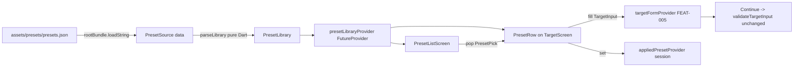

# FEAT-011 — Technical Plan

## 1. Summary
The library is one JSON asset (`assets/presets/presets.json`) bundled with the app, read once per session through `rootBundle`, parsed by a pure-Dart function into immutable types, and held in a Riverpod `FutureProvider`. Picking a spec calls the existing `TargetFormController.fill(TargetInput)` [Fact](lib/features/target/presentation/target_form_controller.dart, `fill`: "a preset or a saved spec"), so `TargetSpec` and FEAT-005 validation stay untouched. The applied-preset reference (form id, kind) lives in its own session-only provider; the row label is derived by comparing the validated current `TargetSpec` with the preset's. Search reuses FEAT-005's `cleanNumberText` plus lowercase and a small diacritic fold. CI gets a pure-Dart data test (every PRD section 8 rule, with self-tests), a string test, and one integration test that runs every spec through crop and compression on images generated at test time. No package, Gradle dependency, permission or network call is added.

## 2. Architecture impact
New feature module `lib/features/presets/{domain,data,presentation}` (ADR-001 module layout). Changed: `target_screen.dart` (one row slot below the photo line, where the code already reserves it [Fact](target_screen.dart, line 193 comment)), `pubspec.yaml` (one asset entry), `app_*.arb` (new `preset*` keys), CI (`bundle.dart` gains one test), FEAT-016 `claims.md` section 6 (one checklist line).



## 3. Components
| Component | Layer | Responsibility | New / changed |
|---|---|---|---|
| `preset_types.dart`: `PresetForm`, `PresetSpec`, `PresetSource`, `NotCovered` (sealed), `SpecKind`, `FormCategory`, `PresetLibrary`, `AppliedPreset` | domain | Immutable data; `PresetSpec.target` gives the `TargetSpec`, `PresetSpec.input` gives the `TargetInput` | New |
| `parse_library.dart`: `parseLibrary(Object? json) -> PresetLibrary` | domain | Structural read + runtime validity (via `checkTarget`, `validateTarget`); skips a bad spec, drops a form with no valid spec; counts skips. Ignores unknown fields (forward-compatible) | New |
| `preset_search.dart`: `searchKey(String)`, `filterForms(...)` | domain | Cleaning (FEAT-005 `cleanNumberText` + lowercase + diacritic fold), substring match, section grouping and sort | New |
| `preset_asset_source.dart` | data | `rootBundle.loadString('assets/presets/presets.json')` + `jsonDecode` + `parseLibrary`; writes one enum log line on failure or skip | New |
| `preset_providers.dart`: `presetLibraryProvider` (FutureProvider, kept alive), `appliedPresetProvider` (Notifier<AppliedPreset?>, not auto-disposed, no restoration) | state | Session-only holders | New |
| `preset_strings.dart` | presentation | Maps codes to ARB getters (country/category `select`, note keys, kind labels, spec summary); adds bidi isolates around data names | New |
| `PresetRow` | presentation | "Choose a form" / "<form> · <kind>" / load-failure message; notes while applied; opens list; on pick: fill + sync text controllers + unfocus | New (UI gated, FR-25) |
| `PresetListScreen` | presentation | Search field, sectioned lazy list, spec rows, notes, empty state, footer | New (UI gated, FR-25) |
| `TargetScreen` | presentation | Hosts `PresetRow`; exposes a callback that copies provider text into its four `TextEditingController`s (same as `_usePhotoSize` does today [Fact](target_screen.dart, `_usePhotoSize`)) | Changed |
| `test/presets/library_rules.dart` + `library_data_test.dart` | test | FR-19 CI rules (strict, incl. CI-only rules), self-tests for AC-7.1..7.3 | New |
| `test/presets/preset_copy_test.dart` | test | FR-15 banned words, key presence and `select` cases in 6 locales, no-storage code scan (AC-8.2) | New |
| `integration_test/preset_fixture_run.dart` | test | FR-20 engine run on generated synthetic images | New |
| `tool/presets/freshness.dart` | tool | FR-21: prints form count and forms checked more than 90 days ago | New |

## 4. API contracts
No network API (FR-18). Internal contracts:

```dart
// domain (pure Dart, no Flutter, Riverpod or DI imports — ADR-001)
PresetLibrary parseLibrary(Object? json);            // never throws on bad content; throws FormatException only if root is not {schema:1, forms:[...]}
List<FormSection> filterForms(List<PresetForm> forms, String query, String Function(PresetForm) localTerms, String Function(String country) countryName);
String searchKey(String raw);                        // cut to 100 chars, cleanNumberText, toLowerCase, fold diacritics

// data
Future<PresetLibrary> loadPresets();                 // async (rootBundle); errors propagate as AsyncError

// presentation result of the list route
final class PresetPick { final String formId; final SpecKind kind; }
```

Log lines (FR-16, the FEAT-016 FR-18 enum-only pattern [Fact](lib/features/privacy/data/uncaught_error_log.dart)): `exactsize.presets outcome=LOAD_FAILED` and `exactsize.presets outcome=SPEC_SKIPPED`. No form id, count, path, exception text or search text. The source takes the existing `LogSink` typedef as a constructor parameter with a `debugPrint` default, as `outcome_log.dart` and `uncaught_error_log.dart` do [Fact](lib/features/compression/data/outcome_log.dart line 6), so tests inject a fake sink. The whole-tree scan covers the new folder without edits, and its print ban applies only to `lib/features/privacy/` [Fact](test/privacy/whole_tree_scan_test.dart lines 8–9, 49).

## 5. Data model
**Format and location (OQ-12): JSON asset `assets/presets/presets.json`**, declared in `pubspec.yaml` `flutter: assets:`. Parsed with `dart:convert` (SDK; no package).

```json
{
  "schema": 1,
  "forms": [
    {
      "id": "test-form-a",
      "name": "Test Form A",
      "issuer": "Test Issuer",
      "country": "ZZ",
      "category": "exam_admission",
      "aliases": ["TFA"],
      "source": { "title": "Test notice 1", "url": "[PLACEHOLDER]" },
      "lastChecked": "2026-11-01",
      "specs": [
        { "kind": "photo", "width": 200, "height": 230, "minKb": 20, "maxKb": 50, "format": "jpeg",
          "notCovered": [ { "code": "dpi", "dpi": 200 }, { "code": "background" } ] },
        { "kind": "signature", "width": 140, "height": 60, "minKb": null, "maxKb": 20, "format": "jpeg",
          "engineReview": "[PLACEHOLDER: Product Owner reason, only if FR-20 reports this spec]" }
      ]
    }
  ]
}
```
The example is synthetic (country `ZZ` is an ISO user-assigned code); it is not a real form.

**Dart types** (all `final class`, `const` constructors, unmodifiable lists, value equality where compared):
- `enum SpecKind { photo, signature }`; `enum FormCategory { job, examAdmission, visaPassport, other }` (JSON `job`, `exam_admission`, `visa_passport`, `other`).
- `sealed class NotCovered` → `DpiNote(int dpi)`, `BackgroundNote()`, `ContentNote()`. A list of objects, not a map, so CI can detect repeats (`jsonDecode` silently keeps the last duplicate key [Fact](dart:convert behaviour)).
- `PresetSpec { kind, width, height, int? minKb, maxKb, OutputFormat format, List<NotCovered> notCovered, String? engineReview }`; `TargetSpec get target`; `TargetInput get input` (`minKb` null → `''`).
- `PresetForm { id, name, issuer, country, category, List<String> aliases, PresetSource source(title, String? url), DateTime lastChecked (date only), List<PresetSpec> specs }`.
- `PresetLibrary { List<PresetForm> forms; int skipped }`.
- `AppliedPreset { formId, kind }`, `toString()` redacted like `TargetSpec` [Fact](target_spec.dart, `toString`), because it reveals the user's application.

`engineReview` is Product Owner-only data for FR-20 and is never rendered (AC-5.5). `source` and `lastChecked` are exposed through `PresetForm` for FEAT-014 (FR-4); no UI here.

**Runtime vs CI rules.** One parser, two strictness levels:
- Runtime (`parseLibrary`): skips a spec that is structurally wrong, has an unknown kind/format/note code, a repeated kind, or fails `checkTarget(Target(w, h))` [Fact](lib/features/crop/domain/target_check.dart) or `validateTarget(maxText, minText, format)` [Fact](lib/features/compression/domain/target_validator.dart); skips a form with no valid spec or a missing id/name; logs `SPEC_SKIPPED` once if anything was skipped. Root not an object with `schema == 1` and a `forms` list → `FormatException` → `LOAD_FAILED`.
- CI only (`test/presets/library_rules.dart`, not shipped): unknown fields, duplicate or non-slug ids, 16 px floor, `dpi` 1–1200, issuer/source title present, `lastChecked` `YYYY-MM-DD` and not after today, country/category present as `select` cases in `app_en.arb`, no `test-` id or "Test Form" name in the shipped file. Kept out of `lib/` so no dead code ships.

**Storage:** none. Nothing is persisted, so there is no migration; a corrected spec in a new app version replaces the old one with nothing stale on the device.

**Development data.** Until the Product Owner supplies OQ-1 data, the shipped asset holds `"forms": []` and the row is hidden when the library is empty (FEAT-005 alone). All unit, widget and integration tests use `test/presets/fixtures/test_library.json` with synthetic "Test Form A/B" entries in country `ZZ`. A CI rule rejects test entries in the shipped file.

## 6. Integrations
- **FEAT-005:** `TargetFormController.fill`, `targetFormProvider`, `TargetFormState.result`, `cleanNumberText`. No change to `TargetSpec`, `TargetInput` or validation.
- **FEAT-002 / FEAT-004:** `checkTarget`, `validateTarget` (runtime and CI); `CropRenderer`, `SourceProbe`, `CompressionRunner` (FR-20 test only, same calls as `integration_test/crop_to_compression.dart` [Fact]).
- **FEAT-014:** reads `PresetForm.source` and `lastChecked`; owns their display.
- **FEAT-016:** whole-tree scan and privacy copy tests must stay green; release checklist gains the FR-21 line.
- **FEAT-019 / gen-l10n (FR-23):** new keys in `app_en.arb`, each with a "FEAT-011 ..." description in the existing style [Fact](app_en.arb, `target*` keys): `presetChooseForm`, `presetApplied` ({form}, {kind}; form already isolated), `presetKindPhoto`, `presetKindSignature`, `presetSpecRange` / `presetSpecUpTo` (numbers pre-formatted, isolated), `presetListTitle`, `presetSearchHint`, `presetNoMatch`, `presetEnterYourself`, `presetNoteDpi` ({dpi} int), `presetNoteBackground`, `presetNoteContent`, `presetNotAffiliated`, `presetLoadFailed`, `presetCountry` (`{code, select, <ISO code>{<name>} ... other{{code}}}`; cases added with the OQ-1 data, never `ZZ`; rule self-tests pass their own key set), `presetCategory` (`select` over the four values). Form names, issuers, aliases and source titles are never ARB values. Every locale must also pass FEAT-016's existing rule that no key outside its allow-list talks about the network, which runs over all keys [Fact](test/privacy/privacy_copy_test.dart lines 20–21, 57–60): "Forms could not be loaded" passes; any wording with "offline", "online", "connect" would fail.
- **Third-party SDKs/services:** none. No data leaves the device.

## 7. Security & privacy
- **PCI-DSS / Bangladesh Bank:** N/A. No money, card data, token or credential in data, code or UI. Any future example uses `[PLACEHOLDER]`.
- **Personal data:** the applied preset and the search text are sensitive [Assumption, PRD section 10]. They live only in memory: `appliedPresetProvider` (no persistence, no `restorationId`, like `targetFormProvider` [Fact](target_form_controller.dart, comment on `targetFormProvider`)) and the list screen's `TextEditingController`, disposed on pop. No `PageStorageKey` for search text; scroll position survives configuration changes because the State survives them [Assumption: Flutter's default Android `configChanges` keep the activity].
- **Logs:** two enum lines only (section 4). No form id even though form ids are public data, because a log written after a pick could reveal the choice.
- **Keyboard (FR-9):** `autocorrect: false`, `enableSuggestions: false`, `enableIMEPersonalizedLearning: false`, `autofillHints: null`. These compile on the pinned Flutter 3.50.1: the FEAT-005 fields use exactly these [Fact](target_screen.dart lines 137–140; pubspec `flutter: 3.50.1`). Whether a given keyboard app honours the no-learning flag is up to the keyboard [Hypothesis: Gboard honours `IME_FLAG_NO_PERSONALIZED_LEARNING`; others may not]. `keyboardType` stays `text` so Devanagari and Arabic input work.
- **Clipboard:** the app never writes to it. The search field keeps the system copy/paste menu because paste is a user action (NFR-8 tests a long paste); no `Clipboard` call is added, and the FEAT-016 whole-tree scan already bans one [Fact](test/privacy/whole_tree_scan_test.dart, `_dartRules`).
- **No storage code (AC-8.2):** `preset_copy_test.dart` scans `lib/features/presets/` for `dart:io`, `path_provider`, `shared_preferences`, `restorationId`, `PageStorageKey`, `Clipboard` and fails on any hit.
- **Data file integrity:** bundled, so it is as trusted as the code. No signing now; FEAT-013 adds signing if it is ever unparked (claims.md section 7 (b) [Fact]).
- **No network, permission or dependency (FR-18):** `rootBundle` and `dart:convert` are already in use; `tool/privacy/reviewed_packages.txt` and `android/app/reviewed_dependencies.txt` stay unchanged.

## 8. Requirement coverage
| Requirement | How it is met |
|---|---|
| FR-1 | One asset file; values entered as the Product Owner supplies them (OQ-1); release checklist checks count 15–20 |
| FR-2 | `PresetForm` fields; JSON schema in section 5; CI rules for id, country, category |
| FR-3 | `PresetSpec`, `NotCovered` sealed set; width/height required (OQ-3: KB-only excluded) |
| FR-4 | `PresetForm.source`, `lastChecked` public fields; no UI here |
| FR-5 | `PresetRow` in the reserved slot of `TargetScreen`; manual fields untouched |
| FR-6 | `filterForms` groups by country, sorts sections by localized name and forms by name; spec summary string |
| FR-7 | One tappable row per spec; tap pops `PresetPick` |
| FR-8 | `searchKey` (reuses `cleanNumberText`) over name, issuer, aliases, localized country and category |
| FR-9 | TextField flags (section 7); text in widget State only |
| FR-10 | Empty state with "Enter sizes yourself" = pop with no result |
| FR-11 | `fill(spec.input)` replaces all five values; screen copies text into its controllers; `FocusScope.unfocus()` |
| FR-12 | `TargetSpec` unchanged; `appliedPresetProvider` beside `targetFormProvider` |
| FR-13 | Row label derived: `state.result is TargetInputValid(:spec) && spec == preset.target` |
| FR-14 | Note strings by code (`presetNoteDpi` with `{dpi}`, `presetNoteBackground`, `presetNoteContent`), icon + text, reuse `BoothNotice` style on the target step |
| FR-15 | Footer key; `preset_copy_test.dart` bans "official", "approved", "guaranteed" in `preset*` strings (en, plus Latin tokens in all locales) and in `aliases` |
| FR-16 | `AsyncError` → row replaced by message; enum log; spec-level skip in `parseLibrary`; no retry |
| FR-17 | Memory-only holders; storage scan; enum-only logs; no recents |
| FR-18 | No new package, permission or network; FEAT-016 gates unchanged |
| FR-19 | `library_data_test.dart` loads the shipped JSON with `dart:io` and applies every section 8 rule; self-tests plant the AC-7.1..7.3 cases |
| FR-20 | `preset_fixture_run.dart` imported as a module by `integration_test/bundle.dart`, like the other tests there [Fact](integration_test/bundle.dart imports), so it runs in the existing API 28 emulator job (`ci.yml`, `flutter test integration_test/bundle.dart`, 2 GB) with no new driver. It probes, renders the default crop at W×H, compresses with the spec's KB range and format (same calls as `crop_to_compression.dart`), and fails on a size, KB or `can't reach` outcome unless `engineReview` is non-empty. Fixtures are generated with `dart:ui` into the app support dir: no real person |
| FR-21 | `dart run tool/presets/freshness.dart` + one line in FEAT-016 `claims.md` section 6 |
| FR-22 | Process: PR review checks `docs/CHANGELOG.md` line when the asset changes |
| FR-23 | New `preset*` ARB keys with descriptions; translated via `/l10n-translate`; data names never pass through gen-l10n |
| FR-24 | Data names wrapped in FSI/PDI (U+2068/U+2069) and numbers with units in LRI/PDI, the `_iso` / `_ltr` helpers used by the other message classes [Fact](lib/features/preview/presentation/check_messages.dart lines 51–52); digits formatted 0–9 |
| FR-25 | UI tasks blocked on the impeccable pass; data, loader, search, strings, CI tasks are not |
| NFR-1 | Load starts when the target step opens (row watches the provider); < 100 KB JSON; 20 forms filter in microseconds; timed in the fixture test [Hypothesis: well under 300 ms] |
| NFR-2 | `MergeSemantics` per spec row, `Semantics(header: true)` on headings, 48 dp minimum, icon + text notes, emulator check at 200% |
| NFR-3 | No network code; add "Pick a preset" to FEAT-016 offline matrix (claims.md section 5) |
| NFR-4 | Strings through FEAT-019, `AI-reviewed only`; `select` cases checked in 6 locales |
| NFR-5 | Section 7 |
| NFR-6 | Adding a form = JSON edit; a new country or category = one `select` case in `app_en.arb` (+ translations); no Dart change |
| NFR-7 | Pure-Dart table tests for `searchKey`, `filterForms`, `parseLibrary`, rules; one emulator drive en/ar/hi at 200% |
| NFR-8 | Fuzz test: 1,000 random strings incl. surrogates and controls through `searchKey`/`filterForms`; `LengthLimitingTextInputFormatter(100)`; widget test for a long paste and font-scale/locale change with the list open |
| NFR-9 | No API-level-specific code |
| NFR-10 | Source and date required by CI per form |

## 9. Risks
| Risk | Likelihood | Impact | Mitigation |
|---|---|---|---|
| OQ-1 data arrives late; feature built and released empty, or with synthetic forms left in | High | High | Shipped file `forms: []` until data arrives; CI rejects `test-` ids and "Test Form" names in the shipped file; release checklist requires 15–20 forms; tests use only `test/presets/fixtures/` |
| A real spec fails the engine (e.g. tiny max KB at a large size) and the user gets "can't reach this size" | Medium | High | FR-20 run per spec; failure blocks CI until the Product Owner records `engineReview` |
| Generated fixtures are not representative of real photos (noise compresses worse, flat images better) | Medium | Medium | One textured photo-like and one stroke-on-white signature-like image per kind [Hypothesis: brackets real content]; closed test is the real check |
| Stale or wrong spec over time | Certain over time | High | Freshness tool at each release, FEAT-014 display, changelog per change |
| Translators break ICU `select` cases for country/category names | Medium | Medium | `preset_copy_test.dart` checks every `select` case exists in every locale; fallback `other{...}` shows the code, never crashes |
| Keyboard app ignores the no-learning flag | Medium | Medium (privacy) | Flags set; residual risk stated in privacy explainer review [Hypothesis]; no further control exists in app code |
| Row label flicker or wrong label after edits with leading zeros or native digits | Low | Low | Compare validated `TargetSpec`, not raw text; `validateTargetInput` already cleans each field with `cleanNumberText` [Fact](lib/features/target/domain/validate_target_input.dart lines 16, 39) |
| Fixture run lengthens the CI emulator job | Medium | Low | One fixture per spec kind; about 40 runs [Hypothesis: 1–3 min]; inside the existing `bundle.dart` timeout |
| Banned word inside a form name as published | Low | Medium | Open question OQ-T3; names are not scanned by default |

## 10. Decisions
- Relies on **ADR-001** (Flutter 3.50.1, Riverpod, get_it/injectable, gen-l10n, module layout).
- **No new ADR.** The bundled data format is cheap to reverse: one file of about 20 records, read only by this app version, nothing persisted on the device, no outside consumer; converting JSON to Dart constants or back is a script of under a day [Hypothesis]. The costly-to-reverse decision is the FEAT-013 remote file schema and signing, which ships to older app versions; that ADR belongs to FEAT-013's tech plan if it is unparked. The `schema: 1` field keeps that door open at no cost.
- **Chosen: JSON asset** over Dart constants. Dart constants would give compile-time field checks and no load path (FR-16 nearly unreachable), but the Product Owner edits Dart syntax, FEAT-013 would need a JSON parser anyway, and FR-19's "unknown or missing fields" and AC-6.2's runtime skip would test a path that cannot happen. YAML was rejected: it needs a package (FR-18) and has implicit typing traps (`NO` → false).
- **Country and category names as ICU `select` messages** (`presetCountry`, `presetCategory`) instead of one key per country, so NFR-6 holds (no Dart change for a new country).

## 11. Deliberately left out
- Locale-aware collation for section sorting: Dart has no Collator; sort by code units of the localized name [Fact](dart:core `String.compareTo`). Upgrade if testers find the order odd.
- Full Unicode normalisation: a small fold table for Latin precomposed letters (es, pt, id) and Arabic harakat; no NFD [Hypothesis: enough for 15–20 names].
- Signing, remote update, schema migration (FEAT-013).
- Source-note UI, date display, "check your notice" (FEAT-014).
- Recents, favourites, device-region ordering, "Common sizes" (PRD OQ-6, OQ-15).
- A CI check that `docs/CHANGELOG.md` changes with the asset (review is enough at this size).
- `tasks.md` (Stage 7, `/handoff`).

## 12. Open questions
- **OQ-T1 Empty library behaviour during development.** Default: hide the row when there are zero forms (not the load-failure message, which would be untrue). Product Owner may prefer the release to be blocked instead; the checklist already blocks it.
- **OQ-T2 Fixture images.** Default: generated at test time with `dart:ui` (no binary committed, no real person). Alternative: commit two small synthetic files under the existing fixture push.
- **OQ-T3 Banned words in published names.** Default: scan UI strings and `aliases` only; names, issuers and source titles stay as published. If the Product Owner wants names scanned, a real name containing "Official" would need an exception list.
- **OQ-T4 Where the "meets spec" wording risk lands** stays PRD OQ-9 (no FEAT-006 change).

## Effort
| Work | Days [Assumption] |
|---|---|
| Types, `parseLibrary`, loader, providers, enum log, unit tests | 1.0 |
| CI data rules + self-tests, copy/storage test, freshness tool, checklist line | 1.0 |
| Search key, filter, fuzz test | 0.5 |
| ARB keys (en) + `/l10n-translate` for 5 languages | 0.75 |
| Target-step wiring (fill, controller sync, derived row, notes) | 0.5 |
| impeccable pass (lean) | 0.5 |
| List screen + row UI, RTL, 200%, TalkBack, emulator states | 2.0 |
| FR-20 fixture integration test and CI wiring | 1.0 |
| **Total** | **7.25 days ≈ 1.45 pw**, inside PRD OQ-17's 1.2–1.8 pw; Product Owner sourcing time is extra |

## Change log
| Version | Date | Change |
|---|---|---|
| 0.1 | 2026-11-27 | First draft |
| 1.0 | 2026-11-27 | Approved by the Product Owner (/approve FEAT-011-TECH); OQ-T1..T3 defaults stand |
