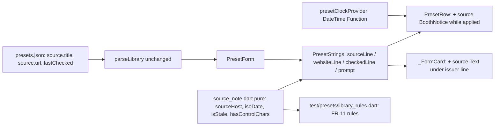

# FEAT-014 — Technical Plan

## 1. Summary
This feature only displays text. It adds one small pure-Dart file (`source_note.dart`) with four functions: get the host from the stored URL, format the stored date as `YYYY-MM-DD`, check whether the date is more than 90 days old, and detect control characters. `PresetStrings` gets five new ARB-backed lines that wrap data in isolates. `PresetRow` gets one more `BoothNotice` under the existing notes. The list's `_FormCard` gets one plain `Text` under the issuer line. The device date comes from one new Riverpod provider that returns a `DateTime Function()` (default `DateTime.now`), which tests override, the same way FEAT-011 overrides `presetSourceProvider`. The preset data, schema, parser, storage, packages, permissions and network code stay unchanged. The FEAT-011 CI data rules get the PRD FR-11 checks, and the synthetic fixture gets real-looking `example.test` URLs so the new URL rule passes.

## 2. Architecture impact
There is no new module, screen, route or package. Everything stays inside `lib/features/presets/` (ADR-001 layout).



### Files
| File | New / changed | Change |
|---|---|---|
| `lib/features/presets/domain/source_note.dart` | New | `staleAfterDays = 90`, `sourceHost`, `isoDate`, `isStale`, `hasControlChars` (section 4). Pure Dart, no imports |
| `lib/features/presets/domain/preset_types.dart` | Changed | Comment only: `PresetSource.url` "Stored as text and never opened; FEAT-014 shows its host only (FR-4)." (PRD section 11) |
| `lib/features/presets/presentation/preset_providers.dart` | Changed | `presetClockProvider` (section 4) |
| `lib/features/presets/presentation/preset_strings.dart` | Changed | `sourceLine`, `websiteLine`, `checkedLine`, `prompt`, `cardSource`, `block` |
| `lib/features/presets/presentation/preset_row.dart` | Changed | The notes block now shows whenever a spec is applied, and the source `BoothNotice` comes last |
| `lib/features/presets/presentation/preset_list_screen.dart` | Changed | `_FormCard`: one `Text(s.cardSource(form))` between the issuer line and the first `_SpecKey` |
| `lib/l10n/app_en.arb` + `app_{es,pt,hi,id,ar}.arb` + generated `app_localizations*.dart` | Changed | 5 keys (section 6) |
| `test/features/presets/source_note_test.dart` | New | Table tests: host, date, age (PRD section 8 stale table), control characters |
| `test/features/presets/preset_strings_test.dart` | Changed | Line building, isolates, missing title, issuer or date (AC-6.3); FR-10 over the 17 shipped forms in 6 locales |
| `test/features/presets/preset_row_test.dart` | Changed | AC-1.1–1.7, AC-3.1–3.5, AC-4.3, FR-8 no-interaction; clock override |
| `test/features/presets/preset_list_screen_test.dart`, `preset_a11y_test.dart` | Changed | AC-2.1–2.4, AC-5.3; ripples where the issuer text now appears twice on a card |
| `test/presets/library_rules.dart`, `library_data_test.dart` | Changed | FR-11 rules and self-tests (AC-6.2) |
| `test/presets/preset_copy_test.dart` | Changed | FR-9 extra banned words (en); descriptions may start `FEAT-011` or `FEAT-014`; module scan also bans `SelectableText`, `SelectionArea`, `GestureRecognizer`, `launchUrl` |
| `test/presets/freshness_test.dart` | Changed | One test: `staleAfterDays == maxAgeDays` (same 90, FR-6) |
| `test/presets/fixtures/test_library.json`, `integration_test/preset_fixture_data.dart` | Changed | URLs: A `https://notice.example.test/page`, B `http://notice.example.test/b`, C: `url` removed. Synthetic; `fixture_data_test` keeps the two equal |
| `integration_test/preset_demo.dart` | Changed | Clock override plus states `source` (fresh), `stale`, `source-ar`, `source-hi`, `source200` (KB-only Test Form C at 200%), `list200` |
| `docs/features/FEAT-016-on-device-privacy/claims.md` | Changed | Offline matrix: "see source note" added to the Pick a preset row (NFR-3) |
| `docs/CHANGELOG.md` | Changed | One line per task |

**Unchanged:** `parse_library.dart` (it already keeps `url` as text and `lastChecked` as UTC y/m/d), `assets/presets/presets.json` (all 17 URLs are `http`/`https` with a host and no user info; the longest title has 97 characters [Fact](assets/presets/presets.json)), `pubspec.yaml`, `AndroidManifest.xml`, `tool/privacy/reviewed_packages.txt`, `android/app/reviewed_dependencies.txt`, `target_screen.dart`, the FEAT-016 tests.

## 3. Components
| Component | Layer | Responsibility | New / changed |
|---|---|---|---|
| `source_note.dart` | domain | Host from the URL, date text, age check, control-character check; shared by runtime and CI | New |
| `presetClockProvider` | state | The only place that reads the device clock | New |
| `PresetStrings` (6 methods) | presentation | ARB lookup, isolates, leaving out missing lines | Changed |
| `PresetRow` | presentation | Source block while applied (FR-1, FR-7) | Changed (UI, design-gated FR-13) |
| `_FormCard` | presentation | Source, website and date lines per form (FR-2) | Changed (UI, design-gated FR-13) |
| `library_rules.dart` | test (CI) | FR-11 rules | Changed |
| `preset_copy_test.dart` | test (CI) | FR-9 words, FR-8 tokens | Changed |

## 4. API contracts
No network API. Internal contracts:

```dart
// lib/features/presets/domain/source_note.dart (pure Dart)
const staleAfterDays = 90;                           // FEAT-011 FR-21; tool/presets/freshness.dart maxAgeDays is test-checked equal
String? sourceHost(String? url);                     // null = "unusable", line left out
String isoDate(DateTime d);                          // YYYY-MM-DD from d.year/month/day, ASCII digits, no toLocal()
bool isStale(DateTime? lastChecked, DateTime now);   // true only if local calendar days > 90
bool hasControlChars(String s);                      // bidi controls + C0/C1; ZWJ/ZWNJ allowed

// lib/features/presets/presentation/preset_providers.dart
final presetClockProvider = Provider<DateTime Function()>((ref) => DateTime.now);

// lib/features/presets/presentation/preset_strings.dart
String? sourceLine(PresetForm f);                    // null if title or issuer is empty
String? websiteLine(PresetForm f);                   // null if sourceHost(f.source.url) == null
String? checkedLine(PresetForm f);                   // null if lastChecked == null
String prompt(PresetForm f, DateTime now);           // presetCheckNotice or presetCheckNoticeOld
String cardSource(PresetForm f);                     // first three non-null, joined by '\n' ('' if none)
String block(PresetForm f, DateTime now);            // first three non-null + prompt, joined by '\n'
```

**Host ("usable" rule, FR-4).** `sourceHost(url)`:
1. Returns null if `url` is null or blank, or if `Uri.tryParse(url)` returns null.
2. Returns null unless `uri.isAbsolute` is true and `uri.scheme` is `http` or `https` (Dart lowercases the scheme).
3. Returns null if `uri.userInfo` is not empty or `uri.host` is empty.
4. Otherwise it decodes the host with `Uri.decodeComponent(uri.host)`. Dart percent-encodes non-ASCII host characters, so decoding shows an IDN host as written. Decoding errors return null. The result is null if it contains a control character.

Scheme, port, path, query and fragment are never returned. Nothing is rewritten: `http` is not upgraded, and only the host part is ever shown. Dart lowercases ASCII letters in the host [Hypothesis: `Uri` reg-name normalisation; the table test pins it], and the plan accepts that as "as parsed" (OQ-T3). Shipped examples: `http://dept.bpsc.gov.bd/node/photo` gives `dept.bpsc.gov.bd`, and `https://www.ibps.in` gives `www.ibps.in`. These return null: `[PLACEHOLDER]`, `ftp://notice.example.test/x`, `https://[PLACEHOLDER]@notice.example.test` (either a parse failure or user info), `https:///path`, `notice.example.test/page` (relative), and the empty string.

**Date and age (FR-3, FR-6).** `lastChecked` is already `DateTime.utc(y, m, d)` (parser). `isoDate` pads the year to 4 digits and the month and day to 2 from those integers, so the digits are always 0–9 and no time-zone conversion happens. `isStale` builds `today = DateTime.utc(now.year, now.month, now.day)` from the device's local date fields. It returns `today.difference(lastChecked).inDays > staleAfterDays`, and false if `lastChecked` is null. Both values are UTC midnights, so DST cannot shorten a day. A device date before `lastChecked` gives a negative number and the normal prompt. This is the same rule as `freshness.dart`.

**Clock seam.** `PresetRow.build` calls `ref.watch(presetClockProvider)()` once per build. Nothing caches it and there is no timer (FR-7, AC-3.5). Tests and `preset_demo.dart` use `presetClockProvider.overrideWithValue(() => DateTime(2026, 10, 16))`. This was chosen over a `PresetRow` constructor parameter because `PresetRow` is built inside `TargetScreen`, and a parameter would have to pass through FEAT-005's screen. The provider follows FEAT-011's existing test pattern. The `clock` package was rejected because it would be a new dependency (FEAT-016 NFR-10).

## 5. Data model
No change: the same schema and fields, nothing persisted, no migration. The FR-11 CI rules are added to `libraryProblems` in `library_rules.dart`. Messages follow PRD section 8:
- Title longer than 100 characters, or `hasControlChars(title)` → "Form [ID]: source title is empty, too long or has control characters." An empty title keeps FEAT-011's existing message.
- Issuer longer than 100 characters, or `hasControlChars(issuer)` → "Form [ID]: issuer is too long or has control characters."
- `source.url` present and `sourceHost(url) == null` → "Form [ID]: source URL must be http or https with a host and no user info."

`hasControlChars` matches `[\u0000-\u001F\u007F-\u009F؜‎‏‪-‮⁦-⁩]`. ZWNJ U+200C and ZWJ U+200D are not matched. Runtime and CI share one URL rule, so they cannot drift apart. Self-tests:
- Planting each AC-6.2 case gives its message.
- A title with ZWJ passes.
- A 101-character title fails.
- A missing `url` passes.

## 6. Integrations
- **FEAT-011:** reads `PresetForm.source`, `issuer` and `lastChecked`. Applied state comes from the existing `_applied` (FR-13), so AC-1.3 needs no new logic.
- **FEAT-019 / gen-l10n.** New keys in `app_en.arb`, each with a description starting "FEAT-014". They get `preset` names so the existing banned-word, key-presence and translated checks cover them:

| Key | English | Placeholders (all `String`, already isolated) |
|---|---|---|
| `presetSourceLine` | "Source: {title} ({issuer})" | `title`, `issuer`: data in FSI…PDI, never translated |
| `presetWebsiteLine` | "Website: {host}" | `host`: LRI…PDI, never translated |
| `presetLastChecked` | "Last checked: {date}" | `date`: `YYYY-MM-DD` in LRI…PDI |
| `presetCheckNotice` | "Check these sizes against your form's notice or instructions before you upload. They can change." | none |
| `presetCheckNoticeOld` | "These sizes were last checked more than {days} days ago. Check your form's notice or instructions before you upload." | `days`: `_lri(_number.format(90))`; the description says it is always 90, so translators should use the plural form for 90 |

  Bidi handling uses the existing `_fsi` and `_lri` helpers in `PresetStrings`. No marks are added inside ARB values (CLAUDE.md, Localization). Translations go through `/l10n-translate` (es-419, pt-BR, hi, id, MSA ar with Western digits), status "AI-reviewed only". The back-translation review must check "notice" (PRD OQ-4).
- **FEAT-016:**
  - The whole-tree scan already bans `url_launcher`, `Clipboard` and network classes. `Uri.tryParse` is not banned and makes no network call.
  - `privacy_copy_test`'s network-word rule runs over every English key. None of the five strings contains internet/connect/network/offline/online. "Website" is allowed, and the reviewer must not introduce "online" while rewording.
  - `reviewed_packages_test` is unchanged because no package is added.
- **Third parties:** none. No data leaves the device.

## 7. Security & privacy
- **PCI-DSS / Bangladesh Bank:** N/A. The feature shows public text and a date, with no money, card data, token or credential. Any example uses `[PLACEHOLDER]`.
- **No link, selection or clipboard (FR-8):**
  - Only plain `Text` is used (no `SelectableText`, `SelectionArea` or `TextSpan` recognizer), and `lib/` has no `SelectionArea` [Fact](code search).
  - `BoothNotice` and `_FormCard` add no `InkWell` or `GestureDetector`.
  - The preset module scan in `preset_copy_test.dart` gains `SelectableText`, `SelectionArea`, `GestureRecognizer` and `launchUrl`. `Clipboard` and `url_launcher` stay banned by both scans.
  - A widget test taps and long-presses each line, then checks that no route was pushed, no `AdaptiveTextSelectionToolbar` or selection handles appeared, and the widget tree is unchanged.
- **No trace (FR-12, AC-4.3):** no log line, no stored value, no counter. A widget test captures `debugPrint` and the loader sink while Test Form A is applied and viewed. It checks that no captured line contains `test-form-a`, the title, the host or the date. The existing storage-token scan also covers the new file.
- **Spoofing:** CI rejects bidi and control characters in titles and issuers. The runtime host check rejects them too. Titles and issuers are not stripped at runtime because the data is bundled and CI-gated (section 11).
- **Shared phones:** nothing survives a restart (AC-4.4), because all state is in memory and derived.

## 8. Requirement coverage
| Requirement | How it is met |
|---|---|
| FR-1 | `PresetRow`: while `_applied` gives a spec, it shows the KB-only line, then the notes, then `BoothNotice(icon, s.block(form, now))`. Icon plus text, plain. Widget tests AC-1.1, 1.4, 1.5 |
| FR-2 | `_FormCard`: `Text(s.cardSource(form))` after the issuer line, outside `_SpecKey`, once per form, no prompt. Widget tests AC-2.1, 2.2 (search), 2.4 (footer last, no prompt text in the list) |
| FR-3 | `sourceLine` (FSI title and issuer, `null` if either is empty) and `checkedLine` (`isoDate`, LRI). Table test covers time zones by building `DateTime.utc` dates and `isoDate` with no local conversion |
| FR-4 | `sourceHost` rule (section 4). Table test covers http, https, port, IP, upper case, IDN, user info, ftp, relative, `[PLACEHOLDER]`, blank |
| FR-5 | `presetCheckNotice` is always the last line of the block. It has no handler, checkbox or state |
| FR-6 | `isStale` plus `presetClockProvider`. Table test has the exact PRD section 8 cases (2026-03-01, 03-05, 06-03, 06-04, 2099-01-01, 1970-01-01, with `lastChecked` 2026-03-05). `freshness_test` checks the constant is equal |
| FR-7 | The block is built inside `PresetRow.build` from `_applied` and the clock every time. AC-1.3 widget test: edit a value and the block is gone; restore it and the block is back. AC-3.5 test: change the clock override value, return from the list, and the prompt changes |
| FR-8 | Section 7: token scan plus a tap and long-press widget test |
| FR-9 | 5 ARB keys with "FEAT-014" descriptions. `preset_copy_test` bans `verified|accurate|up to date|latest|current|certified|compliant` in English `preset*` values (no existing preset string matches [Fact](app_en.arb)), plus a self-test. The existing 6-locale presence and "not English" checks cover translation |
| FR-10 | `preset_strings_test`: parse the shipped asset, check that no form was dropped (count equals the raw count), then for each of the 17 forms and each of the 6 locales, check `sourceLine`, `checkedLine`, `block` and `cardSource` are non-empty and contain the title and date |
| FR-11 | `library_rules.dart` rules plus self-tests (section 5) |
| FR-12 | No new code path that writes or logs. AC-4.3 log test. FEAT-016 scans and `reviewed_packages_test` unchanged and green |
| FR-13 | UI tasks blocked until the Product Owner is told and the lean impeccable pass is done. `source_note.dart`, strings, CI rules and tests can start first |
| FR-14 | Process: PR review checks the `docs/CHANGELOG.md` line when `lastChecked` changes (as FEAT-011 FR-22) |
| NFR-1 | No new read and no async step. Strings are built synchronously in `build` |
| NFR-2 | One `Text` in `BoothNotice` gives one TalkBack node after the row and notes. The `Icon` has no semantic label, so it is not announced. `_FormCard` Text comes after the issuer Text in reading order. No new touch target. Existing Booth colours. a11y test plus emulator check at 200% |
| NFR-3 | No network code. Offline matrix row updated in `claims.md` |
| NFR-4 | `/l10n-translate` for 5 languages. Arabic digits: date from integers, days through the existing `NumberFormat` (Western digits). Emulator check in ar and hi |
| NFR-5 | Section 7 |
| NFR-6 | All logic in pure functions with an injectable clock. Table-driven tests |
| NFR-7 | Each line is optional. `isStale` handles null, far-past and far-future dates. `sourceHost` never throws (try-catch around decode). A widget test pumps a hostile fixture form (empty title, null date, 300-character URL, control character in title) and checks there is no exception and no "Source: ()" |
| NFR-8 | No API-level code |
| NFR-9 | No package, plugin or WebView. `reviewed_packages_test` and the whole-tree scan stay green |
| AC-1.6 | Tap and long-press test (FR-8) |
| AC-1.7 | Existing paths: `AsyncError` draws the notice and no block, and no applied spec means no block. Widget test |
| AC-5.1 | Unit test checks the FSI/LRI code points around each placeholder. Emulator screenshot in ar |
| AC-5.2 | Emulator screenshots at 200%, 360×640 dp, en/ar/hi, using the longest shipped title (97 characters) and issuer. `TargetScreen` already scrolls (`SingleChildScrollView`) |
| AC-6.3 | String test with an empty title or issuer and a null date: the prompt is still shown and nothing contains "()" |
| AC-6.4 | Process (FR-14) |

## 9. Risks
| Risk | Likelihood | Impact | Mitigation |
|---|---|---|---|
| The prompt is always shown and users stop reading it [Hypothesis] | High | Medium | Old-check variant. Nothing more in R1 (PRD section 9) |
| A release built after 2027-02-25 shows the old-check prompt on all 17 forms (all checked 2026-11-27) | High if releases slip | Low (true and non-blocking) | `freshness.dart` at every release. Re-check, then update the date and CHANGELOG (FR-14) |
| FEAT-011 widget tests break because the issuer now also appears in the source line (`findsOneWidget` on issuer text) and the fixture URLs change | Medium | Low | Fix the finders in the same task (named in section 2) |
| Dart `Uri` lowercases or percent-encodes the host differently from what is expected | Low (no IDN or upper-case host shipped) | Low | `decodeComponent` plus a pinned table test. OQ-T3 |
| The 200% layout with KB-only line, DPI note and a four-line block pushes Continue far down | Medium | Medium | Screen already scrolls. Emulator check `source200`. Design pass may shorten the spacing |
| A shipped title grows past 100 characters (longest is 97 today) | Medium | Low | CI fails with the form id. The Product Owner shortens the title in the data |
| A translator uses a network word, or "notice" maps to the wrong document | Low | Medium | `privacy_copy_test` (en), description notes, back-translation review |
| Arabic or Hindi plural for the fixed 90 is wrong | Low | Low | Description states it is always 90. Back-translation |
| Wrong device clock picks the wrong prompt | Medium | Low | The date line is always shown. Non-blocking (PRD section 9) |
| Adding words to the banned-word list blocks a later legitimate string ("current" also matches "currency") | Low | Low | Message names the key. Reword |

## 10. Decisions
- Relies on **ADR-001** (Flutter, Riverpod, gen-l10n, module layout).
- **No new ADR.** Everything here is display code over unchanged bundled data, with nothing persisted and no schema, package or platform change. Removing or reshaping it takes under a day [Hypothesis]. The costly-to-reverse choices (URL never opened, no network time) are product rules already fixed in the PRD and FEAT-016.
- **Chosen, with the alternative considered:**
  - **Reuse `BoothNotice` with one joined `Text`, over a new multi-line `SourceNote` widget.** It gives one TalkBack node for free and adds no new component. A new widget is justified only if the design pass wants the prompt styled differently.
  - **Clock provider over a constructor parameter or the `clock` package** (section 4).
  - **Share `sourceHost` between runtime and CI, over a separate regex in the rules.** One definition of "usable" cannot drift.
  - **Keep the 90 in `tool/presets/freshness.dart` and add an equality test, over importing `lib/` into the tool.** No change to how the tool runs.

## 11. Deliberately left out
- Any link, copy, share, selection or browser launch (PRD non-goals).
- An `AppLifecycleListener` to re-read the clock on resume (OQ-T1).
- Stripping control characters from titles and issuers at runtime: CI blocks them, and the data is bundled.
- A sixth key "Source: {title}" for a missing issuer (OQ-T2).
- Localised month names (PRD OQ-2 default), network time, and caching of the lines.
- Adding the source or prompt to the pick announcement (OQ-T4).
- Any data, schema or parser change.
- `tasks.md` (Stage 7).

## 12. Open questions
- **OQ-T1 "Resume" in AC-3.5.** In Flutter, resuming the app does not rebuild `PresetRow`. Default: no listener. The prompt is chosen again on the next build (return from the list, language or font change, rotation, any edit). The only case missed is an app left open on the target step across the 90-day boundary. Alternative: make `PresetRow` a `ConsumerStatefulWidget` with an `AppLifecycleListener` that rebuilds on resume (about 10 lines).
- **OQ-T2 Empty issuer at runtime** (CI blocks it; the parser defaults it to `''`). Default: leave the source line out, so "Source: Title ()" never appears. Alternative: a sixth key "Source: {title}" in 6 languages.
- **OQ-T3 Host display.** Default: the host as Dart parses it, with ASCII letters lowercased and IDN percent-decoded to Unicode. The PRD says "as parsed, no conversion"; the plan reads lowercase as part of parsing. Alternative: slice the host out of the raw string by hand (more code, more edge cases).
- **OQ-T4 Pick announcement.** Default: unchanged (form · kind, plus the KB-only note). TalkBack reaches the block as the next item. Alternative: add the prompt to the announcement, which makes it longer every time.
- Product open questions OQ-1 to OQ-11 keep their PRD defaults. Icon, spacing and whether the prompt looks different from the lines are decided in the impeccable pass (PRD OQ-9).

## Effort
| Work | Days [Assumption] |
|---|---|
| `source_note.dart` plus table tests, constant equality test | 0.5 |
| `PresetStrings` methods, 5 English keys, copy-test changes, FR-10 shipped-forms test | 0.5 |
| CI FR-11 rules, fixture URL changes in both fixtures, self-tests | 0.5 |
| Lean impeccable pass (after telling the Product Owner) | 0.25 |
| `PresetRow` block, clock provider, widget tests (AC-1, AC-3, AC-4.3, FR-8) | 0.75 |
| `_FormCard` lines, list and a11y tests, FEAT-011 finder ripples | 0.5 |
| `/l10n-translate` for 5 languages | 0.5 |
| `preset_demo` states, emulator screenshots (en, ar, hi, 200%), offline matrix row, CHANGELOG | 0.5 |
| **Total** | **4.0 days ≈ 0.8 pw**: above the roadmap's 0.3 pw and the PRD's 3-day guess, inside the PRD OQ-11 range of 0.4–0.9 pw |

## Change log
| Version | Date | Change |
|---|---|---|
| 0.1 | 2026-11-27 | First draft |
| 1.0 | 2026-11-27 | Approved by the Product Owner (/approve FEAT-014-TECH); open-question defaults stand |
