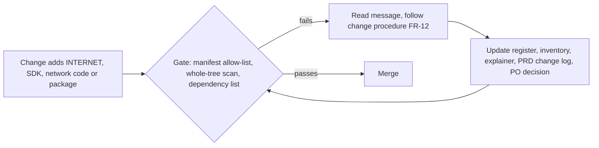

# FEAT-016 — On-device-only, offline-capable processing with in-app privacy explainer

## 1. Overview
The image pipeline already runs on the phone and already works offline (FEAT-001, 002, 004, 005, 006 and 007 are Implemented). FEAT-016 is the **delta** that turns that fact into a promise users and the store can trust: (1) one short, scoped privacy line plus a plain in-app explainer in which every sentence can be checked in code or the manifest; (2) build and CI gates that fail when the promise would become false (INTERNET permission, network code, unreviewed dependency); (3) an offline test matrix for every core flow; (4) the inputs for the store listing and Google Play Data safety form. It merges the rejected FEAT-017 (offline follows from on-device) [Fact](docs/product/decisions.md, 2026-11-19). **Release:** MVP (R1), Phase A, Must, roadmap effort 0.5 pw (0.3 + 0.2) [Fact](docs/roadmap.md, FEAT-016 row); see OQ-10 on that estimate.

**What already exists (not rebuilt here):**
- The release app has no INTERNET permission in the main manifest; only the Flutter debug and profile manifests add it, for tooling [Fact](android/app/src/main/AndroidManifest.xml; android/app/src/debug/AndroidManifest.xml; android/app/src/profile/AndroidManifest.xml). The FEAT-007 T23 record lists the merged permissions as `WRITE_EXTERNAL_STORAGE` (max API 28) and the AndroidX non-exported receiver permission, "no INTERNET" [Fact](docs/features/FEAT-007-export-share/tasks.md, Test record, T23 NFR-8 row).
- A static no-network test over the compression, crop, pick, export and preview folders and `es_codec` [Fact](test/features/compression/no_network_imports_test.dart); a target-folder test [Fact](test/features/target/target_privacy_test.dart); a preview test that also bans analytics, ads and crash SDK imports, `Clipboard` and image-cache use [Fact](test/features/preview/preview_privacy_test.dart); crop, pick and export privacy tests [Fact](test/features/ — `*_privacy_test.dart`).
- Logs carry enum outcome codes only [Fact](docs/features/FEAT-006-preview-spec-check/prd.md, FR-19; docs/features/FEAT-007-export-share/prd.md, FR-27).
- The pick screen shows "Your photos stay on your phone and are never uploaded." [Fact](lib/l10n/app_en.arb, `pickPrivacyNote`; lib/features/pick/presentation/pick_view.dart line 97) and the export panel shows "Saving puts a copy in your gallery or a folder you pick. Sharing gives a copy to the app you choose." [Fact](lib/l10n/app_en.arb, `exportPrivacy`). Both say "final copy belongs to FEAT-016" [Fact](docs/features/FEAT-001-pick-image/prd.md, FR-22; docs/features/FEAT-007-export-share/prd.md, FR-26).
- Airplane-mode tooling: `tool/run_offline_test.sh`, `integration_test/offline_test.dart` (compression only) and the export bridge test, run in the CI API 28 job [Fact](tool/run_offline_test.sh; .github/workflows/ci.yml line 157).

**Gaps this feature closes (found by reading the code, all [Fact] unless tagged):**
1. `checkMergedManifest` bans CAMERA, READ_EXTERNAL_STORAGE, ACCESS_MEDIA_LOCATION, MANAGE_EXTERNAL_STORAGE and READ_MEDIA_*, but **not INTERNET** [Fact](android/app/build.gradle.kts, `banned` set). The "no INTERNET" fact is observed once, not enforced. The T23 row is labelled a release merged manifest but its build column says "profile build", so even the observation is ambiguous.
2. The network scan lists folders; `lib/main.dart`, `lib/app.dart`, `lib/di/`, `lib/ui/`, the Kotlin sources and any **new** feature folder are not scanned [Fact](test files above). It is allow-by-default, not deny-by-default.
3. There is no check on dependencies: a new package or AAR could add collection or sockets [Fact](pubspec.yaml; android/app/build.gradle.kts).
4. The pick-screen claim is absolute ("never uploaded"). All five translation reviews flagged it and asked for it to be scoped to the app [Fact](docs/l10n/ai-review-log.md, pickPrivacyNote entries for es, pt, hi, id, ar).
5. There is no explainer, no entry point to one (the line is a plaque on the start screen, [Hypothesis] not tappable today) and no store-disclosure inputs.
6. Offline is automated for compression and export only; pick, crop, check and UI flows are covered by per-feature manual rows.
7. No global Dart error handler exists [Fact](lib/main.dart; grep of lib/ for `FlutterError.onError`, `PlatformDispatcher.onError`, `runZonedGuarded`: none), so "logs hold only codes" holds for feature code, not for framework error output [Hypothesis: default Flutter error output can contain exception text, to verify in Stage 6].
8. `android:allowBackup` is not set in the main manifest [Fact](grep of android/ sources: none). The default is backup on [Hypothesis]. The app writes only to cache folders [Fact](lib/features/compression/data/temp_files.dart, `getTemporaryDirectory`; MainActivity.kt `cacheDir`; no documents-directory or preferences use found in lib/), which Auto Backup normally skips [Hypothesis], so nothing should be backed up, but nothing enforces it.

**Release state (important, see OQ-2).** The roadmap row for FEAT-016 and FEAT-025 still speaks of a "no-ads MVP" where the label can say "no data collected". That was superseded: R1 merges both milestones and ships ads and the subscription [Fact](docs/product/decisions.md, 2026-11-18 rows 16 and 17; docs/product/vision.md v1.5, Business model; docs/roadmap.md v1.4, R1 Phase B and R1 exit criteria "store privacy labels match the ads SDK's real data collection (not 'no data collected')"). FEAT-025 is a Should and is in the cut order after the Could items [Fact](docs/roadmap.md, Release plan), so R1 could still ship without ads. This PRD therefore defines two states: **ad-free build** (what Phase A builds and what exists today) and **build with ads** (the plan of record, FEAT-025). Phase A is built ad-free; FEAT-025 must update the claims in the same change (FR-12, FR-19).

## 2. Problem statement
**Who:** applicants and students who upload photos and signatures, including identity-sensitive ones and photos of minors [Fact](docs/product/vision.md, Compliance scope); cyber café operators on shared phones.
**Pain:** they cannot tell which resizer keeps their photo. Of the tools researched, iLoveIMG uploads files; others claim browser or on-device processing, unverified; several apps' privacy information is unknown; one ad-supported iOS app claims "no data collected" while another declares tracking [Fact](docs/research/competitors.md, Feature comparison "Processing" row and Gap 2, Medium confidence). Google Play Data safety pages could not be read [Fact](docs/research/competitors.md, Research gaps), so the Android picture is incomplete.
**Why it matters:** privacy is part of the UVP ("photos never leave the phone: works offline, nothing uploaded") [Fact](docs/product/vision.md, UVP), but the vision itself marks competitor weakness there as an [Assumption]. That users choose a tool for privacy is a [Hypothesis]; no user research exists. The differentiator that competitors cannot copy cheaply is **verifiable** privacy, not a slogan (research Gap 2).
**Why now:** the line ships in six languages with an absolute wording; ads planned for R1 can make several claims false (the ad SDK adds the main privacy exposure [Fact](docs/product/vision.md)); and today nothing in the build would stop that.

## 3. Goals & success metrics
No usage telemetry exists or is allowed for this feature (NFR-6), so metrics are verification results, not behaviour data.

| Goal | Metric | Target |
|---|---|---|
| Every user-facing privacy claim is true and checkable | Claims in the register (section 10) with a named check or marked "disclosure only" | 100% |
| The guarantee cannot silently break | Planted violations (INTERNET permission, network class in a new folder, unreviewed new dependency) that fail the build in self-tests | 3 of 3 |
| Offline-capable is testable | Core-flow rows in the offline matrix (FR-14) that pass on the release candidate in airplane mode | 100% of rows |
| Plain words | English explainer length and sentence length | at most 150 words; at most 20 words per sentence [Assumption] |
| Easy to find | Taps from app start to the explainer | at most 2 |
| Language parity | Launch languages with explainer strings through `/l10n-translate` (status `AI-reviewed only`) | 6 of 6 |
| Store consistency | Contradictions between register, explainer, store listing and Data safety answers at release | 0 |
| Cost | Extra CI minutes for the gates | 0 (run inside existing jobs) [Assumption] |

**Non-goals:**
- No change to the image pipeline, no new permission, no new dependency.
- No settings screen, privacy dashboard, delete-my-data screen or offline toggle or banner (nothing is stored, nothing to toggle).
- No consent management or ad SDK work (FEAT-025), no analytics or counters (FEAT-027), no preset download (FEAT-013), no metadata stripping (FEAT-018; no claim about it until it is verified).
- No drafting of the legal privacy policy and no legal advice; this PRD supplies inputs and flags questions.
- No iOS labels (iOS is later) [Fact](docs/product/vision.md, Platforms).
- No visual design of the explainer screen; it is designed later with impeccable, and the Product Owner is told first [Fact](CLAUDE.md, Implementation).

## 4. User stories
- **US-1** As an applicant on the start screen, I want one short line that says what ExactSize does with my photo, so that I know before I pick one.
  - **AC-1.1** Given the app starts, when the pick screen shows, then the privacy line reads the scoped wording of FR-1 and contains no absolute claim such as "never leaves your phone".
  - **AC-1.2** Given any launch language, when the pick screen shows, then the line is present in that language and passes the banned-claim check of FR-5.
- **US-2** As an applicant (or a cyber café customer on a shared phone), I want a short explainer in plain words, so that I understand what stays on the phone, what I might put elsewhere by tapping Save or Share, and what ExactSize cannot control.
  - **AC-2.1** Given the pick screen, when I tap the privacy line (or its labelled control), then the explainer opens in at most 2 taps from app start and Back returns to the pick screen with nothing selected.
  - **AC-2.2** Given airplane mode, when I open the explainer, then it opens at once with no spinner and no error, because it is local text.
  - **AC-2.3** Given the explainer, when I read it, then it says: processing is on the phone and ExactSize never uploads photos; no account is needed; temporary copies are deleted when I finish or at the next start; logs hold only status codes; a saved or shared copy leaves ExactSize's control; and the gallery, keyboard and receiving apps follow their own rules.
  - **AC-2.4** Given the explainer text, when the banned-claim check runs, then no banned phrase appears (FR-5).
  - **AC-2.5** Given Arabic with 200% font, when I open the explainer, then it is right-to-left, nothing is clipped and TalkBack reads headings then paragraphs in order.
- **US-3** As an applicant with a poor or no connection, I want every step to work offline, so that a bad network never blocks my upload deadline.
  - **AC-3.1** Given Wi-Fi and mobile data are off, when I cold-start the app and run pick, target entry, crop, compress, check, Save and Share, then each step completes with no network error and no wait caused by the network.
  - **AC-3.2** Given a photo stored only in an online album and no network, when I pick it, then the existing "couldn't open this photo" message appears (the download belongs to the gallery app) and the rest of the app still works.
  - **AC-3.3** Given the offline script runs in CI, when it starts, then its first check proves networking is off, and the core-stage integration tests pass.
- **US-4** As the maintainer (Product Owner with Claude Code), I want the build to fail when the promise would become false, so that no later change makes a claim untrue by accident.
  - **AC-4.1** Given a change adds INTERNET (directly or through a plugin), when the release build runs, then it fails and names the permission and the allow-list rule.
  - **AC-4.2** Given a network class or banned SDK import in any file under `lib/`, the Kotlin sources or `es_codec` (including a new folder), when `flutter test` runs, then the scan fails with file and line.
  - **AC-4.3** Given a new Dart package or Gradle dependency, when `flutter test` runs, then the dependency test fails until the package is added to the reviewed list with a network and data note.
  - **AC-4.4** Given each rule, when its self-test plants a violation, then the check fails; and when the planted violation is removed, then it passes.
  - **AC-4.5** Given a failure message, when it is shown, then it points to the change procedure (FR-12).
- **US-5** As the Product Owner preparing the store listing, I want a data inventory, permission list and claims register that match the build, so that the Data safety form and listing are honest and quick to fill.
  - **AC-5.1** Given a release candidate, when I open the release checklist, then it lists the merged release manifest permissions, the data inventory and the claims register, and each store statement maps to a register entry.
  - **AC-5.2** Given the build includes ads, when I read the register, then "no data collected" and "no internet permission" are marked false and the ad SDK disclosure placeholders are listed for filling.
- **US-6** As the Product Owner, I want a defined rule for what happens to the claims when ads or preset updates arrive, so that those features cannot ship with stale promises.
  - **AC-6.1** Given FEAT-025 is drafted, when its PRD is reviewed, then it contains the acceptance criteria listed in FR-19(a).
  - **AC-6.2** Given FEAT-013 is drafted, when its PRD is reviewed, then it contains those of FR-19(b).
  - **AC-6.3** Given an allow-listed network folder is added, when the scan runs, then only that folder is exempt and the exemption is recorded in the change log of this PRD.

## 5. User flows
**A. Read the explainer.** Start screen (pick) shows the scoped line, tap the line or its labelled control, explainer opens (scrollable static text, headings per part), Back returns to the pick screen. Alternate: language change while open (the activity handles locale changes without recreation [Fact](android/app/src/main/AndroidManifest.xml, `configChanges`)), so the text updates in place. Alternate: a photo is shared into the app while the explainer is open, the normal share flow takes over (Stage 6 checks the route stack; the explainer holds no image and no `PopScope` that releases one). Error flow: none, because the explainer has no data and no network.

**B. Offline run.** Airplane mode on, cold start, pick (system picker with a local photo, camera, Choose from files, share-in), target entry, crop, compress, check, Save, Share sheet, explainer. Any step that fails or waits on the network is a defect.

**C. Guarantee gate.**

**D. Release.** Run the release checklist (FR-13): print merged release manifest, run offline matrix on a real phone, compare register with explainer, store listing and Data safety answers, check six languages, close or consciously waive the compliance review (OQ-7).

**E. Later change (ads, preset updates, counters).** The owning feature's PRD carries the FR-19 criteria; its build change flips the gate deliberately, updates register and explainer in the same change, and the Product Owner approves the PRD change.

## 6. Functional requirements
| ID | Requirement | Story | Priority (MoSCoW) |
|---|---|---|---|
| FR-1 | The pick screen privacy line shall use app-scoped wording and no absolute claim. Proposed English: "Your photos are resized on your phone. ExactSize never uploads them." It replaces the FEAT-001 FR-22 copy (key `pickPrivacyNote`); the text is final only after the Product Owner decides OQ-1. | US-1 | Must |
| FR-2 | The privacy line (or a labelled control beside it) shall open the explainer, reachable in at most 2 taps from app start, with a touch target of at least 48 dp [Assumption: Material guideline]. Back shall return to the pick screen unchanged. The explainer shall hold no image and no session state. | US-2 | Must |
| FR-3 | The explainer shall contain these parts, each sentence mapped to a register entry (section 10): (a) on your phone and no upload (C1, C3); (b) works without internet (C2) with the online-album exception (AC-3.2); (c) what is kept: temporary copies deleted when you finish or at next start (C4), logs hold only status codes (C5); (d) where copies can go: Save, Share (C8); (e) outside ExactSize: gallery, keyboard, receiving apps (C9); (f) ExactSize reads only the photo you choose (C10). Length at most 150 English words [Assumption]. It shall state no internal-gate fact (no INTERNET permission, no data collected). | US-2 | Must |
| FR-4 | The explainer shall be static local text from string resources: no network call, no permission, no WebView, no external link in the ad-free build, no new dependency, no analytics or open counter. | US-2 | Must |
| FR-5 | A test shall fail if the English privacy strings (`privacy*`, `pickPrivacyNote`, `exportPrivacy`) contain a banned phrase: "never leaves", "no data collected", "100%", "secure", "encrypted", "anonymous", "GPS" or "location removed" (until FEAT-018 is verified), "compliant", "certified", "GDPR", "PCI", "Bangladesh Bank". The `/l10n-translate` reviewer brief for these keys shall name the same list and the rule "claims stay scoped to ExactSize", so the back-translation review checks all six languages. | US-2 | Must |
| FR-6 | Explainer strings shall be one ARB key per part, each `@` description naming its register IDs, with no placeholders, translated through `/l10n-translate` into es, pt (pt-BR), hi, id and ar, status `AI-reviewed only`, never described as native-reviewed [Fact](CLAUDE.md, Localization). The `pickPrivacyNote` change retranslates all five. Parts are separate keys so FEAT-025 and FEAT-013 can replace or add one part without rewriting the others. | US-2 | Must |
| FR-7 | The `exportPrivacy` line (FEAT-007 FR-26) shall be confirmed as final unchanged, so no retranslation is needed, and the explainer part (d) shall not contradict it. | US-2 | Should |
| FR-8 | The release build shall fail unless the merged release manifest permission set is within a reviewed allow-list (today: `WRITE_EXTERNAL_STORAGE` with max API 28 and the AndroidX non-exported receiver permission). The message shall name INTERNET, ACCESS_NETWORK_STATE, ACCESS_WIFI_STATE and `com.google.android.gms.permission.AD_ID` when found [Hypothesis: AD_ID is the ads-identifier permission, to verify with FEAT-025]. It extends `checkMergedManifest` and its self-test pattern, and shall not strip entries with `tools:node="remove"` (existing rule). | US-4 | Must |
| FR-9 | One test shall scan, deny by default, every `.dart` file under `lib/` (generated localisation and injection files included or excluded by an explicit list), `packages/es_codec/lib` and `hook`, and the Kotlin files under `android/app/src/main`, for: network packages and classes (the existing list), `java.net`, OkHttp, WebView; analytics, ads and crash SDK imports; and `Clipboard`. The exempt-path list is empty in R1. It supersedes the folder lists in the existing per-feature tests; those tests stay as they are. Today's code has no match, so the scan starts green [Fact](grep of lib/, packages/es_codec/lib and hook, 2026-11-26). | US-4 | Must |
| FR-10 | A test shall compare the Dart package names in `pubspec.lock` and the Gradle dependency coordinates with a checked-in reviewed list, and fail on any name not listed, saying "review network, data and permissions, then add with a note". Version bumps of listed names do not fail. | US-4 | Should |
| FR-11 | The gates shall run inside existing CI steps (`flutter test`; the release build) and locally in `flutter test` before each push [Fact](CLAUDE.md, Budget), each with a self-test that plants a violation (INTERNET permission, network class in a new folder, unlisted package) and expects failure. The Stage 6 task shall confirm that `flutter build apk --release` runs `checkMergedManifest` and that its log line appears in CI [Hypothesis: the Flutter tool calls `assembleRelease`; the check is attached to that task]. | US-4 | Must |
| FR-12 | Change procedure: a change that adds INTERNET, a third-party SDK, an app-initiated network call, new data collection or a new way a photo leaves the phone shall, in the same change: update the claims register and data inventory; update the explainer parts and their translations (or block the release); change this PRD through its change log with Product Owner approval; and record the decision. Gate failure messages shall point here. | US-4, US-6 | Must |
| FR-13 | Release checklist: before store submission, print the merged release manifest permissions and compare them with the inventory; run the offline matrix on a real phone; compare register, explainer, store listing text and Data safety answers; confirm the privacy policy URL is set [PLACEHOLDER]; confirm six languages are `AI-reviewed only`; record the compliance review result or the Product Owner's waiver (OQ-7). The data inventory and register baseline are in section 10. | US-5 | Must |
| FR-14 | Offline definition: with Wi-Fi and mobile data off, each row completes with no network error and no network wait: cold start; pick via system picker (local photo), camera, Choose from files, share-in; target entry; crop; compress; check; Save; Share (the chooser opens; whether the receiving app sends anything is its own business); open explainer. The matrix is recorded per release candidate on a real phone in the test record. | US-3 | Must |
| FR-15 | No code path shall show a connectivity message or wait on connectivity. The only network-related text stays the pick-time "couldn't open this photo" message, which tells the user to connect or choose a local photo [Fact](lib/l10n/app_en.arb, `pickSourceUnavailable`); it shall not imply that ExactSize needs a connection. | US-3 | Must |
| FR-16 | The offline script and CI API 28 job shall run every integration test that drives a core stage without UI interaction (compression, crop to compression, preview check, export bridge) with networking off, after a first check that proves it is off (existing pattern [Fact](integration_test/offline_test.dart)). UI rows stay manual (FR-14). | US-3 | Should |
| FR-17 | The manifest shall exclude all app data from cloud backup and device transfer (`allowBackup` off and the Android 12+ extraction rules, exact attributes chosen in Stage 6), and the manifest gate shall check it. Revisit with FEAT-012 if saved presets need restore. | US-4 | Should |
| FR-18 | Uncaught Dart errors (`FlutterError.onError`, `PlatformDispatcher.onError`) shall be written through the enum-only log wrapper as one code, with no exception text, stack, path or URI. Stage 6 first verifies the gap [Hypothesis]. | US-4 | Should |
| FR-19 | Carried requirements, copied into the PRDs of the owning features (this PRD does not build them). **(a) FEAT-025 ads:** ad code lives in one allow-listed folder (FR-9); no ad request before valid consent; the ad slot collapses when offline and no core step waits on the ad or consent network; no ad view on a screen that shows photo pixels (crop, check, result) [Assumption: placement is FEAT-025's decision]; the SDK receives no image, URI, path, name or measured value; the register, inventory and explainer ads part change in the same change (placeholder text: "This app shows ads from [AD_NETWORK_PLACEHOLDER]. Ads may use your device's advertising ID [PLACEHOLDER per SDK disclosure]. ExactSize never gives ads your photos."); Data safety follows the pinned SDK vendor's disclosure. **(b) FEAT-013 presets:** the fetch sends no user data, device identifier or query parameter; the file is signed and verified; failure offline is silent and bundled presets stay usable; one allow-listed folder; the explainer states what is fetched and from where; the label is updated [Fact](docs/roadmap.md, FEAT-013 row). **(c) FEAT-027 counters:** local-only or opt-in, listed in the explainer, never counting explainer opens. | US-6 | Must (for the owning feature) |

## 7. Non-functional requirements
| ID | Category | Requirement |
|---|---|---|
| NFR-1 | Performance | The explainer opens in under 1 s on the 2 GB emulator profile [Assumption]. The gates add no more than 1 minute to the existing CI steps [Assumption]. |
| NFR-2 | Accessibility | Headings and paragraphs are in reading order for TalkBack; text scales to 200% without clipping or overflow on 360x640; no meaning by colour alone; contrast meets WCAG AA [Assumption: project target]; the entry control is at least 48 dp. |
| NFR-3 | Offline / poor network | The whole feature works with no network (FR-4, FR-14). Flaky networks change nothing, because the app makes no calls. |
| NFR-4 | Localisation | Six languages (en, es, pt-BR, hi, id, ar with RTL) [Fact](docs/product/vision.md, Platforms); strings via `/l10n-translate`, Western digits in ar [Fact](CLAUDE.md, Localization); status `AI-reviewed only`; residual error risk is a [Hypothesis]. Short plain sentences; no idioms. |
| NFR-5 | Integrity of gates | Gates fail closed, are self-tested, name the file or permission and the rule, and are never bypassed by `tools:node="remove"`, a skip flag or a loosened list without a change-log entry. |
| NFR-6 | Privacy of the feature | No analytics, counter, log line or crash detail records that the explainer was opened. FEAT-027 may not count it. |
| NFR-7 | Traceability | Every user-facing privacy sentence and every store statement maps to a register ID with a check type: code test, manifest check, manual checklist or "disclosure only". |
| NFR-8 | Test data | Synthetic images and `[PLACEHOLDER]` values only; no real person's photo or signature, and no real card or identity document image in any fixture, screenshot or doc. |
| NFR-9 | Compatibility | Android 9 (API 28) to latest [Fact](docs/adr/ADR-001-app-stack.md, per BRIEF); the same text and behaviour on every level. |
| NFR-10 | Supply chain | No new runtime dependency, permission, WebView or network library for this feature. |

## 8. Validation rules
There is no user input. The rules apply to content and build inputs; messages are for the developer.

| Field / input | Rule | Error message |
|---|---|---|
| English privacy strings | No banned phrase (FR-5) | "Privacy copy contains a banned claim: [PHRASE]. Scope it to ExactSize or remove it (FEAT-016 FR-5)." |
| Explainer ARB keys | One key per part; `@` description lists register IDs; no placeholders; present in all six locales | "Privacy key [KEY] is missing an ID, has a placeholder, or lacks a translation." |
| Merged release manifest | Permissions within the reviewed list (FR-8) | "Permission [NAME] is not on the reviewed list. Follow the FEAT-016 change procedure (FR-12)." |
| Source files | No network, SDK or Clipboard use outside the exempt list (FR-9) | "[FILE]:[LINE] uses [TOKEN]. ExactSize code must not use the network or clipboard." |
| Dependencies | Every package and coordinate is on the reviewed list (FR-10) | "New dependency [NAME]. Review network, data and permissions, then add it with a note." |
| Backup attributes | App data excluded (FR-17) | "Backup is not disabled for app data (FEAT-016 FR-17)." |

## 9. Edge cases & error states
| Case | Expected behaviour |
|---|---|
| Airplane mode at cold start | App starts; no network wait; with ads later, the slot collapses (FR-19a) |
| Online-only gallery photo, offline | Existing pick-time message; the gallery app, not ExactSize, needs the network (AC-3.2) |
| Online-only gallery photo, online | The gallery or cloud app may download it; that is its network use. The explainer part (e) covers it; the wording is "ExactSize never uploads", never "nothing uses the network" [Fact](docs/features/FEAT-001-pick-image/prd.md, section 10, cloud-only photos) |
| Plugin or SDK adds INTERNET through manifest merge | Release build fails with the permission name (AC-4.1) |
| New feature folder with a network call | Scan fails (deny by default, AC-4.2) |
| Package that opens sockets in native code | Needs INTERNET, so the manifest gate catches it [Hypothesis: standard Android behaviour, to confirm in Stage 6 with a throwaway release-signed build that tries to connect]; the dependency list is the second net |
| Android 9 write permission | The grant may allow reading shared storage [Hypothesis](docs/features/FEAT-007-export-share/prd.md, H2); FEAT-007 FR-8 limits code to its own items. Part (f) says "reads only the photo you choose", which is code behaviour on API 28 and manifest-enforced on API 29+ |
| Ads shipped, consent refused or consent form unreachable offline | No ad requests; core flow unaffected (FR-19a) |
| Ads cut from R1 | Ad-free state stays; the register keeps C6 and C7 as true internally, but C7 reaches the store label only after the compliance review (OQ-7) |
| Preset update fails or offline | Bundled presets used; no message (FR-19b) |
| Explainer open, process killed | App restarts on the pick screen (FEAT-001 FR-16); the explainer is stateless |
| Locale change while open | Text updates in place; RTL flips for Arabic |
| Shared phone (cyber café) | Explainer says saved copies stay in the gallery until deleted; ExactSize never deletes a saved file [Fact](docs/features/FEAT-007-export-share/prd.md, section 10) |
| Screenshots, screen recording | Not blocked; recents thumbnail hidden only on Android 13+ [Fact](docs/features/FEAT-002-crop-resize/prd.md, FR-26). The explainer makes no claim about either |
| Photo shows a payment card or ID | Opaque bytes: no detection, no logging, no network (section 10) |
| Translation turns a scoped claim into an absolute one | Back-translation review (FR-5) flags it; the string is held back, not shipped |
| Store listing text claims more than the register | Release checklist fails (FR-13) |

## 10. Compliance & data privacy
- **Money / payments involved? PCI-DSS scope?** No money moves through FEAT-016. In-app purchase, when it ships, is Google Play Billing (FEAT-026) and stores the card data, not ExactSize [Assumption](docs/product/vision.md, Compliance scope). ExactSize handles no card number, token or merchant credential. A user could still pick a photo that shows a payment card or identity document. ExactSize treats every image as opaque bytes: no OCR, no detection, no logging, no storage beyond the temp copy, no network. So ExactSize does not store, process for others or transmit cardholder data on its own account [Assumption: legal reading to confirm, OQ-7]. How this stays true: the no-network gates (FR-8, FR-9), enum-only logs (FR-18), no backup (FR-17), synthetic test data only (NFR-8), and the FR-19 rule that no ad or preset code receives image data. App and store text shall never say "PCI-DSS compliant" or borrow any certification of the publisher's organisation (FR-5).
- **Bangladesh Bank requirements that apply:** N/A for this feature, reason: no payment instrument, wallet, payment service or money movement and no financial data, so no Bangladesh Bank payment or PSP/PSO rule is engaged [Assumption](docs/product/vision.md, Compliance scope) [Hypothesis](docs/research/competitors.md, Market notes). No specific circular was checked. Revisit if the product takes payments itself, bills customers in-app (operator edition), is used for financial onboarding images, or sends images to a server (for example a cloud AI feature, FEAT-028).
- **Personal data collected, purpose, retention, consent:**
  - Touched: photos, signatures (identity-sensitive), faces (biometric-adjacent), minors among students [Fact](docs/product/vision.md, Compliance scope; docs/features/FEAT-007-export-share/prd.md, section 10). Purpose: the user's own resize. **Collected by ExactSize: none** in the ad-free build. Retention: temp copies in app cache, deleted at flow end or the next start (C4); saved or shared copies are the user's and outside ExactSize's control. Consent: none needed for on-device processing [Assumption: legal reading, OQ-7]. The explainer is information, not a consent screen. Ad consent is FEAT-025's.
  - FEAT-016 itself collects nothing: no open counter, no log (NFR-6).
- **Privacy flags raised proactively:**
  1. **Claims that become false:** ads, preset download, analytics or a crash SDK each break C6 and C7 or C1; the gates and FR-12 exist for this.
  2. **Absolute wording:** "never leaves your phone" is false after Save, Share or a cloud-synced gallery; scoped wording only (OQ-1).
  3. **Ad SDK in the same process:** it runs inside the app sandbox with network access, so "ExactSize never uploads your photos" is checkable for ExactSize's code but not provable for the SDK's internals [Hypothesis]. Mitigations in FR-19a: no ad view on photo screens, no image data to the SDK, init only after consent, ad code in one folder. Do not claim "no data collected" while it ships [Fact](docs/research/competitors.md, Market notes).
  4. **Transitive SDKs and plugins** can add permissions or collection silently; FR-8 and FR-10.
  5. **Backup:** default may back app data up; FR-17.
  6. **Crash data:** no crash SDK in R1, but Google Play's own Android vitals may receive crash data from devices that opted in at OS level [Hypothesis, whether and how to declare it: OQ-7]; uncaught-error text may include a path or URI (FR-18).
  7. **Clipboard:** ExactSize code never touches it (FR-9); text-field copy and paste are framework behaviour on numbers the user types. The keyboard may learn typed text; target fields set no-learning flags [Fact](docs/features/FEAT-005-manual-target/tech.md, R1), and FEAT-005 asked FEAT-016 to state the residual risk, which part (e) does with "keyboard".
  8. **Share-out and save:** copies leave ExactSize's control by the user's choice (C8); the gallery copy can be seen by other apps and cloud sync [Fact](docs/features/FEAT-007-export-share/prd.md, privacy flags).
  9. **System components:** the photo picker (a Google Play services backport on older phones [Fact](android/app/src/main/AndroidManifest.xml, `ModuleDependencies` service)), gallery and keyboard have their own network behaviour (C9).
  10. **Children:** students include minors; ads need Families and COPPA handling in FEAT-025 [Fact](docs/roadmap.md, FEAT-025 row).
  11. **Store text:** listings in six languages must be a subset of the register; no compliance claims.
- **Google Play Data safety and store inputs [Hypothesis, to verify; Play pages could not be read in research]:**

**Claims register (baseline)**

| ID | Plain claim | Check | Ad-free build | Build with ads (FEAT-025) | With preset updates (FEAT-013) |
|---|---|---|---|---|---|
| C1 | ExactSize never uploads your photos or signatures | FR-9 scan; FR-8 manifest; FR-19 for later code | True | True for ExactSize code; the SDK is not provable (flag 3) | True if the fetch carries no user data |
| C2 | Every core step works without internet | FR-14 matrix; FR-16 | True | True; ads do not load | True; bundled presets remain |
| C3 | No account or sign-in | FR-10 dependency list; no sign-in code | True | True | True |
| C4 | Temporary copies are deleted when you finish, or at the next start | Start-up sweeps in `lib/main.dart` [Fact](lib/main.dart); temp-file tests | True | True | True |
| C5 | Logs hold only short status codes | Enum-only wrappers; per-feature privacy tests; FR-18 | True for ExactSize code | SDK logs excluded; say "ExactSize's logs" | True |
| C6 | ExactSize has no permission to use the internet (internal and store-form use only, not in the explainer) | FR-8 | True | False | False |
| C7 | ExactSize collects no data (store label only after OQ-7) | Data inventory below | Reading to confirm | False; use SDK disclosure | Reading to confirm |
| C8 | Saved and shared copies leave ExactSize's control | Disclosure only | True | True | True |
| C9 | Gallery, keyboard and receiving apps follow their own rules | Disclosure only | True | True | True |
| C10 | ExactSize reads only the photo you choose | Manifest bans CAMERA, READ_EXTERNAL_STORAGE, READ_MEDIA_* [Fact](android/app/build.gradle.kts); FEAT-007 FR-8 on API 28 | True | True | True |

**Data inventory for the store forms (ad-free build; ad column to fill from the SDK vendor's published disclosure for the pinned version [PLACEHOLDER])**

| Data type (Play category) | Touched | Leaves the device through ExactSize | Note |
|---|---|---|---|
| Photos and videos | Yes, the chosen photo or signature | No | In memory plus app cache; Save and Share are user actions. How Play treats a user-initiated share through the system chooser is unconfirmed (OQ-7) |
| Files and docs | Yes, via the document picker | No | Same |
| Location | No | No | EXIF GPS is not read; the re-encode carries no source metadata [Fact](docs/features/FEAT-007-export-share/prd.md, section 9, FEAT-004 FR-2). No "location removed" claim until FEAT-018 is verified |
| Personal info, financial info | No | No | Purchases are handled by Google Play (FEAT-026) |
| App activity, app info and performance | No SDK; nothing sent by the app | No | Platform crash data: OQ-7 |
| Device or other IDs | None | No | With ads: advertising ID [PLACEHOLDER per SDK] |
| Permissions declared | `WRITE_EXTERNAL_STORAGE`, API 28 only | n/a | Disclosure text is FEAT-007's input [Fact](docs/roadmap.md, FEAT-007 row) |
| Account, deletion request | No accounts | n/a | Nothing off-device to delete |

- **Relation to open reviews.** FEAT-007 OQ-10 and FEAT-006 OQ-9 (Data safety reading, PCI "opaque image" reading, local data-protection law) and FEAT-001 OQ-10 stay open until one combined review is done. FEAT-016 does not close them: it supplies the single data inventory and register for that review (OQ-7). Until the review is done, ship no "no data collected" claim [Fact](docs/features/FEAT-007-export-share/prd.md, OQ-10 default).
- **Markets:** global launch [Fact](docs/product/vision.md). Local data-protection law was not checked for any market; on-device processing probably means low exposure [Hypothesis].
- Sensitive values in examples use `[PLACEHOLDER]` (SDK names, ad network, policy URL, listing text). No real card number, token, credential or personal data appears in this document.

## 11. Dependencies
- **FEAT-001:** owns the pick screen and the line's layout; FR-22 copy moves to FEAT-016. **FEAT-007:** `exportPrivacy` copy, `checkMergedManifest` (extended here), Kotlin bridges (ADR-006, ADR-007) that the scan must include. **FEAT-002, 004, 005, 006:** existing privacy tests and their NFR rows that "FEAT-016 verifies".
- **FEAT-019:** translation workflow and the six launch languages; translation effort is counted there, not here (as in other features' task lists).
- **FEAT-018:** metadata claim only after it ships and is verified. **FEAT-012:** backup revisit. **FEAT-025, 026, 027, 013:** receive FR-19; FEAT-025 sets the ad SDK and consent flow.
- **UI:** the explainer screen is real UI, so tell the Product Owner first and design with impeccable [Fact](CLAUDE.md, Implementation). Non-visual work (gates, strings, tests, checklist) may start earlier.
- **CI:** `.github/workflows/ci.yml` jobs and `tool/run_offline_test.sh`. No ADR is expected; if the Product Owner picks an enforcement approach costly to reverse (for example a custom Gradle plugin), the architect writes one.
- **Content and legal:** privacy policy text and URL [PLACEHOLDER]; compliance review (OQ-7); store listing text in six languages (store release budget 1.5 pw [Fact](docs/roadmap.md, Scoring conventions)).

## 12. Open questions
- [ ] **OQ-1 (blocking) Claim scope.** Absolute ("Your photos never leave your phone") versus app-scoped ("ExactSize never uploads them"). **Proposed default: app-scoped**, with the FR-1 wording; it keeps the line true after Save or Share and after ads arrive, and follows all five translation reviews. Cost: retranslating `pickPrivacyNote` in five languages.
- [ ] **OQ-2 (non-blocking) Ads in R1.** Roadmap rows say "no-ads MVP"; BRIEF 1.5 and ROADMAP 1.4 ship ads and the subscription in R1; FEAT-025 is a Should and can be cut. **Proposed default:** treat both states as valid (this PRD), build the ad-free explainer in Phase A, FEAT-025 updates it. The Product Owner may want to correct the stale roadmap row text; this PRD does not edit it.
- [ ] **OQ-3 (non-blocking) Entry point.** Tappable line, a labelled "How your photos are handled" control beside it, an info icon, or an extra link on the result screen. **Proposed default:** the labelled control beside the line on the pick screen only; decided in the impeccable pass.
- [ ] **OQ-4 (non-blocking, before release) Privacy policy.** Who writes and hosts it, and whether Play requires an in-app link here [Hypothesis, not verified]. **Proposed default:** policy URL in the store listing [PLACEHOLDER]; no in-app link in the ad-free build (keeps FR-4 clean); FEAT-025 adds the link its consent flow needs.
- [ ] **OQ-5 (non-blocking) Backup off.** **Proposed default: off for R1** (FR-17): nothing worth restoring; security-first. Alternative: leave the default. Revisit with FEAT-012.
- [ ] **OQ-6 (non-blocking) Gate strictness.** **Proposed default:** all three gates (manifest allow-list, deny-by-default scan, dependency-name list). Alternative: manifest and scan only, dropping FR-10 to save about 0.1 pw [Assumption].
- [ ] **OQ-7 (non-blocking, before release) Combined compliance review.** Data safety reading (user-initiated share, platform crash data, "no data collected"), PCI "opaque image" reading, local data-protection law, ad SDK disclosures. **Proposed default:** one review by whoever handles legal and store compliance, using this PRD's register and inventory; FEAT-007 OQ-10, FEAT-006 OQ-9 and FEAT-001 OQ-10 are ticked only by the Product Owner after it; ship no "no data collected" claim until then.
- [ ] **OQ-8 (non-blocking) Where the living register lives.** **Proposed default:** the section 10 tables are the baseline; Stage 6 creates `claims.md` in this feature folder as the living copy, changed through FR-12.
- [ ] **OQ-9 (non-blocking) Ad placement rule.** "No ad view on a screen that shows photo pixels" is FEAT-025's decision, but it affects claim C1. **Proposed default:** FEAT-025 adopts it.
- [ ] **OQ-10 (non-blocking) Effort.** The roadmap says 0.5 pw. Earlier features grew from 0.5 to 1.2-1.75 pw at Stage 6. This draft estimates about 0.8-1.0 pw [Assumption] (explainer screen and design pass, three gates and self-tests, offline matrix, register and checklist; translations not counted). **Proposed default:** Stage 6 re-estimates; the Product Owner updates the roadmap.
- [ ] **OQ-11 (non-blocking) Internet permission claim in the explainer.** C6 stays internal because it is short-lived if ads ship. **Proposed default:** keep it out of user-facing text; add to the store listing only in an ad-free release after OQ-7.
- [ ] **OQ-12 (non-blocking) Global error handler (FR-18).** **Proposed default:** Should, built after Stage 6 confirms the gap.

## Change log
| Version | Date | Change |
|---|---|---|
| 0.1 | 2026-11-26 | First draft |
