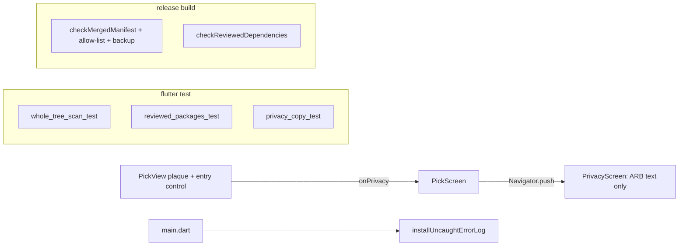

# FEAT-016 — Technical Plan

## 1. Summary
FEAT-016 adds no package, no permission, no native library and no CI job. It does five things, mostly by extending checks that already exist:
1. **Copy and screen.** It adds a scoped `pickPrivacyNote`, a labelled entry control under the pick-screen plaque, and a static explainer screen built from one ARB key per part. The screen is pushed with the app's existing `Navigator.push(MaterialPageRoute)` pattern [Fact](lib/app_flow.dart line 33).
2. **Manifest gate.** It turns the `checkMergedManifest` banned set into an allow-list of permissions, adds backup-off checks and adds new self-test mutations [Fact](android/app/build.gradle.kts, `CheckMergedManifest`).
3. **Source scan.** One deny-by-default scan covers `lib/`, `packages/es_codec/{lib,hook}` and `android/app/src/main/{kotlin,java}`. It reuses `networkUses` from the existing test [Fact](test/features/compression/no_network_imports_test.dart).
4. **Dependency lists.** Two reviewed lists exist: Dart packages, checked in `flutter test` from the runtime dependency graph, and Gradle coordinates, checked by a second inline task in the release build.
5. **Error handler and process.** A global error handler logs enum codes only. The offline integration test gets two more core-stage cases. A living `claims.md` holds the claims register, the data inventory and the release checklist.

All gates run inside the existing `build` and `emulator` CI jobs.

## 2. Architecture impact
- **New module** `lib/features/privacy/`:
  - `presentation/privacy_screen.dart`: the explainer, stateless.
  - `data/uncaught_error_log.dart`: the FR-18 enum-only sink.
  - It has no domain layer and no Riverpod provider, because there is no state.
- **Changed** `lib/features/pick/presentation/pick_view.dart`: a new `onPrivacy` callback and an entry control next to `_Plaque` (line 97). PickView stays a pure view (it draws state and reports taps) [Fact](pick_view.dart lines 9-11).
- **Changed** `lib/features/pick/presentation/pick_screen.dart`: wires `onPrivacy` to `Navigator.of(context).push(MaterialPageRoute<void>(builder: (_) => const PrivacyScreen()))`. A photo shared in while the explainer is open already clears it, because a new image calls `popUntil(route.isFirst)` [Fact](pick_screen.dart line 24). No `PopScope` is needed.
- **Changed** `lib/main.dart`: one `installUncaughtErrorLog()` call after `ensureInitialized()`.
- **Changed** `android/app/src/main/AndroidManifest.xml` (`<application>`): `android:allowBackup="false"` and `android:dataExtractionRules="@xml/data_extraction_rules"`.
- **New** `android/app/src/main/res/xml/data_extraction_rules.xml`.
- **Changed** `android/app/build.gradle.kts`:
  - `CheckMergedManifest` gets the permission allow-list, the backup checks and new mutations.
  - A new inline task `CheckReviewedDependencies` is added.
  - Both tasks write a marker file that CI asserts.
- **New tests:**
  - `test/privacy/whole_tree_scan_test.dart` (FR-9)
  - `test/privacy/reviewed_packages_test.dart` (FR-10, Dart side)
  - `test/privacy/privacy_copy_test.dart` (FR-5, FR-6, FR-15)
  - `test/features/privacy/uncaught_error_log_test.dart` (FR-18)
  - `test/features/privacy/privacy_screen_test.dart` (FR-2, FR-4, NFR-2)
- **New lists:**
  - `tool/privacy/reviewed_packages.txt`
  - `android/app/reviewed_dependencies.txt`
- **Changed (small):**
  - `integration_test/offline_test.dart`: two cases added (FR-16).
  - `.github/workflows/ci.yml` `build` job: one line asserts the gate markers.
- **New doc** `docs/features/FEAT-016-on-device-privacy/claims.md`: the living register, data inventory, permission list, release checklist and FR-19 carried items.
- **Untouched:** the existing per-feature privacy tests (as FR-9 asks), `OutcomeLog`, the image pipeline, the Kotlin bridges and `tool/run_offline_test.sh`. The script already runs `offline_test.dart` and the export bridge with networking off [Fact](tool/run_offline_test.sh lines 14, 17).



## 3. Components
| Component | Layer | Responsibility | New / changed |
|---|---|---|---|
| `PrivacyScreen` | UI | Scaffold with an AppBar (title key) and a scrollable column of 6 parts, each a heading (`Semantics(header: true)`) and a body text. It holds no state, no image, no link and no network or permission use. | New |
| Entry control in `PickView` | UI | A labelled button (key `privacyEntry`, proposed text "How your photos are handled") beside or under the plaque, at least 48 dp. The plaque stays as it is. The impeccable pass chooses the final placement (OQ-3 default). | Changed |
| `PickScreen` | UI wiring | Pushes `PrivacyScreen` | Changed |
| `UncaughtErrorLog` + `installUncaughtErrorLog()` | data | Sets `FlutterError.onError` and `PlatformDispatcher.instance.onError`. Writes one line, `exactsize.app outcome=UNCAUGHT source=<framework\|platform>`, through an injectable `LogSink` (same typedef pattern as `OutcomeLog`). | New |
| `CheckMergedManifest` | build | Permission allow-list, backup attributes and the extraction-rules file. Adds about 8 self-test mutations. Writes a marker file. | Changed |
| `CheckReviewedDependencies` | build | Compares `group:module` of the `releaseRuntimeClasspath` external modules with `reviewed_dependencies.txt`. Self-test: one planted coordinate. Writes a marker file. | New |
| `whole_tree_scan_test.dart` | test | FR-9 deny-by-default scan, with a temp-dir self-test | New |
| `reviewed_packages_test.dart` | test | FR-10 Dart runtime closure compared with the reviewed list, with a self-test | New |
| `privacy_copy_test.dart` | test | FR-5 banned phrases, FR-6 key rules, FR-15 connectivity words | New |
| `offline_test.dart` | integration test | Adds crop-to-compression and preview-check cases (FR-16) | Changed |
| `claims.md` | doc | Living register (OQ-8 default), inventory, checklist (FR-13), FR-19 record | New |

## 4. API contracts
The feature has no network API. These are the internal contracts.

```
Log line (FR-18):  exactsize.app outcome=UNCAUGHT source=FRAMEWORK|PLATFORM
                   It carries no exception text, type name, stack, path or URI.
void installUncaughtErrorLog({LogSink sink = _debugPrintSink, bool debug = kDebugMode})

Scan (FR-9):       List<String> scanTree(List<String> roots, {Map<String, String> exempt = const {}})
                   -> "path:line: text" hits
Deps (FR-10 Dart): Set<String> runtimePackages(Map<String, Object?> pubDepsJson) -> names reachable from the root's
                   non-dev dependencies; unlisted = runtime - reviewed
Gradle tasks:      checkMergedManifest, checkReviewedDependencies; both run before assembleRelease and bundleRelease;
                   each writes build/app/outputs/privacy/<task>.ok
Errors:            GradleException / test failure; every message names the item and the rule and ends with
                   "Follow FEAT-016 FR-12 (docs/features/FEAT-016-on-device-privacy/claims.md)." (AC-4.5)
```

## 5. Data model
Nothing is stored on the device, and nothing is added to the app's storage, preferences or backup. The checked-in data is:

- **`tool/privacy/reviewed_packages.txt`**: one Dart package per line, in the form `name  # network: none|<what>; data: none|<what>; permissions: none|<which>`. The test fails if the note after `#` is missing or empty. Versions are not listed, so version bumps pass (FR-10).
- **`android/app/reviewed_dependencies.txt`**: the same format with `group:module` (for example `androidx.core:core  # network: none; data: none; permissions: DYNAMIC_RECEIVER_NOT_EXPORTED_PERMISSION`).
  - Flutter plugin subprojects (ProjectComponentIdentifier) are skipped, because the Dart list covers them.
  - A first run prints every coordinate; each one is reviewed once, and the notes are written then.
- **Permission allow-list**: a constant in `build.gradle.kts`:
  - `android.permission.WRITE_EXTERNAL_STORAGE`, which must keep `maxSdkVersion` 28 or lower (existing rule)
  - `${applicationId}.DYNAMIC_RECEIVER_NOT_EXPORTED_PERMISSION`
  - Today's merged set [Fact](docs/features/FEAT-007-export-share/tasks.md, T23 row). The first release-build run re-checks this, because that record says "profile build".
  - `claims.md` mirrors the list for the store form. The release checklist compares the two.
- **Explainer ARB keys** in `lib/l10n/app_en.arb`:
  - `privacyEntry` and `privacyTitle`.
  - For each part, a heading key `privacyXTitle` and a body key `privacyX`, with X = `OnPhone` (a), `Offline` (b), `Kept` (c), `Copies` (d), `Outside` (e), `Reads` (f).
  - That makes 14 keys. Each `@` description names its register IDs, for example `"Register: C1, C3"`. No key has placeholders.
  - FEAT-025 adds `privacyAds` (and its title) later. FEAT-013 adds `privacyPresets`.

## 6. Integrations
None. There is no SDK, no WebView, no external link (FR-4, OQ-4 default: the policy URL appears only in the store listing [PLACEHOLDER]) and no data leaves the device. The system photo picker, gallery and keyboard keep their own behaviour, which part (e) discloses (C9).

## 7. Security & privacy
- **PCI-DSS / Bangladesh Bank:** the PRD's section 10 positions are unchanged. No money and no card data are handled. A photo of a card or ID is opaque bytes. Bangladesh Bank is N/A for this feature, and the combined review is OQ-7. Docs and fixtures use `[PLACEHOLDER]` only (NFR-8).
- **Logging:** FR-18 closes the framework-output gap. Debug behaviour is kept for developers, see section 8 FR-18.
- **Backup (FR-17):**
  - API 28–30: `allowBackup="false"` turns off cloud backup, adb backup and device transfer [Hypothesis: Android Auto Backup docs, verify with `adb shell bmgr backupnow` on API 28 in the task].
  - API 31–36: `allowBackup="false"` alone does not stop device-to-device transfer, so `dataExtractionRules` excludes the domains `root`, `file`, `database`, `sharedpref` and `external` in both `<cloud-backup>` and `<device-transfer>` [Hypothesis: same docs; the exact exclude syntax is checked with lint in the task].
  - `fullBackupContent` is deliberately not set. It is inert when `allowBackup="false"` on API 28–30, and it is ignored on 31+ when `dataExtractionRules` is set [Hypothesis].
  - The gate parses the merged manifest. It requires `allowBackup="false"` and `dataExtractionRules="@xml/data_extraction_rules"`, and it requires both sections of that file to exclude all five domains. Merged manifests keep `@xml/...` references, as the existing FileProvider check relies on [Fact](build.gradle.kts lines 102, 108).
- **New privacy risks found (flagged):**
  1. **Release error output.** Release builds may print an exception summary (for example a `FileSystemException` with a path) to logcat through the default handlers [Hypothesis, high likelihood; verified in the FR-18 task with a release build and logcat]. FR-18 covers this.
  2. **Native and system logs.** Android itself logs intents (`dat=content://…`) and Kotlin exception stacks. ExactSize cannot remove these, and on modern Android only privileged apps can read logcat. They are disclosure only and are not claimed in the explainer. C5 already says "ExactSize's logs".
  3. **Debug-signed release.** The release build is signed with the debug key [Fact](build.gradle.kts line 40). This is not a privacy leak, but it must change before store submission. It is added as a release-checklist row, not fixed here.

## 8. Requirement coverage
| Requirement | How it is met |
|---|---|
| FR-1 | Replace the `pickPrivacyNote` value in `app_en.arb` with "Your photos are resized on your phone. ExactSize never uploads them." Retranslate it into 5 languages through `/l10n-translate` (effort counted in FEAT-019). |
| FR-2 | Entry control (at least 48 dp) beside the plaque. Push `PrivacyScreen`, so app start to explainer is 1 tap. Back pops to an unchanged pick screen, because `PickController` state is untouched. The screen is stateless and holds no image. A widget test pumps PickScreen, taps, finds the title, pops and expects the same state. |
| FR-3 | 6 parts mapped (a) to (f) as in section 5. A test counts English body words (at most 150) and checks that no sentence has more than 20 words. The copy is reviewed against the register in `claims.md`. |
| FR-4 | Static `Text` from `AppLocalizations`. The scan (FR-9) bans WebView, `url_launcher` and network use. A widget test asserts the explainer has no `InkWell` or link `Semantics`. NFR-10 holds because no package is added. |
| FR-5 | `privacy_copy_test.dart`: for `privacy*`, `pickPrivacyNote` and `exportPrivacy` in `app_en.arb`, a case-insensitive match against the banned list fails with the PRD section 8 message. Cheap extra: the Latin tokens (`100%`, `GPS`, `GDPR`, `PCI`) are also checked in all 6 ARBs. The `/l10n-translate` reviewer brief for these keys lists the banned phrases and the rule "claims stay scoped to ExactSize". |
| FR-6 | The same test checks, for every `privacy*` key: an `@` description that matches `C\d+`, no `{placeholder}`, and presence in all 6 ARBs. `privacyEntry` and `privacyTitle` are exempt from the register-ID check. Translation goes through `/l10n-translate`, status `AI-reviewed only`. |
| FR-7 | `exportPrivacy` stays unchanged, and FR-5 now checks it. Part (d) is written to agree with it. |
| FR-8 | `CheckMergedManifest` checks every `uses-permission` and `uses-permission-sdk-23` against the allow-list. INTERNET, ACCESS_NETWORK_STATE, ACCESS_WIFI_STATE and `com.google.android.gms.permission.AD_ID` get a named message. The existing banned messages and the no-`tools:node="remove"` rule are kept. New mutations: INTERNET added; ACCESS_NETWORK_STATE as `uses-permission-sdk-23`; AD_ID; an unknown permission. |
| FR-9 | `whole_tree_scan_test.dart`, see section 8.1 |
| FR-10 | Dart: `reviewed_packages_test.dart`, see 8.2. Gradle: `CheckReviewedDependencies` in the release build, see 8.2. **This deviates from AC-4.3**: the Gradle half fails in the release build, not in `flutter test` (OQ-T1). |
| FR-11 | All gates run in the existing `build` job (`flutter test`, then `flutter build apk --release`). Each Gradle task writes a marker file. The CI step after the build adds `test -f build/app/outputs/privacy/checkMergedManifest.ok && test -f build/app/outputs/privacy/checkReviewedDependencies.ok`. This proves the tasks ran even though non-verbose `flutter build` hides Gradle lifecycle lines [Hypothesis]. Every gate has a self-test that plants a violation. |
| FR-12 | Every failure message ends with a pointer to FR-12 and `claims.md`. `claims.md` has a "Change procedure" section that copies FR-12 as a checklist. |
| FR-13 | `claims.md` "Release checklist", which records for each release candidate:<br>- merged release manifest permissions (`aapt2 dump permissions` on the release APK) compared with the inventory<br>- the offline matrix result<br>- register compared with explainer, listing and Data safety answers<br>- privacy policy URL [PLACEHOLDER]<br>- 6 languages `AI-reviewed only`<br>- OQ-7 review result or waiver<br>- a release signing key in place of the debug key |
| FR-14 | Manual matrix table in `claims.md`: cold start; system picker (local photo); camera; Choose from files; share-in; target; crop; compress; check; Save; Share chooser; explainer. Run on a real phone per release candidate in airplane mode. |
| FR-15 | The scan bans `connectivity_plus` / `ConnectivityResult` (Dart) and `ConnectivityManager` / `NetworkCallback` (Kotlin). `privacy_copy_test.dart` fails if an English ARB value matches `internet\|connect\|network\|offline\|online` outside an allow-list of keys (`pickSourceUnavailable`, `privacyOffline`, `privacyOfflineTitle`). |
| FR-16 | Extend `integration_test/offline_test.dart` with crop-to-compression and preview check (one synthetic fixture each), behind its existing "networking is off" first check. The export bridge already runs offline. This stays inside the existing `run_offline_test.sh` step (about 1 min extra [Assumption]). UI rows stay manual. |
| FR-17 | Manifest attributes and the rules file, see section 7. The gate checks them, with mutations: allowBackup removed; allowBackup true; dataExtractionRules missing; `device-transfer` loses one exclude. |
| FR-18 | See 8.3 |
| FR-19 | `claims.md` "Carried requirements" lists (a), (b) and (c) verbatim, with the owner (FEAT-025, FEAT-013, FEAT-027) and the status "to copy into owning PRD at /draft-prd". This plan does not edit other features' docs or the roadmap (OQ-T3). |
| NFR-1 | The explainer is text only, so it opens in well under 1 s [Assumption]. The new tests are file reads plus one `dart pub deps` call (about 5 s). The Gradle tasks reuse the already resolved classpath. Expected CI addition is under 1 min. |
| NFR-2 | Headings use `Semantics(header: true)` and appear in reading order, followed by the body text. The column scrolls, so nothing is clipped at 200% on 360x640. Widget test: `textScaler 2.0`, size 360x640, Arabic locale, no overflow, `Directionality` rtl. TalkBack is verified manually. The entry control is at least 48 dp. |
| NFR-3 | No network code (FR-4, FR-9). Offline row in FR-14. |
| NFR-4 | 6 ARBs via `/l10n-translate`; the FR-6 test checks presence. Western digits for ar (no digits planned). |
| NFR-5 | Gates fail closed and are self-tested:<br>- The scan fails if a root has fewer files than a floor (Dart under `lib/` at least 60; Kotlin at least 4) [Assumption: tune to the real count minus a margin].<br>- The exempt map entries must exist.<br>- There is no skip flag.<br>- CI checks the marker files. |
| NFR-6 | The explainer has no log, provider or counter. The scan of `lib/features/privacy` also bans `print`/`debugPrint` except in `uncaught_error_log.dart`. |
| NFR-7 | `claims.md` register: every explainer key's `@` description names its C-ID (enforced by the FR-6 test). Store statements map to C-IDs in the checklist. |
| NFR-8 | Offline-test fixtures are synthetic (existing generator). Docs use `[PLACEHOLDER]`. |
| NFR-9 | Same Dart text on API 28 to 36. Backup is handled per level (section 7). |
| NFR-10 | No `pubspec.yaml` or Gradle dependency changes; the FR-10 lists would catch one. |

### 8.1 Deny-by-default scan (FR-9)
- **Roots:** `lib/`, `packages/es_codec/lib`, `packages/es_codec/hook`, `android/app/src/main/kotlin`, and `android/app/src/main/java` if it exists.
- **Files:** every `.dart`, `.kt` and `.java` file under the roots. There is no folder list, so a new feature folder is scanned automatically.
- **Generated files are scanned, not excluded:**
  - `lib/l10n/app_localizations*.dart` (7 files) and `lib/di/injection.config.dart` [Fact](glob, 2026-11-26)
  - jnigen and ffigen bindings under `es_codec`
  - `GeneratedPluginRegistrant.java`, which is useful: a network plugin would appear there.
  - `exempt` is an explicit `{path: reason}` map. It is empty in R1. The test fails if an exempt path no longer exists, and each entry is recorded in the PRD change log (AC-6.3).
- **Tokens:**
  - Dart: the existing `networkUses` list, reused by import as the preview test does [Fact](preview_privacy_test.dart line 5). Added: `webview_flutter`, `url_launcher`, `connectivity_plus`, `WebView`, the analytics, ads and crash import list from the preview test (copied, because it is private there), and `\bClipboard\b`.
  - Kotlin/Java: `java.net.`, `javax.net.`, `okhttp3`, `retrofit2`, `HttpURLConnection`, `\bSocket\b`, `android.webkit`, `WebView`, `ConnectivityManager`, `ClipboardManager`, `com.google.firebase`, `com.google.android.gms.ads`. `android.net.Uri` is allowed: only `java.net` is banned.
- **Comment handling:** the same `//` strip as today. Lines starting with `*` (KDoc) are also skipped.
- **Native code not covered:** es_codec's vendored C sources are not scanned. Without INTERNET a socket cannot connect, so the manifest gate covers them [Hypothesis, PRD section 9].
- **Self-test:** it writes a temp tree with `features/new_feature/x.dart` (`HttpClient()`) and `kotlin/X.kt` (`java.net.URL(...)`). Each must give one hit, and the same tree without them must give none (AC-4.4). It never writes into `lib/`.

### 8.2 Dependency lists (FR-10)
- **Dart:** the test runs `dart pub deps --json` (`runInShell: true` for Windows). It walks from the root package's non-dev `dependencies` to the runtime closure and fails on names not in `reviewed_packages.txt`.
  - Why not `pubspec.lock`: it mixes dev-tool transitive packages (for example `http` from `build_runner`), so a runtime package that pulls `http` would pass unnoticed. The closure avoids that.
  - Limit: build-hook packages that es_codec needs (`hooks`, `native_toolchain_c` …) appear as runtime deps. They are listed with the note "build-time hook, not in APK".
  - [Hypothesis: the JSON field names (`packages[].dependencies`, root `directDependencies` / `devDependencies`) are verified in the task; fallback `dart pub deps --no-dev --style=list`.]
  - Self-test: a fixture graph with one unlisted name must fail.
- **Gradle:** `CheckReviewedDependencies` gets `releaseRuntimeClasspath` `incoming.artifacts.resolvedArtifacts`, mapped to `ModuleComponentIdentifier` `group:module` (provider input, configuration-cache safe). The classpath is already resolved by the release build, so the task adds seconds, not a Gradle run inside `flutter test`.
  - Self-test: the real set plus `[PLACEHOLDER_GROUP]:planted` must be refused.
  - Limit: it runs only in release builds (CI, or a local release build), not in local `flutter test`.
  - Main alternative: a Dart test that regex-parses `build.gradle.kts` `dependencies {}`. It is cheaper and runs in `flutter test`, but it sees only direct app dependencies and misses AARs brought in by plugins.

### 8.3 Global error handler (FR-18)
- **Gap:** confirmed. There is no handler in `lib/main.dart` [Fact](lib/main.dart).
- **Install:** `installUncaughtErrorLog()` in `main()` only, so widget tests keep flutter_test's own handler.
- **Release and profile:**
  - `FlutterError.onError = (_) => sink('… source=FRAMEWORK')`.
  - `PlatformDispatcher.instance.onError = (_, _) { sink('… source=PLATFORM'); return true; }`.
  - Neither handler reads the error object, so no text can leak.
- **Debug (`kDebugMode`):**
  - It writes the same line and then calls the previous `FlutterError.onError` (red screen and full console dump kept).
  - The platform handler returns `false`, so the default reporting still runs. Errors are not hidden from developers, and integration tests (debug builds) keep full output.
- **Test:** throw an error whose message contains `[PLACEHOLDER_PATH]` through both handlers with `debug: false`. Expect exactly one line per error, and expect the line not to contain the message.
- **Manual check:** release build plus `adb logcat -s flutter` before and after, recorded in the task. This turns the PRD hypothesis into a fact.

## 9. Risks
| Risk | Likelihood | Impact | Mitigation |
|---|---|---|---|
| The gate never runs: Flutter or a future AGP calls a task other than `assembleRelease` / `bundleRelease`, or adds flavors (name clash with `checkMergedManifest`) | Low | High (silent loss of every build gate) | Marker files asserted in CI (FR-11). A flavor change must rename the tasks per variant (comment in the build file). |
| Non-verbose `flutter build` hides the "OK" lifecycle line, so the PRD's "log line in CI" check cannot be seen | Medium | Low | Marker file instead of a log grep |
| A plugin adds a permission or a `<permission>` through manifest merge (for example a future `path_provider` or AndroidX bump) | Medium | Medium (red build) | Intended failure. The message names the permission. Review under FR-12. Never `tools:node="remove"`. |
| Generated files or KDoc trip the scan (false positive), for example a translated string containing "WebView" in `app_localizations_*.dart` | Low | Low | Explicit exempt map with reason. Self-test keeps the scan honest. |
| False negatives: tokens written differently (`dart:io` `HttpClient` via an alias, reflection, Kotlin `Class.forName`) | Low | Medium | The manifest allow-list (no INTERNET) is the real enforcement. The scan is a second net. |
| Translations re-open absolute claims ("never leaves", "100% safe") | Medium | Medium (false claim in the store or app) | FR-5 on English; Latin tokens on all locales; reviewer brief carries the list; back-translation review holds the string back. |
| `dart pub deps --json` shape or Windows shell behaviour differs | Medium | Low | Verify in the task; documented fallback command |
| Gradle task not configuration-cache safe, or the first coordinate list is long (about 50–80 entries) | Medium | Low (one-time effort) | Provider-based inputs. Bootstrap from the task's own output, with one short note per group. |
| Backup semantics on 31+ misread | Low | Low (the app stores nothing outside cache anyway [Fact](PRD gap 8)) | `bmgr` check on API 28 and on the local API 36 emulator |
| FR-18 handler hides errors in debug | Low | Medium | Debug path calls the previous handler and returns `false`; unit test for both modes |
| Effort overrun (UI pass, list bootstrap, CI round trips) | Medium | Medium | Re-estimate below. FR-10 is the cut candidate (OQ-6 alternative). One CI push at the end. |

## 10. Decisions
- Relies on ADR-001 (stack, API 28+, Flutter pin) and on ADR-006 / ADR-007, whose Kotlin bridges the scan covers.
- **No new ADR.** Every gate is an inline Gradle task or a Dart test, like the existing `checkMergedManifest`, and is easy to reverse. There is no custom Gradle plugin and no new CI job.

## 11. Deliberately left out
- `fullBackupContent` (redundant, section 7).
- A Gradle run inside `flutter test`.
- A separate CI job.
- An automated UI offline drive (manual rows, FR-14).
- Scanning es_codec's vendored C.
- A string-literal URL ban.
- A Riverpod provider for the explainer.
- An in-app policy link (OQ-4).
- A settings screen.
- iOS.
- Fixing the debug release signing (checklist row only).
- Editing the roadmap or other PRDs for FR-19.

**UI gate:** before the explainer screen and the entry control are built, the Product Owner is told first, and the design is one lean impeccable pass on Material 3 [Fact](CLAUDE.md, Implementation). Gates, strings, tests and `claims.md` may start before that.

## 12. Open questions
- **OQ-T1 (non-blocking)** The Gradle half of FR-10 runs in the release build, not in `flutter test` (AC-4.3 wording). **Default:** accept, and clarify AC-4.3 in the next PRD minor version. **Alternative:** a regex parse of `build.gradle.kts` in `flutter test`, which sees direct deps only.
- **OQ-T2 (non-blocking)** Explainer headings: one title key per part (14 keys) or body-only parts (8 keys). **Default:** headings, as flow A and AC-2.5 imply. Headings do not count toward the 150 words [Assumption].
- **OQ-T3 (non-blocking)** FR-19 record: `claims.md` only, or also a note on the FEAT-025, FEAT-013 and FEAT-027 roadmap rows. **Default:** `claims.md`, and the product-analyst brief for those PRDs reads it. The Product Owner decides on roadmap notes.
- **OQ-T4 (non-blocking)** Effort: about 1.1 pw (below) against the roadmap's 0.5 pw. **Default:** the Product Owner updates the roadmap (PRD OQ-10).

**Effort [Assumption], person-days:**

| Area | Days |
|---|---|
| Manifest allow-list, backup attributes and rules, mutations, CI marker | 0.75 |
| Gradle dependency task and list bootstrap | 0.5 |
| Dart package test and list | 0.4 |
| Whole-tree scan and self-test | 0.5 |
| Copy tests (FR-5, FR-6, FR-15) | 0.3 |
| FR-18 handler, test, logcat check | 0.5 |
| English copy (15 strings) | 0.3 |
| Explainer screen and entry (impeccable pass, widget tests, RTL and 200% screenshots) | 1.0 |
| FR-16 offline cases (one CI run) | 0.5 |
| `claims.md`, checklist, FR-19 record | 0.3 |
| Real-phone offline matrix | 0.3 |
| **Total** | **about 5.4 d ≈ 1.1 pw** (range 1.0–1.3) |

Translations are counted in FEAT-019. Dropping FR-10 saves about 0.9 d.

## Change log
| Version | Date | Change |
|---|---|---|
| 0.1 | 2026-11-26 | First draft |
